# 전편 소제목 트리와 흐름도

작가 전용 · 전편 스포일러 · 자동 생성 · 아직 출판 승인 전입니다.

실선은 읽기·선택·합류, 점선은 조건부 반응입니다. 선택 가능 조건은 원래 분기 JSON을 따릅니다.

## 장 전체 흐름

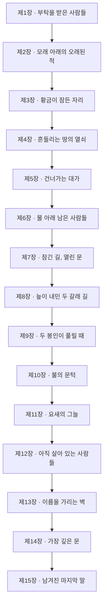

## 소제목 트리

```text
제1장 · 부탁을 받은 사람들
  ├─ 1-1 · 낯선 세계에서 받은 안내
  ├─ 1-2 · 세계의 위기를 듣다
  ├─ 1-3 · 돌아와 증명해야 할 첫 임무
  ├─ 1-4 · 떠난 사람의 이름과 남은 목소리 [분기 후보·미구현]
  ├─ 1-5 · 출발할 일행을 정비하다
  │   ├─ 결정: 출발 준비
  │   │   질문: 성문을 나서기 전, 부족한 준비를 어디에서 마칠지 정한다.
  │   │   ├─ 무기고에서 필요한 무장을 마련한다
  │   │   ├─ 지금 가진 장비를 점검하고 성문으로 간다
  │   │   └─ 다음 본줄기 전 합류
  │   ├─ 결정: 성문에서의 동행
  │   │   질문: 문 앞의 동행 제안을 어떤 만남으로 이어 갈지 정한다.
  │   │   ├─ 제안자를 동료로 받아 함께 떠난다
  │   │   ├─ 함께 갈 사정을 듣고 동행을 받아들인다
  │   │   ├─ 동행 제안을 받지 않고 지금 일행과 떠난다
  │   │   └─ 다음 본줄기 전 합류
  ├─ 1-6 · 남서쪽 동굴에 도달하다
  ├─ 1-7 · 탐사의 중심을 확인하다
  ├─ 1-8 · 첫 보고가 다음 부탁이 되다
제2장 · 모래 아래의 오래된 적
  ├─ 2-1 · 도착을 기다리던 성
  ├─ 2-2 · 실종자에게 가족이 있었다 [분기 후보·미구현]
  ├─ 2-3 · 북쪽으로 향하는 이유
  ├─ 2-4 · 성을 위협하던 상대와의 대결 [분기 후보·미구현]
  ├─ 2-5 · 구제의 결과를 보고하다
  ├─ 2-6 · 쌍둥이 성으로 이어지는 문
제3장 · 황금이 잠든 자리
  ├─ 3-1 · 쌍둥이 성의 실제 모습
  ├─ 3-2 · 풀어서는 안 되는 봉인
  ├─ 3-3 · 지각이 끊어 놓은 길
  ├─ 3-4 · 치료와 식량 뒤의 작별
  │   ├─ 결정: 부상자 지원 역할
  │   │   질문: 치료를 도우며 탈출할 수 있는 준비를 어떻게 맡을지 정한다.
  │   │   ├─ 식량과 짐의 준비를 동료에게 맡긴다
  │   │   ├─ 발을 디딜 길의 확인을 동료에게 맡긴다
  │   │   ├─ 일행이 함께 치료와 탈출 준비를 나눈다
  │   │   └─ 다음 본줄기 전 합류
  ├─ 3-5 · 황금의 봉인을 찾아 지키다
  ├─ 3-6 · 발견 뒤에도 남은 위험
제4장 · 흔들리는 땅의 열쇠
  ├─ 4-1 · 발견에서 격퇴로 바뀐 임무
  ├─ 4-2 · 비밀문이 많은 동굴 [분기 후보·미구현]
  ├─ 4-3 · 대륙에 남은 적을 넘다 [분기 후보·미구현]
  ├─ 4-4 · 보고가 열쇠를 얻는 근거
  ├─ 4-5 · 열쇠가 가리키는 목적지
  ├─ 4-6 · 남은 준비를 마치고 떠나다 [분기 후보·미구현]
제5장 · 건너가는 대가
  ├─ 5-1 · 문까지 가져가야 할 열쇠
  ├─ 5-2 · 통로를 지키는 상대들
  ├─ 5-3 · 세 수문장을 통과하다 [분기 후보·미구현]
  ├─ 5-4 · 이동 조건을 실제로 쓰다
  ├─ 5-5 · 물에 잠긴 땅에 도착하다
제6장 · 물 아래 남은 사람들
  ├─ 6-1 · 마지막 아군 성의 사정
  ├─ 6-2 · 이름으로만 알던 생존자 [분기 후보·미구현]
  ├─ 6-3 · 첫 섬의 위협을 맡다
  ├─ 6-4 · 처음 들었던 이름과 다시 만나다 [분기 후보·미구현]
  ├─ 6-5 · 첫 동굴의 대결을 마치다 [분기 후보·미구현]
  ├─ 6-6 · 인정받았지만 하나가 남다
제7장 · 잠긴 길, 열린 문
  ├─ 7-1 · 나머지 동굴의 부탁
  ├─ 7-2 · 미로에서 만난 수도자
  ├─ 7-3 · 배움과 동행은 다른 일
  │   ├─ 결정: 가르침 뒤의 동행
  │   │   질문: 가르침을 들은 뒤의 동행을 정한다.
  │   │   ├─ 새 동료와 함께 남은 동굴을 탐색한다
  │   │   ├─ 가르침을 기억하고 현재 동료들과 길을 잇는다
  │   │   └─ 다음 본줄기 전 합류
  ├─ 7-4 · 미로 끝의 용을 상대하다 [분기 후보·미구현]
  ├─ 7-5 · 다른 땅의 문을 여는 보상
  ├─ 7-6 · 직진 대신 돌아가는 여행
제8장 · 늪이 내민 두 갈래 길
  ├─ 8-1 · 이전에 열지 못했던 문
  ├─ 8-2 · 다음 문에는 두 조건이 있다
  ├─ 8-3 · 기록이 설명하는 일행의 자리
  ├─ 8-4 · 배척하던 이름의 도움 [분기 후보·미구현]
  ├─ 8-5 · 다른 차원에서 온 설명 [분기 후보·미구현]
  ├─ 8-6 · 설명은 얻었고 수행은 남다
제9장 · 두 봉인이 풀릴 때
  ├─ 9-1 · 해제해야 하는 두 봉인
  │   ├─ 결정: 두 봉인의 순서
  │   │   질문: 두 봉인을 모두 풀어야 한다. 먼저 들어갈 동굴을 정한다.
  │   │   ├─ 늪 속 장치가 있는 동굴부터 찾는다
  │   │   ├─ 문답의 시험이 있는 동굴부터 찾는다
  │   │   └─ 두 탐색 모두 수행한 뒤 합류
  ├─ 9-2 · 물속 레버에 닿는 조건 [분기 후보·미구현]
  ├─ 9-3 · 일곱 갈래 뒤의 봉인
  ├─ 9-4 · 문답으로 여는 다른 길 [분기 후보·미구현]
  ├─ 9-5 · 미로 뒤에서 들은 출처
  ├─ 9-6 · 시험 끝의 봉인을 해제하다
  ├─ 9-7 · 두 결과가 하나의 다음 길이 되다
제10장 · 불의 문턱
  ├─ 10-1 · 두 봉인의 완료를 문 앞에서 확인하다
  ├─ 10-2 · 문을 지키는 적들을 넘다 [분기 후보·미구현]
  ├─ 10-3 · 용암의 대륙에서 받는 안내
  ├─ 10-4 · 보호의 소식과 마지막 도움의 약속
  ├─ 10-5 · 먼저 갈 요새가 정해지다
제11장 · 요새의 그늘
  ├─ 11-1 · 적의 요새 아래로 가는 목적
  ├─ 11-2 · 길을 조종하는 적의 도전 [분기 후보·미구현]
  ├─ 11-3 · 지하로 이어지는 출입구
  ├─ 11-4 · 도착과 도움 사이의 거리
제12장 · 아직 살아 있는 사람들
  ├─ 12-1 · 기다리던 사람들을 만나다
  ├─ 12-2 · 같은 이름에 다른 평가가 쌓이다 [분기 후보·미구현]
  ├─ 12-3 · 세계 밖을 말하는 주민
  ├─ 12-4 · 마지막 여정을 위한 실제 준비
  │   ├─ 결정: 결전 전 준비
  │   │   질문: 피난처에서 받은 도움을 어떤 준비로 이어 갈지 정한다.
  │   │   ├─ 식량 짐을 나누며 마지막 길을 준비한다
  │   │   ├─ 장비와 짐의 고정을 확인하며 마지막 길을 준비한다
  │   │   └─ 다음 본줄기 전 합류
  ├─ 12-5 · 지상으로 돌아가는 이유
제13장 · 이름을 가리는 벽
  ├─ 13-1 · 최종 세력의 입구를 넘다 [분기 후보·미구현]
  ├─ 13-2 · 상대가 밝힌 이름을 듣다
  ├─ 13-3 · 환상에서 실제 대결로 돌아오다 [분기 후보·미구현]
  ├─ 13-4 · 패배 뒤에야 드러나는 정체
  ├─ 13-5 · 숨겨진 성을 드러내는 장치
  ├─ 13-6 · 이름이 아닌 실제 상대를 향하다
제14장 · 가장 깊은 문
  ├─ 14-1 · 종족을 내세운 수문장 [분기 후보·미구현]
  ├─ 14-2 · 최종 상대 대신 나선 기계 적 [분기 후보·미구현]
  ├─ 14-3 · 약속했던 두 존재의 마지막 도움
  ├─ 14-4 · 기록의 조건이 실제 변화가 되다
  ├─ 14-5 · 두 숨은 문이 하나의 길을 열다 [분기 후보·미구현]
  ├─ 14-6 · 마지막 문 앞의 상대 [분기 후보·미구현]
  ├─ 14-7 · 탐색을 끝내고 결전으로 들어가다
제15장 · 남겨진 마지막 말
  ├─ 15-1 · 실제 최종 상대와 그 무리
  ├─ 15-2 · 도주가 허용되지 않는 대결 [분기 후보·미구현]
  ├─ 15-3 · 죽음 대신 다른 공간으로
  ├─ 15-4 · 반복되는 운명의 말을 남기다
  ├─ 15-5 · 여정의 끝과 남은 원문
```

트리는 소속이고 실행 순서가 아닙니다. 9장의 두 탐색은 어느 쪽이 먼저여도 둘 다 필수입니다.

## 선택과 후속 반응의 연결

공유 상태와 실제 경로에서 함께 관찰된 연결입니다. 조건이 맞아야 반응이 나오며 유일한 원인의 증명은 아닙니다.

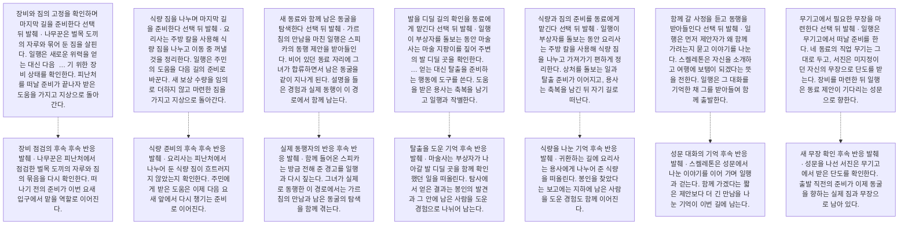

## 제1장 · 부탁을 받은 사람들

```mermaid
%%{init: {"flowchart": {"curve": "stepAfter"}}}%%
flowchart TB
  n98e8ec0ffa413c18["1-1 · 낯선 세계에서 받은 안내"]
  nb17b56184bed81e3["1-1 · 필수 결과"]
  nc8071dfad99e13d0["1-2 · 세계의 위기를 듣다"]
  nf28be7c0ca1aa4ea["1-2 · 필수 결과"]
  n190db19ca8d0cc1a["1-3 · 돌아와 증명해야 할 첫 임무"]
  n9b0d813eb2eb43e3["1-3 · 필수 결과"]
  nd248c339a7b8876c["1-4 · 떠난 사람의 이름과 남은 목소리"]
  nbc73310f9df002bd["1-4 · 필수 결과"]
  n2cd5cac721c1ba9e["1-5 · 출발할 일행을 정비하다"]
  na4bc40dfd645eebd{"출발 준비 질문 · 성문을 나서기 전, 부족한 준비를 어디에서 마칠지 정한다."}
  nba66bf68e1866dbe["선택 결과 합류"]
  ne90cb4be5ec486eb["무기고에서 필요한 무장을 마련한다 선택 뒤 발췌 · 일행은 무기고에서 떠날 준비를 한다. 네 동료의 직업 무기는 그대로 두고, 서진은 미지정이던 자신의 무장으로 단도를 받는다. 장비를 마련한 뒤 일행은 동료 제안이 기다리는 성문으로 향한다."]
  n95e32e7ac358fec3["지금 가진 장비를 점검하고 성문으로 간다 선택 뒤 발췌 · 일행은 함께 가져온 도구와 짐을 점검하고 곧바로 성문으로 간다. 무기고에서 새 장비를 받은 경험은 없지만 동료들의 기존 무기는 남아 있다. 출발을 앞둔 일행은 성문에서 들려오는 동행 제안을 듣는다."]
  n7f060bce3d588dfe{"성문에서의 동행 질문 · 문 앞의 동행 제안을 어떤 만남으로 이어 갈지 정한다."}
  n1b88ce94aadb22b4["선택 결과 합류"]
  n7ba3ecd919e83af1["제안자를 동료로 받아 함께 떠난다 선택 뒤 발췌 · 스켈레톤은 함께 가겠다는 제안을 하고 일행의 답을 기다린다. 일행은 그를 새로운 동료로 받아들여 성문을 나선다. 이제 동굴로 향하는 발걸음에는 이 만남을 함께 겪은 동행자가 하나 더 있다."]
  n014a871b3662ed77["함께 갈 사정을 듣고 동행을 받아들인다 선택 뒤 발췌 · 일행은 먼저 제안자가 왜 함께 가려는지 묻고 이야기를 나눈다. 스켈레톤은 자신을 소개하고 여행에 보탬이 되겠다는 뜻을 전한다. 일행은 그 대화를 기억한 채 그를 받아들여 함께 출발한다."]
  ne90591f4f78d7cd1["동행 제안을 받지 않고 지금 일행과 떠난다 선택 뒤 발췌 · 일행은 제안을 받아들이지 않고 현재의 동료들과 길을 나선다. 제안자는 성문에 남고, 앞으로 … 사람들의 경험으로 이어진다. 동행하지 않은 인물이 동굴의 대화를 함께 들은 것으로 기록되지 않는다."]
  na2c06cdbbb7567b4["1-5 · 필수 결과"]
  n092cafae94f92daf["1-6 · 남서쪽 동굴에 도달하다"]
  n8d5ad8c7a73504e6["새 무장 확인 후속 반응 발췌 · 성문을 나선 서진은 무기고에서 받은 단도를 확인한다. 출발 직전의 준비가 이제 동굴을 향하는 실제 짐과 무장으로 남아 있다."]
  n356596ea343d4bf1["조건부 문단 합류"]
  n9b3ea50bec258bbf["성문 대화의 기억 후속 반응 발췌 · 스켈레톤은 성문에서 나눈 이야기를 이어 가며 일행과 걷는다. 함께 가겠다는 짧은 제안보다 더 긴 만남을 나눈 기억이 이번 길에 남는다."]
  n2c3bc14f141d0353["조건부 문단 합류"]
  n5e9c1a6d49b7feb3["1-6 · 필수 결과"]
  n0e49f9b23a58cadc["1-7 · 탐사의 중심을 확인하다"]
  n2f5732839995a994["1-7 · 필수 결과"]
  n8c04d61d73708a26["1-8 · 첫 보고가 다음 부탁이 되다"]
  na91743fdd0740a35["1-8 · 필수 결과"]
  n98e8ec0ffa413c18 --> nb17b56184bed81e3
  nc8071dfad99e13d0 --> nf28be7c0ca1aa4ea
  nb17b56184bed81e3 --> nc8071dfad99e13d0
  n190db19ca8d0cc1a --> n9b0d813eb2eb43e3
  nf28be7c0ca1aa4ea --> n190db19ca8d0cc1a
  nd248c339a7b8876c --> nbc73310f9df002bd
  n9b0d813eb2eb43e3 --> nd248c339a7b8876c
  n2cd5cac721c1ba9e --> na4bc40dfd645eebd
  na4bc40dfd645eebd -->|조건을 만족할 때| ne90cb4be5ec486eb
  ne90cb4be5ec486eb --> nba66bf68e1866dbe
  na4bc40dfd645eebd -->|조건을 만족할 때| n95e32e7ac358fec3
  n95e32e7ac358fec3 --> nba66bf68e1866dbe
  nba66bf68e1866dbe --> n7f060bce3d588dfe
  n7f060bce3d588dfe -->|조건을 만족할 때| n7ba3ecd919e83af1
  n7ba3ecd919e83af1 --> n1b88ce94aadb22b4
  n7f060bce3d588dfe -->|조건을 만족할 때| n014a871b3662ed77
  n014a871b3662ed77 --> n1b88ce94aadb22b4
  n7f060bce3d588dfe -->|조건을 만족할 때| ne90591f4f78d7cd1
  ne90591f4f78d7cd1 --> n1b88ce94aadb22b4
  n1b88ce94aadb22b4 --> na2c06cdbbb7567b4
  nbc73310f9df002bd --> n2cd5cac721c1ba9e
  n092cafae94f92daf -.->|조건을 만족할 때| n8d5ad8c7a73504e6
  n092cafae94f92daf -.->|반응 조건 없음| n356596ea343d4bf1
  n8d5ad8c7a73504e6 -.-> n356596ea343d4bf1
  n356596ea343d4bf1 -.->|조건을 만족할 때| n9b3ea50bec258bbf
  n356596ea343d4bf1 -.->|반응 조건 없음| n2c3bc14f141d0353
  n9b3ea50bec258bbf -.-> n2c3bc14f141d0353
  n2c3bc14f141d0353 --> n5e9c1a6d49b7feb3
  na2c06cdbbb7567b4 --> n092cafae94f92daf
  n0e49f9b23a58cadc --> n2f5732839995a994
  n5e9c1a6d49b7feb3 --> n0e49f9b23a58cadc
  n8c04d61d73708a26 --> na91743fdd0740a35
  n2f5732839995a994 --> n8c04d61d73708a26
  n014a871b3662ed77 -.-> n9b3ea50bec258bbf
  ne90cb4be5ec486eb -.-> n8d5ad8c7a73504e6
```

## 제2장 · 모래 아래의 오래된 적

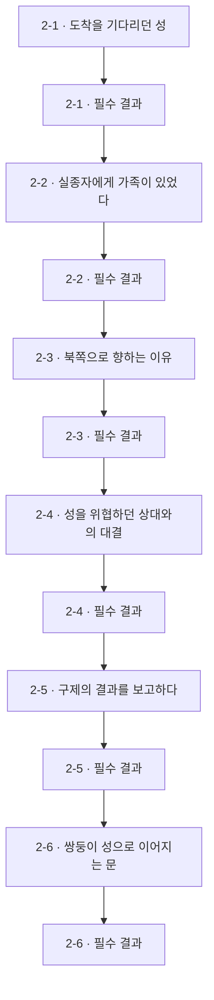

## 제3장 · 황금이 잠든 자리

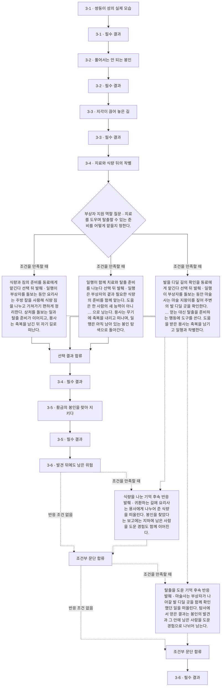

## 제4장 · 흔들리는 땅의 열쇠

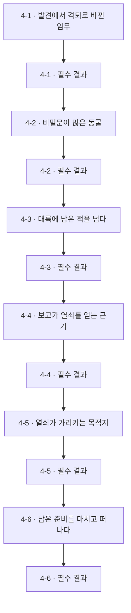

## 제5장 · 건너가는 대가

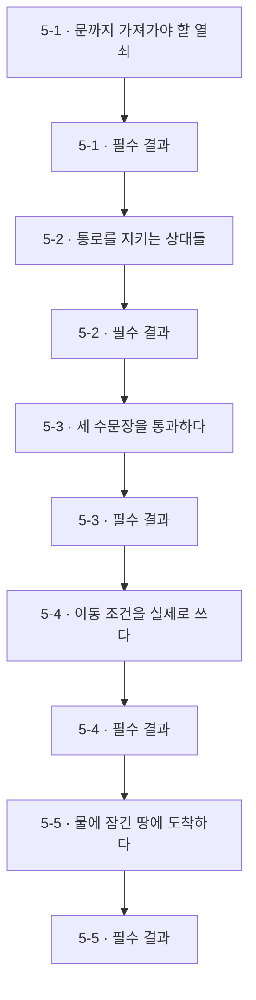

## 제6장 · 물 아래 남은 사람들

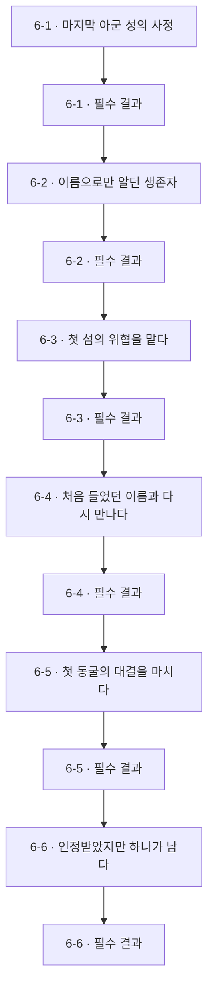

## 제7장 · 잠긴 길, 열린 문

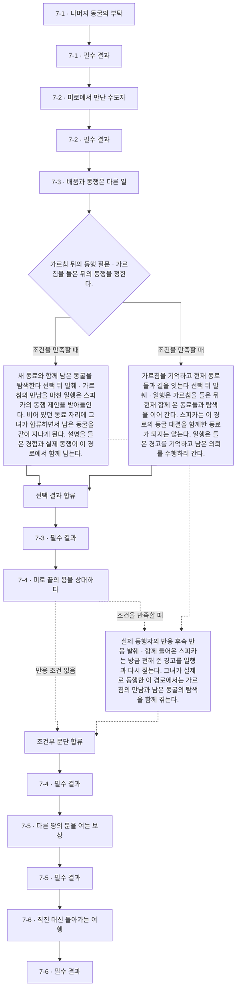

## 제8장 · 늪이 내민 두 갈래 길

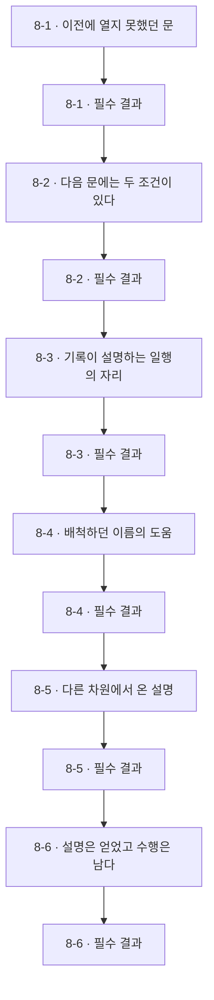

## 제9장 · 두 봉인이 풀릴 때

```mermaid
%%{init: {"flowchart": {"curve": "stepAfter"}}}%%
flowchart TB
  n5a31bcd048cdb49e["9-1 · 해제해야 하는 두 봉인"]
  ned7920098391b842{"두 봉인의 순서 질문 · 두 봉인을 모두 풀어야 한다. 먼저 들어갈 동굴을 정한다."}
  nd6284598b9e1c3c2["두 탐색 모두 완료"]
  n7189034055f8da23["늪 속 장치가 있는 동굴부터 찾는다 선택 뒤 발췌 · 일행은 먼저 이블 갓의 레버와 봉인을 찾기로 한다. 이 탐색을 마쳐도 다른 동굴의 결과를  … 머디의 시험과 봉인도 찾아야 한다. 먼저 고른 동굴로 향하며 두 탐색이 모두 남아 있음을 기억한다."]
  n5c6e6ee7cb8651d5["9-1 · 필수 결과"]
  n568b13b0d58b9453["9-2 · 물속 레버에 닿는 조건"]
  n54bc867b522cfd71["9-2 · 필수 결과"]
  naf3cbf7f8823dea3["9-3 · 일곱 갈래 뒤의 봉인"]
  n301813bd38d2d872["9-3 · 필수 결과"]
  n3bb2e86f93a5133c["9-4 · 문답으로 여는 다른 길"]
  na29c6406789185ae["9-4 · 필수 결과"]
  nf9eaffcbe50f8f82["9-5 · 미로 뒤에서 들은 출처"]
  n78e46d87ab69eb5f["9-5 · 필수 결과"]
  n9c9b72ab0ded8ae5["9-6 · 시험 끝의 봉인을 해제하다"]
  nfe03a05dcba17f5b["9-6 · 필수 결과"]
  n9f6c1675f9b87a31["문답의 시험이 있는 동굴부터 찾는다 선택 뒤 발췌 · 일행은 먼저 머디의 시험과 봉인을 찾기로 한다. 이 탐색을 마쳐도 다른 동굴의 결과를 얻은 …  갓의 장치와 봉인도 찾아야 한다. 먼저 고른 동굴로 향하며 두 탐색이 모두 남아 있음을 기억한다."]
  nee0c931c4c2de572["9-1 · 필수 결과"]
  nf1921b6624151c72["9-4 · 문답으로 여는 다른 길"]
  n16547d9b365062ac["9-4 · 필수 결과"]
  n5b848d1c684b1483["9-5 · 미로 뒤에서 들은 출처"]
  neba2615549804954["9-5 · 필수 결과"]
  na6c96ad2aef22282["9-6 · 시험 끝의 봉인을 해제하다"]
  nc90d562a8bef4c55["9-6 · 필수 결과"]
  nbc6bb7416a4fce66["9-2 · 물속 레버에 닿는 조건"]
  nab6c80cf2d8efd71["9-2 · 필수 결과"]
  n5c4e9de218435f71["9-3 · 일곱 갈래 뒤의 봉인"]
  nca3799a90ba8aae0["9-3 · 필수 결과"]
  nf42af18a4e8ee019["9-7 · 두 결과가 하나의 다음 길이 되다"]
  n0674e2d386001e0d["9-7 · 필수 결과"]
  n5a31bcd048cdb49e --> ned7920098391b842
  ned7920098391b842 -->|조건을 만족할 때| n7189034055f8da23
  n7189034055f8da23 --> n5c6e6ee7cb8651d5
  n568b13b0d58b9453 --> n54bc867b522cfd71
  n5c6e6ee7cb8651d5 --> n568b13b0d58b9453
  naf3cbf7f8823dea3 --> n301813bd38d2d872
  n54bc867b522cfd71 --> naf3cbf7f8823dea3
  n3bb2e86f93a5133c --> na29c6406789185ae
  n301813bd38d2d872 --> n3bb2e86f93a5133c
  nf9eaffcbe50f8f82 --> n78e46d87ab69eb5f
  na29c6406789185ae --> nf9eaffcbe50f8f82
  n9c9b72ab0ded8ae5 --> nfe03a05dcba17f5b
  n78e46d87ab69eb5f --> n9c9b72ab0ded8ae5
  nfe03a05dcba17f5b --> nd6284598b9e1c3c2
  ned7920098391b842 -->|조건을 만족할 때| n9f6c1675f9b87a31
  n9f6c1675f9b87a31 --> nee0c931c4c2de572
  nf1921b6624151c72 --> n16547d9b365062ac
  nee0c931c4c2de572 --> nf1921b6624151c72
  n5b848d1c684b1483 --> neba2615549804954
  n16547d9b365062ac --> n5b848d1c684b1483
  na6c96ad2aef22282 --> nc90d562a8bef4c55
  neba2615549804954 --> na6c96ad2aef22282
  nbc6bb7416a4fce66 --> nab6c80cf2d8efd71
  nc90d562a8bef4c55 --> nbc6bb7416a4fce66
  n5c4e9de218435f71 --> nca3799a90ba8aae0
  nab6c80cf2d8efd71 --> n5c4e9de218435f71
  nca3799a90ba8aae0 --> nd6284598b9e1c3c2
  nf42af18a4e8ee019 --> n0674e2d386001e0d
  nd6284598b9e1c3c2 --> nf42af18a4e8ee019
```

## 제10장 · 불의 문턱

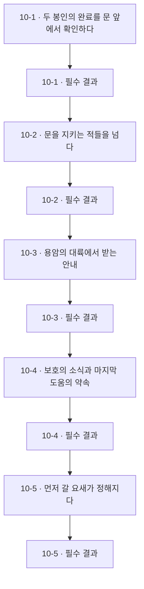

## 제11장 · 요새의 그늘

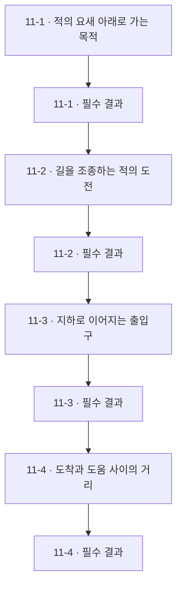

## 제12장 · 아직 살아 있는 사람들

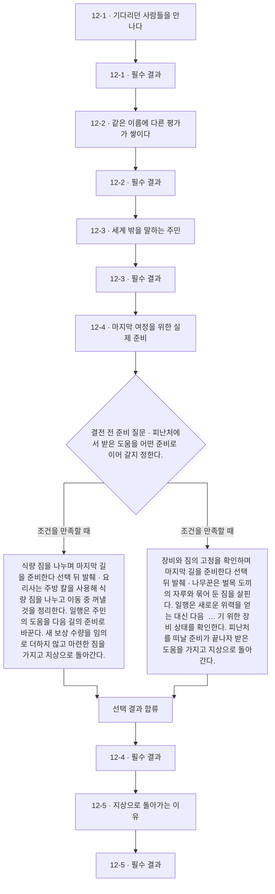

## 제13장 · 이름을 가리는 벽

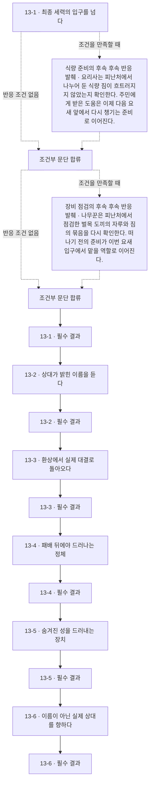

## 제14장 · 가장 깊은 문

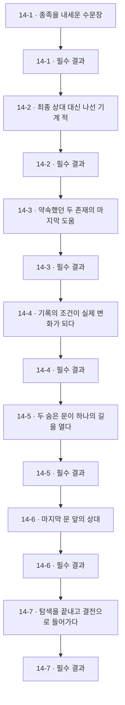

## 제15장 · 남겨진 마지막 말

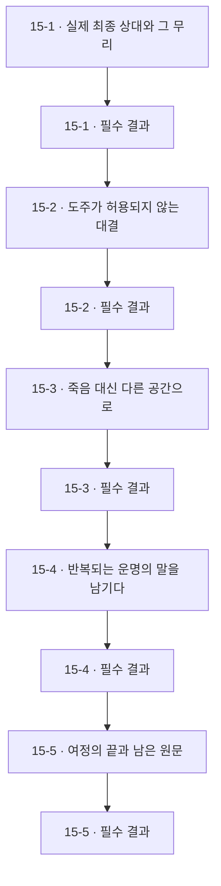

## 선형 출판 순서표

전체 선택지를 한 이야기로 합치지 않습니다. 아래는 지정한 예시 경로만의 실제 읽기 순서이며 페이지는 미정입니다.

### paper-draft

종이책 편집 순서의 예시 경로다. 정사·최종 출판 경로·페이지·장편 본문을 승인한 것이 아니다.

수동 선택: prepare/armory → company/talk_join → aid/cook → seal_order/evil_first → shelter_prepare/food

| 순서 | 소제목 | 소단락 ID | 페이지 |
| --- | --- | --- | --- |
| 1 | 1-1 · 낯선 세계에서 받은 안내 | `chapter01/p01` | 미정 |
| 2 | 1-2 · 세계의 위기를 듣다 | `chapter01/p02` | 미정 |
| 3 | 1-3 · 돌아와 증명해야 할 첫 임무 | `chapter01/p03` | 미정 |
| 4 | 1-4 · 떠난 사람의 이름과 남은 목소리 | `chapter01/p04` | 미정 |
| 5 | 1-5 · 출발할 일행을 정비하다 | `chapter01/p05` | 미정 |
| 6 | 1-6 · 남서쪽 동굴에 도달하다 | `chapter01/p06` | 미정 |
| 7 | 1-7 · 탐사의 중심을 확인하다 | `chapter01/p07` | 미정 |
| 8 | 1-8 · 첫 보고가 다음 부탁이 되다 | `chapter01/p08` | 미정 |
| 9 | 2-1 · 도착을 기다리던 성 | `chapter02/p01` | 미정 |
| 10 | 2-2 · 실종자에게 가족이 있었다 | `chapter02/p02` | 미정 |
| 11 | 2-3 · 북쪽으로 향하는 이유 | `chapter02/p03` | 미정 |
| 12 | 2-4 · 성을 위협하던 상대와의 대결 | `chapter02/p04` | 미정 |
| 13 | 2-5 · 구제의 결과를 보고하다 | `chapter02/p05` | 미정 |
| 14 | 2-6 · 쌍둥이 성으로 이어지는 문 | `chapter02/p06` | 미정 |
| 15 | 3-1 · 쌍둥이 성의 실제 모습 | `chapter03/p01` | 미정 |
| 16 | 3-2 · 풀어서는 안 되는 봉인 | `chapter03/p02` | 미정 |
| 17 | 3-3 · 지각이 끊어 놓은 길 | `chapter03/p03` | 미정 |
| 18 | 3-4 · 치료와 식량 뒤의 작별 | `chapter03/p04` | 미정 |
| 19 | 3-5 · 황금의 봉인을 찾아 지키다 | `chapter03/p05` | 미정 |
| 20 | 3-6 · 발견 뒤에도 남은 위험 | `chapter03/p06` | 미정 |
| 21 | 4-1 · 발견에서 격퇴로 바뀐 임무 | `chapter04/p01` | 미정 |
| 22 | 4-2 · 비밀문이 많은 동굴 | `chapter04/p02` | 미정 |
| 23 | 4-3 · 대륙에 남은 적을 넘다 | `chapter04/p03` | 미정 |
| 24 | 4-4 · 보고가 열쇠를 얻는 근거 | `chapter04/p04` | 미정 |
| 25 | 4-5 · 열쇠가 가리키는 목적지 | `chapter04/p05` | 미정 |
| 26 | 4-6 · 남은 준비를 마치고 떠나다 | `chapter04/p06` | 미정 |
| 27 | 5-1 · 문까지 가져가야 할 열쇠 | `chapter05/p01` | 미정 |
| 28 | 5-2 · 통로를 지키는 상대들 | `chapter05/p02` | 미정 |
| 29 | 5-3 · 세 수문장을 통과하다 | `chapter05/p03` | 미정 |
| 30 | 5-4 · 이동 조건을 실제로 쓰다 | `chapter05/p04` | 미정 |
| 31 | 5-5 · 물에 잠긴 땅에 도착하다 | `chapter05/p05` | 미정 |
| 32 | 6-1 · 마지막 아군 성의 사정 | `chapter06/p01` | 미정 |
| 33 | 6-2 · 이름으로만 알던 생존자 | `chapter06/p02` | 미정 |
| 34 | 6-3 · 첫 섬의 위협을 맡다 | `chapter06/p03` | 미정 |
| 35 | 6-4 · 처음 들었던 이름과 다시 만나다 | `chapter06/p04` | 미정 |
| 36 | 6-5 · 첫 동굴의 대결을 마치다 | `chapter06/p05` | 미정 |
| 37 | 6-6 · 인정받았지만 하나가 남다 | `chapter06/p06` | 미정 |
| 38 | 7-1 · 나머지 동굴의 부탁 | `chapter07/p01` | 미정 |
| 39 | 7-2 · 미로에서 만난 수도자 | `chapter07/p02` | 미정 |
| 40 | 7-3 · 배움과 동행은 다른 일 | `chapter07/p03` | 미정 |
| 41 | 7-4 · 미로 끝의 용을 상대하다 | `chapter07/p04` | 미정 |
| 42 | 7-5 · 다른 땅의 문을 여는 보상 | `chapter07/p05` | 미정 |
| 43 | 7-6 · 직진 대신 돌아가는 여행 | `chapter07/p06` | 미정 |
| 44 | 8-1 · 이전에 열지 못했던 문 | `chapter08/p01` | 미정 |
| 45 | 8-2 · 다음 문에는 두 조건이 있다 | `chapter08/p02` | 미정 |
| 46 | 8-3 · 기록이 설명하는 일행의 자리 | `chapter08/p03` | 미정 |
| 47 | 8-4 · 배척하던 이름의 도움 | `chapter08/p04` | 미정 |
| 48 | 8-5 · 다른 차원에서 온 설명 | `chapter08/p05` | 미정 |
| 49 | 8-6 · 설명은 얻었고 수행은 남다 | `chapter08/p06` | 미정 |
| 50 | 9-1 · 해제해야 하는 두 봉인 | `chapter09/p01` | 미정 |
| 51 | 9-2 · 물속 레버에 닿는 조건 | `chapter09/p02` | 미정 |
| 52 | 9-3 · 일곱 갈래 뒤의 봉인 | `chapter09/p03` | 미정 |
| 53 | 9-4 · 문답으로 여는 다른 길 | `chapter09/p04` | 미정 |
| 54 | 9-5 · 미로 뒤에서 들은 출처 | `chapter09/p05` | 미정 |
| 55 | 9-6 · 시험 끝의 봉인을 해제하다 | `chapter09/p06` | 미정 |
| 56 | 9-7 · 두 결과가 하나의 다음 길이 되다 | `chapter09/p07` | 미정 |
| 57 | 10-1 · 두 봉인의 완료를 문 앞에서 확인하다 | `chapter10/p01` | 미정 |
| 58 | 10-2 · 문을 지키는 적들을 넘다 | `chapter10/p02` | 미정 |
| 59 | 10-3 · 용암의 대륙에서 받는 안내 | `chapter10/p03` | 미정 |
| 60 | 10-4 · 보호의 소식과 마지막 도움의 약속 | `chapter10/p04` | 미정 |
| 61 | 10-5 · 먼저 갈 요새가 정해지다 | `chapter10/p05` | 미정 |
| 62 | 11-1 · 적의 요새 아래로 가는 목적 | `chapter11/p01` | 미정 |
| 63 | 11-2 · 길을 조종하는 적의 도전 | `chapter11/p02` | 미정 |
| 64 | 11-3 · 지하로 이어지는 출입구 | `chapter11/p03` | 미정 |
| 65 | 11-4 · 도착과 도움 사이의 거리 | `chapter11/p04` | 미정 |
| 66 | 12-1 · 기다리던 사람들을 만나다 | `chapter12/p01` | 미정 |
| 67 | 12-2 · 같은 이름에 다른 평가가 쌓이다 | `chapter12/p02` | 미정 |
| 68 | 12-3 · 세계 밖을 말하는 주민 | `chapter12/p03` | 미정 |
| 69 | 12-4 · 마지막 여정을 위한 실제 준비 | `chapter12/p04` | 미정 |
| 70 | 12-5 · 지상으로 돌아가는 이유 | `chapter12/p05` | 미정 |
| 71 | 13-1 · 최종 세력의 입구를 넘다 | `chapter13/p01` | 미정 |
| 72 | 13-2 · 상대가 밝힌 이름을 듣다 | `chapter13/p02` | 미정 |
| 73 | 13-3 · 환상에서 실제 대결로 돌아오다 | `chapter13/p03` | 미정 |
| 74 | 13-4 · 패배 뒤에야 드러나는 정체 | `chapter13/p04` | 미정 |
| 75 | 13-5 · 숨겨진 성을 드러내는 장치 | `chapter13/p05` | 미정 |
| 76 | 13-6 · 이름이 아닌 실제 상대를 향하다 | `chapter13/p06` | 미정 |
| 77 | 14-1 · 종족을 내세운 수문장 | `chapter14/p01` | 미정 |
| 78 | 14-2 · 최종 상대 대신 나선 기계 적 | `chapter14/p02` | 미정 |
| 79 | 14-3 · 약속했던 두 존재의 마지막 도움 | `chapter14/p03` | 미정 |
| 80 | 14-4 · 기록의 조건이 실제 변화가 되다 | `chapter14/p04` | 미정 |
| 81 | 14-5 · 두 숨은 문이 하나의 길을 열다 | `chapter14/p05` | 미정 |
| 82 | 14-6 · 마지막 문 앞의 상대 | `chapter14/p06` | 미정 |
| 83 | 14-7 · 탐색을 끝내고 결전으로 들어가다 | `chapter14/p07` | 미정 |
| 84 | 15-1 · 실제 최종 상대와 그 무리 | `chapter15/p01` | 미정 |
| 85 | 15-2 · 도주가 허용되지 않는 대결 | `chapter15/p02` | 미정 |
| 86 | 15-3 · 죽음 대신 다른 공간으로 | `chapter15/p03` | 미정 |
| 87 | 15-4 · 반복되는 운명의 말을 남기다 | `chapter15/p04` | 미정 |
| 88 | 15-5 · 여정의 끝과 남은 원문 | `chapter15/p05` | 미정 |

## 출판 전 확인

- 작가용 전편 스포일러다. 독자 웹에 통째로 게시하지 않는다.
- 트리는 장·소단락·분기의 소속이다. 트리 배열을 실제 실행 순서로 혼동하지 않는다.
- 그래프 실선은 읽기·선택·합류이며 점선은 조건부 반응 또는 이후 상태 영향이다. 모든 선택을 한 번에 읽는 뜻이 아니다.
- 두 봉인은 순서별 문맥 복제 노드로 그린다. 두 순서를 공유 노드에 양방향으로 연결해 순환처럼 보이게 하지 않는다.
- 일부 분기 후보는 미구현 표시만 한다. 기존 첫 챕터 웹의 별도 실행 그래프를 전편 그래프로 자동 승격하지 않는다.
- 선형 출판 순서표는 실제 선택 ID 경로를 재생해 만든다. 표제·조건·본문은 원래 JSON 참조로 이어지고 아직 페이지 번호는 없다.
- JSON은 구조와 참조, Markdown은 목차 트리·Mermaid 흐름도, HTML/SVG는 외부 라이브러리 없이 보는 도식이다.
- 소제목·인물·무기 이름은 원래 자료에서 참조하고 표시명 변경 뒤 재생성한다. 생성물을 직접 편집하지 않는다.
