# 전편 소제목 트리와 흐름도

작가 전용 · 전편 스포일러 · 자동 생성 · 아직 출판 승인 전입니다.

실선은 읽기·선택·합류, 점선은 조건부 반응입니다. 선택 가능 조건은 원래 분기 JSON을 따릅니다.

## 장 전체 흐름

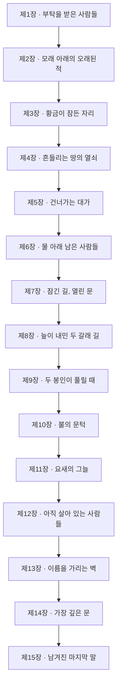

## 소제목 트리

```text
제1장 · 부탁을 받은 사람들
  ├─ 1-1 · 낯선 세계에서 받은 안내
  ├─ 1-2 · 세계의 위기를 듣다
  ├─ 1-3 · 돌아와 증명해야 할 첫 임무
  ├─ 1-4 · 떠난 사람의 이름과 남은 목소리
  │   ├─ 결정: 성벽 아래의 두레박
  │   │   질문: 성벽 안쪽의 작은 우물 곁에서 물 긷던 여인이 일행을 붙잡는다. 끊어진 줄 끝에서 두레박이 돌 틈에 걸렸다. 성문으로 나갈 시간은 정해 두었지만, 우물의 일을 잠깐 도울 수는 있다.
  │   │   ├─ 두레박을 건져 여인이 물을 길을 수 있게 돕는다
  │   │   ├─ 우물 곁을 지나 출발 준비를 계속한다
  │   │   └─ 다음 본줄기 전 합류
  ├─ 1-5 · 출발할 일행을 정비하다
  │   ├─ 결정: 출발 준비
  │   │   질문: 성문을 나서기 전, 부족한 준비를 어디에서 마칠지 정한다.
  │   │   ├─ 무기고에서 필요한 무장을 마련한다
  │   │   ├─ 지금 가진 장비를 점검하고 성문으로 간다
  │   │   └─ 다음 본줄기 전 합류
  │   ├─ 결정: 성문에서의 동행
  │   │   질문: 문 앞의 동행 제안을 어떤 만남으로 이어 갈지 정한다.
  │   │   ├─ 제안자를 동료로 받아 함께 떠난다
  │   │   ├─ 함께 갈 사정을 듣고 동행을 받아들인다
  │   │   ├─ 동행 제안을 받지 않고 지금 일행과 떠난다
  │   │   └─ 다음 본줄기 전 합류
  │   ├─ 결정: 성문 밖으로 흘러나온 불빛
  │   │   질문: 출발 준비가 끝난 성문 곁에서 문지기가 흔들리는 등롱을 붙들고 있다. 떨어진 고리가 덮개 틈에 끼어 다시 걸 수 없다고 한다.
  │   │   ├─ 문지기와 떨어진 고리를 꺼낸다
  │   │   ├─ 문지기의 일을 맡지 않고 동굴로 향한다
  │   │   └─ 다음 본줄기 전 합류
  │   ├─ 결정: 성문 밖으로 흘러나온 불빛 · 해결 방법
  │   │   질문: 덮개를 받쳐 틈을 넓힐까, 고리만 걸어 끌어낼까?
  │   │   ├─ 덮개를 받쳐 문지기가 손을 넣을 틈을 만든다
  │   │   ├─ 빌린 철사로 고리를 걸어 꺼낸다
  │   │   ├─ 자동 연결 · 참여하지 않은 곁가지
  │   │   └─ 다음 본줄기 전 합류
  ├─ 1-6 · 남서쪽 동굴에 도달하다
  ├─ 1-7 · 탐사의 중심을 확인하다
  ├─ 1-8 · 첫 보고가 다음 부탁이 되다
제2장 · 모래 아래의 오래된 적
  ├─ 2-1 · 도착을 기다리던 성
  ├─ 2-2 · 실종자에게 가족이 있었다
  │   ├─ 결정: 무너진 제빵소의 마지막 자루
  │   │   질문: 성 밖으로 향하는 짧은 길에서 무너진 작업장 앞의 노인이 부탁한다. 젖기 전에 마지막 곡식 자루를 꺼내고 싶지만 기울어진 선반 아래로 혼자 들어갈 수 없다. 북쪽의 위협을 해결하는 임무와는 별개인 작은 구조 작업이다.
  │   │   ├─ 기울어진 선반을 받치고 곡식 자루를 꺼낸다
  │   │   ├─ 작업장에 들어가지 않고 북쪽으로 향한다
  │   │   └─ 다음 본줄기 전 합류
  ├─ 2-3 · 북쪽으로 향하는 이유
  │   ├─ 결정: 북쪽 길의 쓰러진 경계돌
  │   │   질문: 북쪽으로 가던 길의 갈림목에서 어린 짐꾼이 빈 수레를 끌고 돌아본다. 표석이 엎어져 어느 쪽이 지나온 마을인지 짚지 못한다.
  │   │   ├─ 표석을 세워 짐꾼의 지나온 길을 함께 확인한다
  │   │   ├─ 짐꾼에게 길을 맡기고 북쪽 탐사를 계속한다
  │   │   └─ 다음 본줄기 전 합류
  ├─ 2-4 · 성을 위협하던 상대와의 대결 [분기 후보·미구현]
  ├─ 2-5 · 구제의 결과를 보고하다
  ├─ 2-6 · 쌍둥이 성으로 이어지는 문
제3장 · 황금이 잠든 자리
  ├─ 3-1 · 쌍둥이 성의 실제 모습
  ├─ 3-2 · 풀어서는 안 되는 봉인
  │   ├─ 결정: 폐허에서 온 손수레
  │   │   질문: 성주에게 봉인의 위험을 들은 뒤, 성 밖의 길에서 돌무더기에 바퀴가 걸린 손수레를 만난다. 폐허에서 살림을 옮겨 온 사람들이 물 항아리를 넘어뜨리지 않고 수레를 빼내려고 한다. 봉인을 찾는 의뢰와는 다른 국소적인 부탁이다.
  │   │   ├─ 수레를 빼내고 피난민의 항아리를 옮겨 준다
  │   │   ├─ 수레의 일은 남겨 두고 의뢰의 길로 간다
  │   │   └─ 다음 본줄기 전 합류
  ├─ 3-3 · 지각이 끊어 놓은 길
  ├─ 3-4 · 치료와 식량 뒤의 작별
  │   ├─ 결정: 부상자 지원 역할
  │   │   질문: 치료를 도우며 탈출할 수 있는 준비를 어떻게 맡을지 정한다.
  │   │   ├─ 식량과 짐의 준비를 동료에게 맡긴다
  │   │   ├─ 발을 디딜 길의 확인을 동료에게 맡긴다
  │   │   ├─ 일행이 함께 치료와 탈출 준비를 나눈다
  │   │   └─ 다음 본줄기 전 합류
  │   ├─ 결정: 식어 버린 화덕의 재
  │   │   질문: 용사를 떠나보내고 탐색을 잇는 길, 폐허 가장자리에서 주민이 무너진 담에 눌린 공동 화덕을 치운다. 오늘 저녁만이라도 쓸 자리를 만들고 싶다고 한다.
  │   │   ├─ 주민과 벽돌을 걷어 작은 화덕 자리를 만든다
  │   │   ├─ 화덕을 고치지 않고 봉인 탐색을 잇는다
  │   │   └─ 다음 본줄기 전 합류
  ├─ 3-5 · 황금의 봉인을 찾아 지키다
  ├─ 3-6 · 발견 뒤에도 남은 위험
제4장 · 흔들리는 땅의 열쇠
  ├─ 4-1 · 발견에서 격퇴로 바뀐 임무
  ├─ 4-2 · 비밀문이 많은 동굴
  │   ├─ 결정: 막다른 굴의 작은 빛
  │   │   질문: 복잡한 동굴의 본길을 찾던 일행은 옆으로 짧게 꺾인 굴에서 등불이 굴러오는 것을 본다. 안쪽에는 적에게 쫓기다 막다른 곳에 몰린 무명 탐색자가 있다. 그를 데리고 나오는 일은 의뢰의 상대에게 가는 길을 대신하지 않는다.
  │   │   ├─ 짧은 옆굴로 들어가 탐색자를 데리고 나온다
  │   │   ├─ 옆굴에 들어가지 않고 본길 탐색을 이어 간다
  │   │   └─ 다음 본줄기 전 합류
  │   ├─ 결정: 갈라진 벽감의 낡은 흔적
  │   │   질문: 복잡한 동굴의 막힌 벽감에 천 꾸러미가 보인다. 물건을 잃었다는 무명 길잡이는 그 안의 낡은 장갑을 되찾고 싶어 한다. 꾸러미는 불안정한 돌 아래에 있다.
  │   │   ├─ 꾸러미를 꺼내 길잡이에게 돌려준다
  │   │   ├─ 벽감을 건드리지 않고 안쪽 길을 찾는다
  │   │   └─ 다음 본줄기 전 합류
  │   ├─ 결정: 갈라진 벽감의 낡은 흔적 · 해결 방법
  │   │   질문: 갈라진 돌을 받칠까, 틈 아래로 천을 밀어 꾸러미만 꺼낼까?
  │   │   ├─ 돌을 받친 뒤 꾸러미를 옮긴다
  │   │   ├─ 천으로 감싸 꾸러미만 끌어낸다
  │   │   ├─ 자동 연결 · 참여하지 않은 곁가지
  │   │   └─ 다음 본줄기 전 합류
  ├─ 4-3 · 대륙에 남은 적을 넘다 [분기 후보·미구현]
  ├─ 4-4 · 보고가 열쇠를 얻는 근거
  ├─ 4-5 · 열쇠가 가리키는 목적지
  ├─ 4-6 · 남은 준비를 마치고 떠나다 [분기 후보·미구현]
제5장 · 건너가는 대가
  ├─ 5-1 · 문까지 가져가야 할 열쇠
  ├─ 5-2 · 통로를 지키는 상대들
  │   ├─ 결정: 통로에 남은 어긋난 발소리
  │   │   질문: 문으로 이어지는 길의 짧은 곁굴에서 발소리가 다른 박자로 돌아온다. 뒤따르던 무명 운반인은 빈 상자를 그 안에 빠뜨렸다며 회수를 부탁한다.
  │   │   ├─ 운반인과 얕은 곁굴에서 빈 상자를 회수한다
  │   │   ├─ 곁굴을 살피지 않고 문으로 향한다
  │   │   └─ 다음 본줄기 전 합류
  ├─ 5-3 · 세 수문장을 통과하다
  │   ├─ 결정: 날개 그늘 아래의 밧줄
  │   │   질문: 통로의 수문장들을 넘어선 뒤, 문으로 가는 길 옆에서 끊어진 운반대와 아래턱에 매달린 짐꾼을 발견한다. 그는 남은 밧줄을 붙들고 있으나 혼자 올라오지 못한다. 아직 문은 통과하지 않았고, 이 일은 열쇠의 사용 조건과 별개다.
  │   │   ├─ 끊어진 운반대를 고정해 짐꾼을 끌어올린다
  │   │   ├─ 아래턱을 살피는 일을 중단하고 안쪽 문으로 간다
  │   │   └─ 다음 본줄기 전 합류
  ├─ 5-4 · 이동 조건을 실제로 쓰다
  ├─ 5-5 · 물에 잠긴 땅에 도착하다
제6장 · 물 아래 남은 사람들
  ├─ 6-1 · 마지막 아군 성의 사정
  ├─ 6-2 · 이름으로만 알던 생존자
  │   ├─ 결정: 물살에 걸린 작은 돛
  │   │   질문: 생존자와의 만남 뒤, 성 가까운 물가에서 떠밀린 작은 배를 본다. 배 안의 두 사람이 찢어진 돛을 낮추려 하지만 돛줄이 바위에 걸려 배가 계속 돌아간다. 섬의 적을 격퇴하기 전에 잠깐 손을 빌려줄지 정한다.
  │   │   ├─ 돛줄을 풀어 배가 안전한 얕은 곳에 닿도록 돕는다
  │   │   ├─ 물가의 일에 개입하지 않고 성의 의뢰를 우선한다
  │   │   └─ 다음 본줄기 전 합류
  ├─ 6-3 · 첫 섬의 위협을 맡다
  │   ├─ 결정: 섬 가장자리의 떠밀린 짐
  │   │   질문: 첫 섬으로 향하는 물가에서 배 주인이 얕은 돌 사이를 오가는 빈 짐통을 가리킨다. 잠기기 전에 모아 달라는 작은 부탁이다.
  │   │   ├─ 배 주인과 얕은 물가의 짐통을 끌어 올린다
  │   │   ├─ 짐통 회수를 맡지 않고 첫 동굴로 간다
  │   │   └─ 다음 본줄기 전 합류
  ├─ 6-4 · 처음 들었던 이름과 다시 만나다 [분기 후보·미구현]
  ├─ 6-5 · 첫 동굴의 대결을 마치다 [분기 후보·미구현]
  ├─ 6-6 · 인정받았지만 하나가 남다
제7장 · 잠긴 길, 열린 문
  ├─ 7-1 · 나머지 동굴의 부탁
  ├─ 7-2 · 미로에서 만난 수도자
  │   ├─ 결정: 미로에 놓인 작은 종
  │   │   질문: 수도자를 만난 자리에서 다음 배움을 듣기 전, 가까운 옆길에서 바닥을 두드리는 소리가 들린다. 길을 잃은 무명 여행자가 떨어뜨린 작은 종으로 자기 위치를 알리려 한다. 그를 본길에 돌려보내는 일과 새 능력을 배우는 일은 별개다.
  │   │   ├─ 옆길의 소리를 따라 여행자를 본길로 데려온다
  │   │   ├─ 옆길을 더 찾지 않고 원래의 만남을 이어 간다
  │   │   └─ 다음 본줄기 전 합류
  ├─ 7-3 · 배움과 동행은 다른 일
  │   ├─ 결정: 가르침 뒤의 동행
  │   │   질문: 가르침을 들은 뒤의 동행을 정한다.
  │   │   ├─ 새 동료와 함께 남은 동굴을 탐색한다
  │   │   ├─ 가르침을 기억하고 현재 동료들과 길을 잇는다
  │   │   └─ 다음 본줄기 전 합류
  │   ├─ 결정: 미로의 바람막이
  │   │   질문: 배움을 듣고 남은 미로로 가는 길, 쉬던 무명 탐사자가 찢어진 바람막이를 붙든다. 천이 문턱에 걸려 통행을 방해한다.
  │   │   ├─ 탐사자와 바람막이를 정리한다
  │   │   ├─ 탐사자의 일을 맡지 않고 미로 탐색을 잇는다
  │   │   └─ 다음 본줄기 전 합류
  │   ├─ 결정: 미로의 바람막이 · 해결 방법
  │   │   질문: 쉼터를 남겨 고칠까, 천을 내려 통로를 넓힐까?
  │   │   ├─ 천을 묶어 쉴 자리를 남긴다
  │   │   ├─ 천을 접어 통로부터 비운다
  │   │   ├─ 자동 연결 · 참여하지 않은 곁가지
  │   │   └─ 다음 본줄기 전 합류
  ├─ 7-4 · 미로 끝의 용을 상대하다 [분기 후보·미구현]
  ├─ 7-5 · 다른 땅의 문을 여는 보상
  ├─ 7-6 · 직진 대신 돌아가는 여행
제8장 · 늪이 내민 두 갈래 길
  ├─ 8-1 · 이전에 열지 못했던 문
  ├─ 8-2 · 다음 문에는 두 조건이 있다
  │   ├─ 결정: 늪 가장자리의 꺼지는 불
  │   │   질문: 늪의 위험과 두 봉인의 임무를 들은 뒤, 본길 가까운 마른 턱에서 꺼지는 작은 불을 본다. 떠돌이 한 사람이 젖은 짐을 옮기다 발목이 진흙에 묶였다. 불 곁으로 그를 돌려놓을지, 현재 탐색 준비를 계속할지 정한다.
  │   │   ├─ 진흙에 묶인 사람을 마른 턱으로 옮겨 준다
  │   │   ├─ 마른 턱의 일을 더 맡지 않고 탐색 준비를 이어 간다
  │   │   └─ 다음 본줄기 전 합류
  ├─ 8-3 · 기록이 설명하는 일행의 자리
  ├─ 8-4 · 배척하던 이름의 도움 [분기 후보·미구현]
  ├─ 8-5 · 다른 차원에서 온 설명
  │   ├─ 결정: 물기 번진 작은 장부
  │   │   질문: 설명을 듣고 돌아오는 쉼터에서 짐 정리하던 사람이 젖은 장부를 들고 있다. 봉인의 기록이 아니라 함께 온 사람들에게 돌려줄 물건 목록이다.
  │   │   ├─ 장부를 펼쳐 물건의 주인을 확인한다
  │   │   ├─ 장부를 맡지 않고 봉인 수행을 준비한다
  │   │   └─ 다음 본줄기 전 합류
  ├─ 8-6 · 설명은 얻었고 수행은 남다
제9장 · 두 봉인이 풀릴 때
  ├─ 9-1 · 해제해야 하는 두 봉인
  │   ├─ 결정: 두 봉인의 순서
  │   │   질문: 두 봉인을 모두 풀어야 한다. 먼저 들어갈 동굴을 정한다.
  │   │   ├─ 늪 속 장치가 있는 동굴부터 찾는다
  │   │   ├─ 문답의 시험이 있는 동굴부터 찾는다
  │   │   └─ 두 탐색 모두 수행한 뒤 합류
  ├─ 9-2 · 물속 레버에 닿는 조건 [분기 후보·미구현]
  ├─ 9-3 · 일곱 갈래 뒤의 봉인
  ├─ 9-4 · 문답으로 여는 다른 길 [분기 후보·미구현]
  ├─ 9-5 · 미로 뒤에서 들은 출처
  ├─ 9-6 · 시험 끝의 봉인을 해제하다
  ├─ 9-7 · 두 결과가 하나의 다음 길이 되다
  │   ├─ 결정: 돌아오는 길의 젖은 매듭
  │   │   질문: 두 동굴의 봉인을 모두 푼 뒤 돌아오는 길에서 낡은 짐걸이와 끊어질 듯한 줄을 본다. 얕은 물가에서 짐을 건너려는 무명 행인이 매듭을 붙들고 있다. 이미 완료한 봉인과는 상관없는 작은 통행의 문제다.
  │   │   ├─ 짐걸이를 고쳐 행인의 짐이 물에 쓸리지 않게 한다
  │   │   ├─ 짐걸이의 일은 맡지 않고 문을 향해 돌아간다
  │   │   └─ 다음 본줄기 전 합류
  │   ├─ 결정: 두 길이 만난 곳의 꺾인 갈대
  │   │   질문: 두 봉인을 모두 푼 뒤 돌아가는 길, 수레 주인이 둔덕에서 바퀴를 뺀다. 길 가장자리의 갈대 표지가 꺾여 물가에 너무 가까이 갔다고 한다.
  │   │   ├─ 수레를 옮기고 꺾인 표지를 다시 묶는다
  │   │   ├─ 수레 일을 맡지 않고 다음 게이트로 간다
  │   │   └─ 다음 본줄기 전 합류
제10장 · 불의 문턱
  ├─ 10-1 · 두 봉인의 완료를 문 앞에서 확인하다
  ├─ 10-2 · 문을 지키는 적들을 넘다 [분기 후보·미구현]
  ├─ 10-3 · 용암의 대륙에서 받는 안내
  ├─ 10-4 · 보호의 소식과 마지막 도움의 약속
  │   ├─ 결정: 먼지를 막는 문턱의 천
  │   │   질문: 피난처의 도움에 관한 약속을 듣고 자리를 뜨는 길, 작업장 사람이 문턱 아래로 들어오는 재에 천을 댄다. 도구를 가져올 동안 한쪽을 잡아 달라고 한다.
  │   │   ├─ 작업장 사람과 천을 고정한다
  │   │   ├─ 천을 고정하지 않고 다음 목적지를 준비한다
  │   │   └─ 다음 본줄기 전 합류
  ├─ 10-5 · 먼저 갈 요새가 정해지다
  │   ├─ 결정: 재 아래 남은 물통
  │   │   질문: 마지막 대륙의 안내를 들은 뒤, 첫 요새로 가는 길 옆의 버려진 운반소에서 재를 털던 사람이 부탁한다. 쓰러진 물통이 받침에 걸려 혼자 바로 세우지 못한다. 피난처의 위치나 보호의 정체에 관한 새 설명은 없는 짧은 조우다.
  │   │   ├─ 물통을 세워 그 사람이 남은 물을 지킬 수 있게 한다
  │   │   ├─ 운반소의 일을 맡지 않고 첫 요새로 향한다
  │   │   └─ 다음 본줄기 전 합류
제11장 · 요새의 그늘
  ├─ 11-1 · 적의 요새 아래로 가는 목적
  ├─ 11-2 · 길을 조종하는 적의 도전
  │   ├─ 결정: 계단 곁에 갇힌 목소리
  │   │   질문: 길을 막던 상대를 넘은 뒤, 지하로 가는 본길 곁의 막힌 작은 칸에서 두드리는 소리가 난다. 안에는 무명 포로 한 사람이 끼인 문을 밀고 있다. 그를 꺼내는 일은 피난처로 통하는 원래 출입구를 찾는 일을 대신하지 않는다.
  │   │   ├─ 끼인 문을 들어 포로가 작은 칸에서 나오게 한다
  │   │   ├─ 작은 칸의 일을 더 맡지 않고 지하 출입구를 찾는다
  │   │   └─ 다음 본줄기 전 합류
  ├─ 11-3 · 지하로 이어지는 출입구
  │   ├─ 결정: 내려가는 계단의 흔들린 발판
  │   │   질문: 지하 출입구 계단 곁에서 무명 운반인이 흔들리는 발판 앞에 멈춘다. 통로 전체는 막히지 않았지만 그의 무거운 짐은 좁은 옆길로 지나가기 어렵다.
  │   │   ├─ 운반인이 짐을 아래로 옮기도록 돕는다
  │   │   ├─ 짐을 맡지 않고 좁은 옆길로 내려간다
  │   │   └─ 다음 본줄기 전 합류
  │   ├─ 결정: 내려가는 계단의 흔들린 발판 · 해결 방법
  │   │   질문: 짐을 나눠 옆길로 옮길까, 발판을 받쳐 운반인이 건너게 할까?
  │   │   ├─ 작은 묶음으로 나누어 옆길로 옮긴다
  │   │   ├─ 발판을 받쳐 직접 짐을 옮기게 한다
  │   │   ├─ 자동 연결 · 참여하지 않은 곁가지
  │   │   └─ 다음 본줄기 전 합류
  ├─ 11-4 · 도착과 도움 사이의 거리
제12장 · 아직 살아 있는 사람들
  ├─ 12-1 · 기다리던 사람들을 만나다
  ├─ 12-2 · 같은 이름에 다른 평가가 쌓이다
  │   ├─ 결정: 벽 사이로 새는 하루치 물
  │   │   질문: 주민들의 서로 다른 평가를 들은 뒤, 생활 구역의 낮은 벽에서 물을 받는 사람이 부탁한다. 갈라진 물길이 안쪽으로 새어 작은 그릇만 계속 채우고 있다. 보호자의 힘이나 바깥의 위협을 바꾸는 일이 아닌 생활의 수선이다.
  │   │   ├─ 갈라진 물길을 임시로 막아 주민의 수고를 덜어 준다
  │   │   ├─ 수선에는 참여하지 않고 다음 만남을 이어 간다
  │   │   └─ 다음 본줄기 전 합류
  ├─ 12-3 · 세계 밖을 말하는 주민
  │   ├─ 결정: 금 간 잔을 내려놓는 자리
  │   │   질문: 주민들의 말을 듣고 준비를 잇는 길, 물 나누던 사람이 금 간 잔들을 고른다. 버리면 오래 기다려야 하고 그대로 쓰면 손을 벨 수 있어 함께 정리해 달라고 한다.
  │   │   ├─ 위험한 잔과 쓸 수 있는 그릇을 나눈다
  │   │   ├─ 그릇 정리를 맡지 않고 마지막 준비를 잇는다
  │   │   └─ 다음 본줄기 전 합류
  ├─ 12-4 · 마지막 여정을 위한 실제 준비
  │   ├─ 결정: 결전 전 준비
  │   │   질문: 피난처에서 받은 도움을 어떤 준비로 이어 갈지 정한다.
  │   │   ├─ 식량 짐을 나누며 마지막 길을 준비한다
  │   │   ├─ 장비와 짐의 고정을 확인하며 마지막 길을 준비한다
  │   │   └─ 다음 본줄기 전 합류
  ├─ 12-5 · 지상으로 돌아가는 이유
제13장 · 이름을 가리는 벽
  ├─ 13-1 · 최종 세력의 입구를 넘다 [분기 후보·미구현]
  ├─ 13-2 · 상대가 밝힌 이름을 듣다
  ├─ 13-3 · 환상에서 실제 대결로 돌아오다 [분기 후보·미구현]
  ├─ 13-4 · 패배 뒤에야 드러나는 정체
  │   ├─ 결정: 벽 뒤에 남겨진 짐
  │   │   질문: 대결 뒤의 고백과 기둥의 소멸을 본 다음, 원래 장치를 찾기 전 낮은 저장 칸에서 살아 있는 작은 짐승의 소리를 듣는다. 무너진 선반 아래에 걸린 천 꾸러미를 치우면 빠져나올 수 있을 듯하다. 표지나 진상에 관한 새 단서는 없는 국소적인 탐색이다.
  │   │   ├─ 저장 칸의 꾸러미를 치워 갇힌 짐승을 밖으로 보낸다
  │   │   ├─ 저장 칸은 더 살피지 않고 원래 장치를 찾는다
  │   │   └─ 다음 본줄기 전 합류
  ├─ 13-5 · 숨겨진 성을 드러내는 장치
  │   ├─ 결정: 드러난 성 곁의 먼지 낀 문
  │   │   질문: 장치를 작동시켜 다음 성을 드러낸 뒤 곁의 얕은 저장공간에서 먼지가 쏟아진다. 작은 문이 돌조각에 눌려 닫히지 않고 빈 상자들이 바닥에 흩어져 있다.
  │   │   ├─ 빈 상자를 정리해 걸어갈 자리를 비운다
  │   │   ├─ 저장공간을 건드리지 않고 드러난 성으로 간다
  │   │   └─ 다음 본줄기 전 합류
  ├─ 13-6 · 이름이 아닌 실제 상대를 향하다
제14장 · 가장 깊은 문
  ├─ 14-1 · 종족을 내세운 수문장 [분기 후보·미구현]
  ├─ 14-2 · 최종 상대 대신 나선 기계 적
  │   ├─ 결정: 용암 곁의 식지 않은 쇠
  │   │   질문: 기계 적과의 대결을 마친 뒤, 본길 곁에 기울어진 오래된 운반 틀이 보인다. 아래쪽에는 떨어진 짐 하나를 붙잡으려던 무명 일꾼이 발을 끼웠다. 틀을 옮길지, 더 다가가지 않고 원래 길로 돌아갈지 정한다. 아직 마지막 도움과 계급 변화는 얻지 않았다.
  │   │   ├─ 운반 틀을 받쳐 일꾼이 발을 뺄 시간을 만든다
  │   │   ├─ 뜨거운 틀에는 더 다가가지 않고 원래 길을 따른다
  │   │   └─ 다음 본줄기 전 합류
  ├─ 14-3 · 약속했던 두 존재의 마지막 도움
  ├─ 14-4 · 기록의 조건이 실제 변화가 되다
  ├─ 14-5 · 두 숨은 문이 하나의 길을 열다
  │   ├─ 결정: 마지막 길 옆의 식은 돌자리
  │   │   질문: 양쪽 레버를 모두 움직여 마지막 입구가 나타난 뒤 옆 벽감에서 작은 돌들이 흘러내린다. 입구는 열려 있고 우회할 폭도 있지만 넘어지기 쉬운 자리다.
  │   │   ├─ 불안정한 작은 돌자리를 정리한다
  │   │   ├─ 돌을 피해 열린 마지막 입구로 간다
  │   │   └─ 다음 본줄기 전 합류
  │   ├─ 결정: 마지막 길 옆의 식은 돌자리 · 해결 방법
  │   │   질문: 움직이는 돌을 옮길까, 돌을 두고 발 디딜 곳을 표시할까?
  │   │   ├─ 옮길 수 있는 작은 돌을 안쪽에 모은다
  │   │   ├─ 돌을 두고 먼지 위에 발 디딜 곳을 표시한다
  │   │   ├─ 자동 연결 · 참여하지 않은 곁가지
  │   │   └─ 다음 본줄기 전 합류
  ├─ 14-6 · 마지막 문 앞의 상대 [분기 후보·미구현]
  ├─ 14-7 · 탐색을 끝내고 결전으로 들어가다
제15장 · 남겨진 마지막 말
  ├─ 15-1 · 실제 최종 상대와 그 무리
  ├─ 15-2 · 도주가 허용되지 않는 대결 [분기 후보·미구현]
  ├─ 15-3 · 죽음 대신 다른 공간으로
  ├─ 15-4 · 반복되는 운명의 말을 남기다
  │   ├─ 결정: 끝난 싸움 뒤의 한 걸음
  │   │   질문: 최종 상대의 작별과 이 세계를 떠나는 모습을 본 뒤, 마무리로 이어지기 전 돌아설 길의 깨진 낮은 발판을 발견한다. 급히 지나가면 건널 수는 있지만 뒤에 같은 자리를 밟을 누군가를 위해 잠깐 정리할 수도 있다. 떠난 상대의 운명에는 손대지 않는 마지막 곁가지다.
  │   │   ├─ 깨진 발판을 정리하고 서로의 마지막 걸음을 돕는다
  │   │   ├─ 발판을 더 고치지 않고 각자의 조심스러운 걸음으로 지나간다
  │   │   └─ 다음 본줄기 전 합류
  │   ├─ 결정: 작별 뒤에 남은 돌조각
  │   │   질문: 상대가 마지막 말을 남기고 떠난 뒤 발밑에 갈라진 돌조각이 남아 있다. 추적 단서나 다른 결말의 문은 아니다. 잠깐 자리를 정리하거나 여정의 마무리로 갈 수 있다.
  │   │   ├─ 날카로운 조각을 옆으로 모으고 잠깐 쉰다
  │   │   ├─ 조각을 피해 바로 여정의 마무리로 간다
  │   │   └─ 다음 본줄기 전 합류
  ├─ 15-5 · 여정의 끝과 남은 원문
```

트리는 소속이고 실행 순서가 아닙니다. 9장의 두 탐색은 어느 쪽이 먼저여도 둘 다 필수입니다.

## 선택과 후속 반응의 연결

공유 상태와 실제 경로에서 함께 관찰된 연결입니다. 조건이 맞아야 반응이 나오며 유일한 원인의 증명은 아닙니다.

```mermaid
%%{init: {"flowchart": {"curve": "stepAfter"}}}%%
flowchart TB
  ne90cb4be5ec486eb["무기고에서 필요한 무장을 마련한다 선택 뒤 발췌 · 일행은 무기고에서 떠날 준비를 한다. 네 동료의 직업 무기는 그대로 두고, 서진은 미지정이던 자신의 무장으로 단도를 받는다. 장비를 마련한 뒤 일행은 동료 제안이 기다리는 성문으로 향한다."]
  n8d5ad8c7a73504e6["새 무장 확인 후속 반응 발췌 · 성문을 나선 서진은 무기고에서 받은 단도를 확인한다. 출발 직전의 준비가 이제 동굴을 향하는 실제 짐과 무장으로 남아 있다."]
  n014a871b3662ed77["함께 갈 사정을 듣고 동행을 받아들인다 선택 뒤 발췌 · 일행은 먼저 제안자가 왜 함께 가려는지 묻고 이야기를 나눈다. 스켈레톤은 자신을 소개하고 여행에 보탬이 되겠다는 뜻을 전한다. 일행은 그 대화를 기억한 채 그를 받아들여 함께 출발한다."]
  n9b3ea50bec258bbf["성문 대화의 기억 후속 반응 발췌 · 스켈레톤은 성문에서 나눈 이야기를 이어 가며 일행과 걷는다. 함께 가겠다는 짧은 제안보다 더 긴 만남을 나눈 기억이 이번 길에 남는다."]
  nff960f8679664228["식량과 짐의 준비를 동료에게 맡긴다 선택 뒤 발췌 · 일행이 부상자를 돌보는 동안 요리사는 주방 칼을 사용해 식량 짐을 나누고 가져가기 편하게 정리한다. 상처를 돌보는 일과 탈출 준비가 이어지고, 용사는 축복을 남긴 뒤 자기 길로 떠난다."]
  nf35327c9f551feb8["식량을 나눈 기억 후속 반응 발췌 · 귀환하는 길에 요리사는 용사에게 나누어 준 식량을 떠올린다. 봉인을 찾았다는 보고에는 지하에 남은 사람을 도운 경험도 함께 이어진다."]
  nadb8d58f44973f43["식량 짐을 나누며 마지막 길을 준비한다 선택 뒤 발췌 · 요리사는 주방 칼을 사용해 식량 짐을 나누고 이동 중 꺼낼 것을 정리한다. 일행은 주민의 도움을 다음 길의 준비로 바꾼다. 새 보상 수량을 임의로 더하지 않고 마련한 짐을 가지고 지상으로 돌아간다."]
  n2f2d0ba141ce8980["식량 준비의 후속 후속 반응 발췌 · 요리사는 피난처에서 나누어 둔 식량 짐이 흐트러지지 않았는지 확인한다. 주민에게 받은 도움은 이제 다음 요새 앞에서 다시 챙기는 준비로 이어진다."]
  n48b6b8da3abc78d4["수레를 빼내고 피난민의 항아리를 옮겨 준다 선택 뒤 발췌 · 수레에는 무기나 보물 대신 이가 빠진 그릇과 물 항아리가 실려 있었다. 수레를 미는 사람은 … 고 의뢰를 수행할 길로 돌아왔다. 뒤쪽에서 바퀴가 작은 돌을 넘는 소리가 전보다 일정하게 이어졌다."]
  n76656e33f482ba0b["폐허에서 온 손수레 · 참여한 경험 후속 반응 발췌 · 봉인의 위치를 보고하러 돌아오며 일행은 수레를 함께 붙들던 손을 떠올린다. 열지 말아야 할 …  다른 일이었다. 그래도 무엇을 건드리고 무엇을 지켜야 하는지 먼저 살핀다는 태도는 여행에 남는다."]
  n3e64dc11b3f15f10["짧은 옆굴로 들어가 탐색자를 데리고 나온다 선택 뒤 발췌 · 등불은 기름을 엎지르지 않은 채 발치까지 굴러왔다. 안쪽에서 “이쪽은 길이 아닙니다”라는  …  비밀 장비나 적을 무너뜨릴 답이 아니라, 좁은 곳에서 서로의 자리를 바꾸어 가며 버틴 경험이었다."]
  n4e7585bf4e05cf09["막다른 굴의 작은 빛 · 참여한 경험 후속 반응 발췌 · 성으로 돌아와 격퇴 결과를 보고하려는 순간, 일행은 옆굴에서 사람을 빼내던 일을 잠시 떠올 … 한 결과이고, 그와 별도로 좁은 곳에서 서로의 자리를 지켜 주었던 작은 싸움도 경험으로 남아 있다."]
  n3fec4a13d650e973["끊어진 운반대를 고정해 짐꾼을 끌어올린다 선택 뒤 발췌 · 구멍 아래에서 먼저 올라온 것은 사람의 얼굴이 아니라 손가락이었다. 바위 끝을 붙들었다가  … 행은 그를 따라 다른 목적지로 가지 않고, 여전히 자신들의 열쇠를 사용해야 할 안쪽 문으로 향했다."]
  n81e2103884c36c62["날개 그늘 아래의 밧줄 · 참여한 경험 후속 반응 발췌 · 물이 덮인 땅에 도착한 뒤, 일행은 건너오기 직전 바위에 매달렸던 손을 기억한다. 누군가를 … 움은 남았다. 이곳에 온 것은 그 도움의 보상이 아니라, 가져온 열쇠를 실제 문에서 사용한 결과다."]
  n591393111bfaa9fc["진흙에 묶인 사람을 마른 턱으로 옮겨 준다 선택 뒤 발췌 · 작은 불은 빛보다 연기를 더 많이 내고 있었다. 그 곁의 사람은 짐을 내려놓지 못한 채 같 …  남은 불은 갈 길을 알려 주는 계시가 아니라, 한 사람이 잠시 몸을 말릴 수 있는 작은 자리였다."]
  n2722bec65e53dfe6["늪 가장자리의 꺼지는 불 · 참여한 경험 후속 반응 발췌 · 두 봉인을 찾아 나설 때 일행은 짐을 먼저 밀어내고 사람의 손을 잡았던 순서를 떠올린다.  … 않는다. 기록과 안내에서 얻은 지식, 아직 실제로 수행해야 할 봉인의 임무는 각각의 자리에 남는다."]
  n39fd1060df954e14["짐걸이를 고쳐 행인의 짐이 물에 쓸리지 않게 한다 선택 뒤 발췌 · 두 매듭 가운데 하나는 겉만 남아 있었다. 행인은 줄 끝을 단단히 잡고 있다고 했지만, 잡 … 가야 할 문 쪽으로 돌아서는 동안 행인이 물에 닿지 않은 짐을 하나씩 확인하는 모습이 뒤에 남았다."]
  n09b9887778d3ea28["돌아오는 길의 젖은 매듭 · 참여한 경험 후속 반응 발췌 · 문 앞에 도착해 두 봉인의 완료를 확인할 때, 일행은 물가에서 나누어 옮긴 짐도 떠올린다. …  서로 다른 결과였다. 수문장을 넘어야 하는 현재의 과제까지 그 작은 도움이 대신해 주지는 않는다."]
  nc339d6b89b0f0aea["물통을 세워 그 사람이 남은 물을 지킬 수 있게 한다 선택 뒤 발췌 · 재는 손으로 쓸어도 곧 다시 내려앉았다. 운반소에 남은 사람은 물통의 뚜껑을 누른 채 바닥 …  다른 경험이었다. 첫 요새로 향할 이유와 마지막 도움을 기다릴 약속은 원래 들었던 그대로 남았다."]
  ncd8885f6989bcf0f["재 아래 남은 물통 · 참여한 경험 후속 반응 발췌 · 첫 요새 아래로 내려갈 목적을 확인하며 일행은 재 묻은 물통을 함께 붙들던 일을 떠올린다. … 는다. 방금 지나온 사람의 사정과 앞으로 만나야 할 사람들의 사정을 섞지 않은 채 안으로 들어간다."]
  neb0ff61576dedc0a["끼인 문을 들어 포로가 작은 칸에서 나오게 한다 선택 뒤 발췌 · 문에는 열쇠를 넣을 자리가 없었다. 문짝 자체가 돌에 눌려 비틀린 채 끼어 있었다. 안쪽  … . 일행은 소리의 주인을 실제로 만났다는 기억을 가지고, 아직 통과해야 할 원래 출입구로 돌아갔다."]
  ne6335c3a9aadb169["계단 곁에 갇힌 목소리 · 참여한 경험 후속 반응 발췌 · 아래에 도착한 일행은 작은 칸에서 풀려난 사람과 앞으로 만날 주민들이 같은 화자가 아니라는 …  관한 설명은 실제 만남 뒤에 들어야 한다. 두드리던 손을 직접 보았다는 작은 경험만 따로 남는다."]
  n1d6149f7f747b61a["갈라진 물길을 임시로 막아 주민의 수고를 덜어 준다 선택 뒤 발췌 · 그 사람은 작은 그릇이 찰 때마다 다른 통으로 물을 옮겼다. 그릇을 비우는 동안 또 한 번 … 주었다. 남은 준비와 마지막 여정에 관한 목적은 그대로 두고, 잠깐 맡았던 물 나르는 일을 마쳤다."]
  nfc7e648fc19b8017["벽 사이로 새는 하루치 물 · 참여한 경험 후속 반응 발췌 · 지상으로 돌아갈 준비를 마친 일행은 그릇을 비우던 손을 기억한다. 자신들이 덜어 준 것은  … 협 제거는 아직 끝나지 않았다. 잠깐 고친 물길을 구원의 완료처럼 여기지 않고 남은 싸움을 향한다."]
  n768fbc8e841ab8b9["저장 칸의 꾸러미를 치워 갇힌 짐승을 밖으로 보낸다 선택 뒤 발췌 · 소리는 큰 대결이 끝난 뒤에야 들렸다. 일행은 처음에는 다시 이름을 자처하는 말이 나오지  …  자리에도 작은 숨이 남아 있다는 경험이었다. 그들은 원래 표지에 적힌 장치를 찾는 길로 돌아왔다."]
  ne06b1cd785016369["벽 뒤에 남겨진 짐 · 참여한 경험 후속 반응 발췌 · 드러난 성을 거쳐 다음 입구로 가며 일행은 사람의 손을 피하다가 열린 틈으로 빠져나간 작은 … 은 원래 표지와 실제 장치 수행으로 열렸고, 짐승이 빠져나온 일은 그 사이에 남은 별도의 경험이다."]
  n513dcbaa9bf30748["운반 틀을 받쳐 일꾼이 발을 뺄 시간을 만든다 선택 뒤 발췌 · 운반 틀은 본길에 이어지는 문이 아니었다. 본길 옆에 버려진 짐의 받침이었고, 아래로 미끄 … 다. 눈앞의 작은 구조를 마친 일행은 원래의 길로 돌아와 아직 이어져야 할 만남과 탐색을 계속했다."]
  n01c78a96fac9af8d["용암 곁의 식지 않은 쇠 · 참여한 경험 후속 반응 발췌 · 마지막 방으로 들어가기 전 일행은 뜨거운 틀 아래에서 만든 짧은 틈을 기억한다. 그때 버티 … , 두 장치의 작동과 수문장의 대결을 모두 거친 현재의 도착을 작은 구조의 보상으로 돌리지 않는다."]
  ne0b7013e1ce22298["깨진 발판을 정리하고 서로의 마지막 걸음을 돕는다 선택 뒤 발췌 · 큰 소리가 사라진 뒤 작은 돌이 구르는 소리가 또렷해졌다. 돌아설 자리의 낮은 발판은 가운 … 를 붙잡은 새 모험이 아니라, 큰 싸움 뒤에도 눈앞의 작은 일을 함께 마칠 수 있었다는 경험이었다."]
  n8f43358ac2eb53b1["끝난 싸움 뒤의 한 걸음 · 참여한 경험 후속 반응 발췌 · 마지막 마무리를 앞둔 일행에게는 깨진 발판에서 서로의 걸음을 기다린 순간도 남는다. 큰 임 … 사실과 눈앞의 작은 일을 마쳤다는 경험을 나란히 두고, 원작의 이별과 마지막 말로 여정을 끝맺는다."]
  nb687834bbbb40e00["문지기와 떨어진 고리를 꺼낸다 선택 뒤 발췌 · 문지기는 등롱을 바닥에 내려놓았다. 젖은 돌 사이로 고리가 반쯤 보였다. 손을 무작정 넣으 … 고리가 걸린 방향을 확인했다. 문지기에게 불빛을 맡기고, 어떤 방법으로 고리를 꺼낼지 함께 정했다."]
  n596b2eb997ffc095["성문 밖으로 흘러나온 불빛 · 덮개를 받쳐 문지기가 손을 넣을 틈을 만든다 후속 반응 발췌 · 지하의 끊어진 길에서 일행은 다친 사람에게 다가갈 공간부터 확인한다. 앞서 돌 덮개를 받치 …  한 경험이 이번 구조 준비에 이어진다. 당시의 받침은 돌려주었으므로 새 장비를 가진 것은 아니다."]
  n2413b7f8aab6dcc5["덮개를 받쳐 문지기가 손을 넣을 틈을 만든다 선택 뒤 발췌 · 문지기가 빌려온 받침을 돌 아래에 밀었다. 덮개가 움직이면 모두 손을 뺐다가 다시 자리를  … 침을 빌릴 수 있는지 물어보겠다며 손을 털었다. 일행은 그가 스스로 고친 불빛 아래를 지나 떠났다."]
  nde1ae5ca6271a6cd["표석을 세워 짐꾼의 지나온 길을 함께 확인한다 선택 뒤 발췌 · 표석 아래쪽은 비에 씻겨 반들거렸다. 일행은 글자를 지어 쓰지 않고 흙에 묻힌 면부터 닦았 …  헤어졌다. 성의 위협을 없애는 일은 아니었지만 같은 길을 오가는 한 사람이 덜 헤맬 수는 있었다."]
  n697d17e7dcbb7bda["북쪽 길의 쓰러진 경계돌 · 참여한 경험 후속 반응 발췌 · 다음 문 앞에서 짐꾼이 길을 알아본 순간을 기억한다. 지금의 이동 역시 확인한 출입구를 통해야 하며 표석의 경험만으로 다른 통로가 열리지는 않는다."]
  nfbc3913d533936b4["주민과 벽돌을 걷어 작은 화덕 자리를 만든다 선택 뒤 발췌 · 주민은 옛집을 되세울 힘은 없다고 했다. 넓은 화덕을 통째로 고칠 수도 없었다. 일행은 굴 … 너진 마을이 돌아온 것은 아니었다. 오늘 한 끼를 마련할 자리를 남기고 봉인을 찾는 길로 돌아갔다."]
  nf430e5fb01eb0a60["식어 버린 화덕의 재 · 참여한 경험 후속 반응 발췌 · 봉인을 찾은 뒤에도 남은 위험을 보며 작은 화덕의 불을 떠올린다. 봉인의 발견이 폐허의 생활을 단번에 되돌리지 않는다는 사실이 손의 감각으로 남는다."]
  nff5bd3b27ae0484f["꾸러미를 꺼내 길잡이에게 돌려준다 선택 뒤 발췌 · 길잡이는 보물이 아니라 함께 오던 사람과 나눠 쓰던 장갑이라고 말했다. 일행은 얕아 보이는 … 쪽에는 꾸러미만 끌어낼 여유가 있었다. 길잡이가 가지고 온 물건 중 무엇을 빌릴 수 있는지 살폈다."]
  n4e9bcfd35d49a3e1["갈라진 벽감의 낡은 흔적 · 돌을 받친 뒤 꾸러미를 옮긴다 후속 반응 발췌 · 다른 대륙의 동굴에서 가르침을 듣기 전, 일행은 좁은 자리에 모두가 설 수 있는지 확인한다 … 살핀다. 이 준비가 배움의 내용을 더해 주지는 않는다. 실제 가르침은 지금 만난 인물에게서 받는다."]
  n63b887c659058cad["돌을 받친 뒤 꾸러미를 옮긴다 선택 뒤 발췌 · 빌린 받침을 돌 아래에 대고 흔들림을 지켰다. 꾸러미를 드는 동안 모래가 어깨에 흘렀다.  … 말라는 표시를 놓았다. 길잡이는 장갑을 확인하고 다음 사람에게 위험을 알리겠다며 표시 곁에 남았다."]
  nf42c7c06766160a5["운반인과 얕은 곁굴에서 빈 상자를 회수한다 선택 뒤 발췌 · 멈춰 서자 사람의 발소리 같은 울림 대신 바닥에서 끌리는 소리만 남았다. 일행은 소리를 적 … 고 확인한 굴 밖으로 나왔다. 작은 소리를 설명했다고 길을 지키는 상대까지 사라지는 것은 아니었다."]
  nc957e171d5ceaf1f["통로에 남은 어긋난 발소리 · 참여한 경험 후속 반응 발췌 · 다음 땅에 닿아 곁굴에서 설명할 수 있었던 울림을 떠올린다. 그 경험과 실제 수문장을 통과한 일은 별개다."]
  n30066780a39ce6e1["배 주인과 얕은 물가의 짐통을 끌어 올린다 선택 뒤 발췌 · 배 주인은 빠른 물살 쪽으로 들어가지 말라고 먼저 말했다. 일행은 육지에 발을 둔 채 짐통 … 지 않았다. 일행도 바다를 마음대로 다니게 된 것은 아니었다. 젖은 손을 닦고 맡은 동굴로 향했다."]
  n9aaa2e87b980a767["섬 가장자리의 떠밀린 짐 · 참여한 경험 후속 반응 발췌 · 격퇴 결과를 인정받고 물가의 통을 떠올린다. 기다렸다 한 번에 움직인 경험이 남지만 성의 인정이나 다음 임무의 근거는 아니다."]
  n49482c85dd78cb12["탐사자와 바람막이를 정리한다 선택 뒤 발췌 · 바람이 동굴의 어느 틈에서 오는지는 확실하지 않았다. 천이 얼굴을 덮으면 탐사자는 손을 놓 …  바람을 새로운 능력의 효과라고 말하지 않았다. 작은 쉼터와 미로를 지나는 길을 함께 살펴야 했다."]
  n563d2f7999de5bc1["미로의 바람막이 · 천을 묶어 쉴 자리를 남긴다 후속 반응 발췌 · 두 봉인 탐색을 모두 마친 일행은 중앙으로 돌아가기 전에 통행을 막지 않는 곳에서 잠깐 상 …  행동은 이미 완료한 두 봉인의 결과를 바꾸지 않는다. 이전 쉼터를 누가 이용했는지는 아직 모른다."]
  nc9a252763b33d155["천을 묶어 쉴 자리를 남긴다 선택 뒤 발췌 · 탐사자가 자기 짐에서 짧은 끈을 꺼냈다. 찢어진 부분을 겹쳐 묶고 바람이 강한 쪽만 낮췄다 …  걸리지 않게 했다. 완전한 수선은 아니었지만 잠깐 쉴 자리는 생겼다. 일행은 남은 미로를 향했다."]
  n872e5d7e042394ae["장부를 펼쳐 물건의 주인을 확인한다 선택 뒤 발췌 · 낱장이 서로 붙어 있었다. 억지로 떼면 이름과 표시가 찢어질 것 같았다. 일행은 주인이 기 … 관한 증거로 삼지도 않았다. 방금 들은 큰 설명과 눈앞에서 확인한 작은 사실의 차이가 손에 남았다."]
  nf7877f1e202e5f1c["물기 번진 작은 장부 · 참여한 경험 후속 반응 발췌 · 설명을 수행으로 옮길 때 장부의 읽을 수 있는 것과 없는 것을 나누던 일을 기억한다. 들은 증언을 전부 확정 사실로 바꾸지 않고 봉인 임무를 준비한다."]
  na91891f304e4f285["수레를 옮기고 꺾인 표지를 다시 묶는다 선택 뒤 발췌 · 봉인으로 갈라진 두 길은 지나온 길이었다. 그렇다고 돌아오는 발밑까지 안전해진 것은 아니었 … 곳에서 다음 사람이 너무 내려가지 않게 하는 표시였다. 짐과 받침을 정리하고 다음 게이트로 향했다."]
  n24c5cb2e837345f4["두 길이 만난 곳의 꺾인 갈대 · 참여한 경험 후속 반응 발췌 · 문 앞에서 두 봉인 완료를 확인하며 바퀴를 떠올린다. 두 수행을 마친 일과 그 뒤 구조를 도운 일은 별개의 기억이다."]
  n4cb748c0560fc118["작업장 사람과 천을 고정한다 선택 뒤 발췌 · 천을 펴면 한쪽으로 재가 들어오고 두껍게 접으면 문이 닫히지 않았다. 일행은 작업장 사람이 … 작업을 이을 만큼 정리하고 손을 뗐다. 지하의 보호와 물자는 실제 그곳에 내려가야 얻을 수 있었다."]
  nfbe02ac021a6cfae["먼지를 막는 문턱의 천 · 참여한 경험 후속 반응 발췌 · 요새 아래로 갈 목적을 확인하며 천을 기억한다. 보호의 설명과 먼지를 막아 본 경험은 다르다. 피난처의 도움은 아직 직접 받아야 한다."]
  n7e527437b96ee999["운반인이 짐을 아래로 옮기도록 돕는다 선택 뒤 발췌 · 일행은 운반인이 건널 곳과 자신들이 지날 수 있는 곳을 따로 확인했다. 짐을 나누거나 그가 … 깐 지킬 수 있었다. 지하의 문 자체를 고치는 일은 아니며 아래의 도움을 미리 받은 것도 아니었다."]
  ncd8c74b8bf8c8a4f["내려가는 계단의 흔들린 발판 · 작은 묶음으로 나누어 옆길로 옮긴다 후속 반응 발췌 · 환상을 벗어난 일행은 떨어져 있던 짐과 서로의 위치를 작은 묶음으로 나누어 확인한다. 지하 … 주었으며 그 경험이 환상을 해제한 힘으로 바뀌지는 않는다. 실제 상대의 공격에는 따로 맞서야 한다."]
  n017fa64ae3df9482["작은 묶음으로 나누어 옆길로 옮긴다 선택 뒤 발췌 · 운반인이 매듭을 풀었다. 안의 물건을 일행의 장비와 섞지 않고 묶음마다 주인을 확인했다.  … . 묶음이 아래에 모이자 운반인은 다시 매듭을 묶었다. 느렸지만 흔들리는 발판을 쓸 필요는 없었다."]
  nf560c1a427500ac9["빈 상자를 정리해 걸어갈 자리를 비운다 선택 뒤 발췌 · 처음 상자를 밀자 아래 돌조각이 함께 굴렀다. 일행은 안이 빈 것을 확인하고 움직이지 않는 …  손을 털고 실제 상대를 향한 길로 돌아왔다. 눈앞의 잡동사니와 큰 비밀의 출입구는 다른 것이었다."]
  n49303f8ce413058f["드러난 성 곁의 먼지 낀 문 · 참여한 경험 후속 반응 발췌 · 실제 상대를 향하며 빈 상자를 옮긴 일을 기억한다. 새로운 단서가 아니라 직접 확인한 작은 경험만 남는다."]
  n81e648711b9abc63["불안정한 작은 돌자리를 정리한다 선택 뒤 발췌 · 일행은 마지막 입구가 나타난 것을 먼저 확인했다. 벽감은 세 번째 조건이 아니었다. 열이  … 있는 돌만 살피고 깊은 틈이나 뜨거운 바위에는 접근하지 않았다. 지금 할 수 있는 정리는 둘이었다."]
  ncb876ff4f6caa9fa["마지막 길 옆의 식은 돌자리 · 돌을 두고 먼지 위에 발 디딜 곳을 표시한다 후속 반응 발췌 · 마지막 대결에서 일행은 서로가 확인한 발 디딜 곳을 기준으로 움직임을 맞춘다. 앞선 벽감의 …  이 방까지 남아 있거나 영구적인 안전을 보장하지는 않는다. 마지막 대결은 계속 직접 치러야 한다."]
  nab6bbd2faf78cf52["돌을 두고 먼지 위에 발 디딜 곳을 표시한다 선택 뒤 발췌 · 맞물린 돌에는 손대지 않았다. 먼지 위에 설 자리를 짧게 그어 함께 확인했다. 영구 안전  … 지막 사람이 지난 것을 본 뒤 입구로 모였다. 돌은 남아 있어도 열린 방은 이미 확인한 사실이었다."]
  n18c3fe3ec06c6313["내려가는 계단의 흔들린 발판 · 발판을 받쳐 직접 짐을 옮기게 한다 후속 반응 발췌 · 환상을 벗어난 일행은 방금 딛는 바닥과 곁에 선 사람의 움직임을 확인한 뒤 공격에 대응한다 … . 당시의 널판은 돌려주었고, 이 주의가 환상을 벗어난 조건이나 새로운 방어 능력이 되지는 않는다."]
  n01760ada4b943ea8["발판을 받쳐 직접 짐을 옮기게 한다 선택 뒤 발췌 · 운반인의 널판을 발판 아래에 대었다. 먼저 빈 발판을 눌러 흔들림을 확인했다. 그는 짐을  … 임시였으므로 오래 버티는 수리라고 말하지 않았다. 널판을 주인에게 돌려주고 일행은 옆길로 내려갔다."]
  n75559f8e7fb8ff41["마지막 길 옆의 식은 돌자리 · 옮길 수 있는 작은 돌을 안쪽에 모은다 후속 반응 발췌 · 마지막 대결에서 일행은 지나는 폭과 서로의 간격을 확인하며 움직인다. 앞선 벽감에서 쉽게  … 했다고 적의 약점이나 새 힘을 얻은 것은 아니다. 대결의 결과는 눈앞의 상대와 실제로 싸워 얻는다."]
  ne974a2500319526b["옮길 수 있는 작은 돌을 안쪽에 모은다 선택 뒤 발췌 · 돌을 들기 전에 옆 조각이 따라오지 않는지 눌렀다. 쉽게 움직이는 것만 낮은 바닥에 모았다 …  깊은 벽을 고친 것은 아니었다. 무기나 힘을 얻지도 않았다. 발을 확인하고 열린 입구로 돌아왔다."]
  n114d004541b9f56a["미로의 바람막이 · 천을 접어 통로부터 비운다 후속 반응 발췌 · 두 봉인 탐색을 모두 마친 일행은 짐과 늘어진 끈을 먼저 정리하고 중앙으로 돌아간다. 미로 …  탐사자가 무사히 도착했다고 가정하지 않으며, 다음 문의 조건은 직접 수행한 두 봉인 해제에 있다."]
  nc918c0fc320bf7e1["천을 접어 통로부터 비운다 선택 뒤 발췌 · 천의 끝을 나누어 잡고 고정 끈을 하나씩 풀었다. 천이 내려오자 문턱이 드러났다. 찢어진  … 새 동료로 받아들이거나 다른 길의 안전을 보장하지 않았다. 각자의 길이 갈라지는 문턱에서 헤어졌다."]
  n0de27617c963e69c["갈라진 벽감의 낡은 흔적 · 천으로 감싸 꾸러미만 끌어낸다 후속 반응 발췌 · 다른 대륙의 동굴에서 일행은 먼저 통과할 폭을 확인하고, 갈라진 부분은 함부로 고치려 들지 … 는 행동으로 이어진다. 그때 쓰던 천은 돌려주었으며 새로운 통로나 비밀 정보를 얻은 상태는 아니다."]
  nf76c3592101bc197["천으로 감싸 꾸러미만 끌어낸다 선택 뒤 발췌 · 길잡이의 넓은 천을 바닥 틈에 밀어 넣었다. 돌은 두고 꾸러미가 걸리지 않는 각도를 찾았다 …  미끄러졌다. 길잡이는 장갑의 먼지를 털었다. 벽감은 고치지 못했으므로 위험 표시는 그대로 남겼다."]
  naf3a7bc80db83c95["성문 밖으로 흘러나온 불빛 · 빌린 철사로 고리를 걸어 꺼낸다 후속 반응 발췌 · 지하의 좁은 통로에서 일행은 보이지 않는 틈을 바로 건드리지 않고 현재 가진 빛의 각도를  … 다. 이 행동이 끊어진 길을 복구하거나 탈출을 완료하지는 않으며 치료와 식량 준비는 여전히 남는다."]
  n1e749c36f851884b["빌린 철사로 고리를 걸어 꺼낸다 선택 뒤 발췌 · 문지기는 손잡이에 끼워 둔 짧은 철사를 내밀었다. 틈 속 고리를 잡을 때마다 철사가 미끄러 …  손잡이에 끼우고 등롱을 달았다. 큰 돌을 옮기지 않아도 되었지만 작은 물건을 오래 지켜봐야 했다."]
  n232117f5ae7df513["수레의 일은 남겨 두고 의뢰의 길로 간다 선택 뒤 발췌 · 일행은 손수레 곁에서 잠깐 멈췄지만 지하의 위험을 먼저 확인하기로 한다. 수레 주인들은 항 … 못한다. 손을 빌려주지 않았다는 경험은 남지만, 그것이 그 사람들의 최후를 알게 해 주지는 않는다."]
  nbf75ecf1a818ac18["폐허에서 온 손수레 · 지나친 경험 후속 반응 발췌 · 봉인을 열지 않고 돌아온 일행에게는 성 밖에서 내려놓던 항아리의 모습도 떠오른다. 그 뒤 수레가 움직였는지는 모른다. 이번에는 실제로 확인한 봉인의 위치와 지켰던 지시만 성주에게 보고한다."]
  nf892cb587a3b5dc6["아래턱을 살피는 일을 중단하고 안쪽 문으로 간다 선택 뒤 발췌 · 일행은 흔들리는 운반대를 더는 믿을 수 없어 몸을 낮추지 않는다. 짐꾼에게 아래턱에서 벗어 …  도움이 왔는지는 모른다. 문을 통과하는 데 필요한 자기 열쇠와 원래의 이동 절차는 그대로 남는다."]
  nfdf0b13e2ce52df4["날개 그늘 아래의 밧줄 · 지나친 경험 후속 반응 발췌 · 물에 잠긴 땅을 바라보는 일행에게는 통로 아래턱의 목소리도 떠오른다. 자신들은 그 사람을  …  보지 못했다. 새로운 땅에 도착했다는 사실로 그 낯선 이의 사정까지 해결되었다고 생각하지 않는다."]
  na3f6a70ecb485376["짐걸이의 일은 맡지 않고 문을 향해 돌아간다 선택 뒤 발췌 · 일행은 낡은 줄을 믿지 않고 행인에게 짐을 나누어 옮기라고 말한다. 짐걸이를 고치지는 않은 … 로 건넜는지는 직접 보지 못한다. 두 동굴에서 실제 완료한 결과는 이 선택으로 줄거나 늘지 않는다."]
  n0455194daa278df4["돌아오는 길의 젖은 매듭 · 지나친 경험 후속 반응 발췌 · 문 앞에서 일행이 확인하는 것은 실제로 해제한 두 봉인이다. 물가의 행인을 도왔다는 기억은 없고, 그 뒤의 통행도 모른다. 짐걸이를 지나쳤다는 이유로 다음 대륙의 조건이 바뀌지는 않는다."]
  n10d237ccebb5e012["작은 칸의 일을 더 맡지 않고 지하 출입구를 찾는다 선택 뒤 발췌 · 일행은 문 위의 돌이 언제 내려앉을지 몰라 강제로 움직이지 않는다. 안쪽 사람에게 손을 문 … 람이 나왔는지는 이후에 보지 못한다. 아직 만나지 않은 지하 주민들의 정보나 도움을 얻지는 않는다."]
  na54a437af9ab2b97["계단 곁에 갇힌 목소리 · 지나친 경험 후속 반응 발췌 · 피난처에 도착해도 계단 곁 작은 칸의 이후 사정까지 알 수는 없다. 일행은 그 안쪽의 사람 … 를 보지 못했다. 지금의 도착을 그 사람까지 구제한 결과로 말하지 않은 채 새로운 만남을 기다린다."]
  na2ce68bd5bdfcb19["저장 칸은 더 살피지 않고 원래 장치를 찾는다 선택 뒤 발췌 · 일행은 선반이 얼마나 버틸지 몰라 안으로 손을 더 넣지 않는다. 저장 칸의 물건을 가져가지 … 로 나왔는지는 보지 못한다. 방금 들은 고백이나 이후 통로의 조건을 새로운 상상으로 바꾸지 않는다."]
  nd762aa7d683ec63b["벽 뒤에 남겨진 짐 · 지나친 경험 후속 반응 발췌 · 다음 입구로 가는 일행은 낮은 저장 칸에서 들었던 소리를 기억하지만 그 주인의 뒤를 알지  … 이나 도움을 얻지 않았으며, 방금의 진상 공개와 장치의 결과만 원래대로 가지고 다음 상대를 향한다."]
  nf4c4472c2c2db638["발판을 더 고치지 않고 각자의 조심스러운 걸음으로 지나간다 선택 뒤 발췌 · 일행은 깨진 자리를 살펴 각자 건널 수 있는 곳으로 조심스럽게 발을 옮긴다. 발판을 정리하 … 고칠지는 알지 못한다. 떠난 상대를 다시 만났거나 그 운명을 끝냈다는 새로운 결말은 만들지 않는다."]
  n48d14a4920c0a2fb["끝난 싸움 뒤의 한 걸음 · 지나친 경험 후속 반응 발췌 · 마지막 마무리를 앞둔 일행은 깨진 발판을 각자 조심해서 건너온 일을 기억한다. 그 자리를  … 겨진 이별과 운명에 관한 말을 새로운 해결로 바꾸지 않고, 자기들이 실제로 끝낸 임무의 끝에 선다."]
  n8b1ae45b937c1d3d["짐꾼에게 길을 맡기고 북쪽 탐사를 계속한다 선택 뒤 발췌 · 일행도 그 마을을 직접 가 보지 않았으므로 방향을 단정하지 않는다. 짐꾼은 개울을 찾아 되돌아가 보기로 한다. 일행은 북쪽으로 향하며 그의 귀환 여부는 알지 못한다."]
  n5d027751a6f6eb2f["북쪽 길의 쓰러진 경계돌 · 지나친 경험 후속 반응 발췌 · 다음 문으로 가며 쓰러진 표석이 생각난다. 짐꾼의 귀환 결과는 알지 못한다. 일행이 확인한 다음 길만 따라 이동한다."]
  n0a5eaafaa61abd23["벽감을 건드리지 않고 안쪽 길을 찾는다 선택 뒤 발췌 · 일행은 길잡이에게 갈라진 돌을 가리키며 가까이 기대지 말라고 한다. 꺼내는 일은 맡지 않고 주 목표의 길을 찾는다. 물건을 되찾았는지는 알 수 없다."]
  n318180eecd2a0a49["갈라진 벽감의 낡은 흔적 · 지나친 경험 후속 반응 발췌 · 다른 대륙의 동굴에서 일행은 가르침을 들을 자리를 직접 확인한다. 앞 동굴의 꾸러미를 꺼내 … 거나 천을 썼던 해결 경험은 없다. 길잡이의 이후 사정을 알게 되는 장면도 이곳에서 만들지 않는다."]
  na1f8e47debee35dd["짐통 회수를 맡지 않고 첫 동굴로 간다 선택 뒤 발췌 · 배 주인은 긴 막대를 가지러 자기 배로 돌아간다. 일행은 의뢰의 상대가 있는 쪽으로 향한다. 통이 몇 개 돌아왔는지는 확인하지 못한다."]
  n4c2479f8d9498e41["섬 가장자리의 떠밀린 짐 · 지나친 경험 후속 반응 발췌 · 보고 뒤 물가의 부탁을 기억한다. 통의 회수 여부는 모르며 성에 보고한 것은 직접 수행한 격퇴뿐이다."]
  n0fc5874e3eb57b47["장부를 맡지 않고 봉인 수행을 준비한다 선택 뒤 발췌 · 주인은 붙은 종이를 두고 짐의 표시부터 살펴보기로 한다. 일행은 쉼터를 떠난다. 누구에게 물건이 돌아갔는지는 확인하지 않았다."]
  n1e7fc1a85d66dd0e["물기 번진 작은 장부 · 지나친 경험 후속 반응 발췌 · 봉인을 준비하며 장부를 정리하던 사람을 떠올린다. 물건 목록은 보지 않았으므로 배운 사실에 보태지 않는다."]
  n63fda04db22b6694["천을 고정하지 않고 다음 목적지를 준비한다 선택 뒤 발췌 · 작업장 사람은 돌을 올리고 다른 사람을 부른다. 일행은 천이 고정되었는지 보지 못한 채 요새로 갈 준비를 잇는다. 작업장의 재와 피난처의 보호는 별개다."]
  nf962d7d34ae624ae["먼지를 막는 문턱의 천 · 지나친 경험 후속 반응 발췌 · 요새 아래로 가며 남겨 둔 부탁을 기억한다. 작업장이 정리되었다고 가정하지 않고 피난처의 약속을 받은 도움으로 바꾸지 않는다."]
  n7e6241e1e05c2e13["돌을 피해 열린 마지막 입구로 간다 선택 뒤 발췌 · 돌이 적은 쪽으로 발을 옮긴다. 벽감의 돌은 남지만 레버는 둘 다 이미 작동했다. 정리하지 않았다고 마지막 입구가 사라지거나 대결이 연기되지는 않는다."]
  nf30022742864fc51["마지막 길 옆의 식은 돌자리 · 지나친 경험 후속 반응 발췌 · 마지막 대결에서 일행은 이 방의 바닥과 서로의 위치를 직접 살피며 움직인다. 앞선 벽감의  …  조건과 현재 동행을 바탕으로 실제 싸움을 수행하며, 곁가지 참여 여부로 승리를 선지급하지 않는다."]
  n2c049ed2fef8cd67["옆굴에 들어가지 않고 본길 탐색을 이어 간다 선택 뒤 발췌 · 일행은 굴 안의 소리만으로 위험의 크기를 알 수 없어 안으로 들어가지 않는다. 입구 방향을 … 주인이 그 말을 듣고 돌아왔는지는 보지 못한다. 새 장비나 옆굴의 사정을 얻었다고 기록하지 않는다."]
  n244797cbaf4831ed["막다른 굴의 작은 빛 · 지나친 경험 후속 반응 발췌 · 보고를 앞둔 일행에게 옆굴의 등불이 잠깐 생각난다. 그 안쪽의 결말은 알지 못한다. 성주에게 전할 것은 자신들이 실제로 찾아 격퇴한 상대와 그 결과뿐이다."]
  n681eb3198a312ea8["마른 턱의 일을 더 맡지 않고 탐색 준비를 이어 간다 선택 뒤 발췌 · 일행은 가까운 턱에도 자기 무게를 버틸 자리가 부족하다고 보고 안으로 들어가지 않는다. 짐 … 속 타는지는 보지 못한다. 아직 만나지 않은 존재들의 설명을 이 조우에서 들었다고 기록하지 않는다."]
  n721953555c3125e3["늪 가장자리의 꺼지는 불 · 지나친 경험 후속 반응 발췌 · 봉인 탐색을 시작하는 일행에게 꺼지던 불이 잠깐 떠오른다. 그 자리에 있던 사람의 이후 사정은 알 수 없다. 본길에 남았다는 선택을 늪의 위험을 모두 피할 방법을 알아낸 경험으로 바꾸지 않는다."]
  n181532e0876f3024["운반소의 일을 맡지 않고 첫 요새로 향한다 선택 뒤 발췌 · 일행은 앞서 받은 안내를 우선하여 운반소에 더 머물지 않는다. 물을 작은 그릇에 먼저 나누 … 바로 섰는지는 알지 못한다. 피난처를 이미 방문했거나 그곳의 물자를 받았다는 경험은 생기지 않는다."]
  n92f71a1f7aafd3bc["재 아래 남은 물통 · 지나친 경험 후속 반응 발췌 · 첫 요새에 들어가는 일행은 운반소에 남겨 둔 통을 기억한다. 그 통의 이후 결과는 모른다. 눈앞의 지하 피난처에 도달하고 실제 사람들을 만나는 일이 여전히 앞으로의 목적이다."]
  nf3fb97ffc2d78ae6["수선에는 참여하지 않고 다음 만남을 이어 간다 선택 뒤 발췌 · 일행은 벽 안쪽의 구조를 모르는 상태에서 판을 더 밀어 넣지 않는다. 주민은 작은 그릇으로 …  확인하지 못한다. 주민들의 평가를 들었다는 사실과 직접 생활의 일을 도왔다는 경험을 섞지 않는다."]
  n6262d32237fd9758["벽 사이로 새는 하루치 물 · 지나친 경험 후속 반응 발췌 · 지상으로 돌아갈 때 일행에게는 작은 그릇을 계속 옮기던 주민의 모습이 남는다. 물길의 수선 …  못한다. 들은 기대에 답하려면 아직 최종 세력에 도전해야 한다는 사실을 생각하며 피난처를 나선다."]
  na64c4e2568232b7e["뜨거운 틀에는 더 다가가지 않고 원래 길을 따른다 선택 뒤 발췌 · 일행은 받침이 버틸지 알 수 없어 운반 틀을 옮기지 않는다. 일꾼에게 본길 쪽으로 틀을 당 … 지는 나중에 보지 못한다. 새 무기를 얻거나 마지막 방의 장치를 먼저 알아낸 경험은 생기지 않는다."]
  n5c144a793de982ae["용암 곁의 식지 않은 쇠 · 지나친 경험 후속 반응 발췌 · 마지막 방에 들어가기 전 일행은 본길 곁의 운반 틀을 떠올린다. 그 자리의 뒤를 보지 못한 … 할 조건을 갖춘 것은 별개의 사실이다. 얻지 않은 구조 경험을 자기들이 했던 일처럼 말하지 않는다."]
  n650368fdb6d0c2c5["문지기의 일을 맡지 않고 동굴로 향한다 선택 뒤 발췌 · 문지기는 등롱을 든 채 다른 경비를 부른다. 일행은 약속한 탐사 길로 들어선다. 뒤를 돌아봤을 때 불빛은 아직 낮았지만 그 뒤 누가 고리를 꺼냈는지는 보지 못한다."]
  n41956aa9900a3b57["성문 밖으로 흘러나온 불빛 · 지나친 경험 후속 반응 발췌 · 지하의 좁은 통로에서 일행은 처음 보는 구조를 직접 살펴 다친 사람에게 접근한다. 성문에서 … 올리거나 빌린 도구를 가진 것으로 쓰지 않는다. 치료와 탈출 준비는 현재 확인한 사정에서 시작한다."]
  n517b01eafc17ecd1["화덕을 고치지 않고 봉인 탐색을 잇는다 선택 뒤 발췌 · 주민은 혼자 들 수 있는 벽돌부터 치우겠다고 한다. 일행은 흔들리는 담 가까이 가지 않고 탐색 길로 돌아선다. 화덕에 다시 불이 붙었는지는 확인하지 않는다."]
  n71cdec83bfabe27b["식어 버린 화덕의 재 · 지나친 경험 후속 반응 발췌 · 봉인을 발견하고도 위험이 남은 폐허에서 화덕 곁 주민의 사정은 알 수 없다. 탐색의 성과를 그 사람의 해결 결과로 바꾸어 말하지 않는다."]
  ncd413adf41c9424d["곁굴을 살피지 않고 문으로 향한다 선택 뒤 발췌 · 운반인은 입구에 짐을 내려놓고 스스로 소리를 살피겠다고 한다. 일행은 본래 통로로 간다. 울림이 잠잠해져도 회수 결과나 소리의 원인을 안다고 판단하지 않는다."]
  ne14c9679967bf55a["통로에 남은 어긋난 발소리 · 지나친 경험 후속 반응 발췌 · 새 땅에서 울림을 떠올려도 보지 않은 굴의 원인을 확정하지 않는다. 직접 넘은 수문장과 문을 통과한 결과만 기억한다."]
  n0e60e6a8ceb11763["탐사자의 일을 맡지 않고 미로 탐색을 잇는다 선택 뒤 발췌 · 탐사자는 천을 자기 쪽으로 당긴다. 일행은 빈 쪽으로 지나간다. 바람막이가 다시 섰는지 다른 사람이 도왔는지는 보지 못한다."]
  nc0fc0530a47c0f8f["미로의 바람막이 · 지나친 경험 후속 반응 발췌 · 두 봉인 탐색을 모두 마친 일행은 현재 짐과 이동 경로를 살피고 중앙으로 돌아간다. 앞 미 … 알고 있지는 않다. 두 봉인 해제와 다음 이동의 조건은 이번 탐색에서 실제 수행한 결과로 이어진다."]
  ndace21965ba36a45["수레 일을 맡지 않고 다음 게이트로 간다 선택 뒤 발췌 · 주인은 짐을 내려 바퀴를 가볍게 하기로 한다. 일행은 두 봉인의 결과를 가지고 다음 문으로 간다. 수레가 나왔는지는 모르며 부탁을 지나쳤다고 통과 조건이 달라지지 않는다."]
  nce4a9458792f6563["두 길이 만난 곳의 꺾인 갈대 · 지나친 경험 후속 반응 발췌 · 문 앞에서 수레의 사정을 모른 채 두 봉인의 결과를 확인한다. 남겨 둔 부탁은 본줄기 통과 조건을 대신하거나 취소하지 않는다."]
  n7a096b75fd9ce46d["짐을 맡지 않고 좁은 옆길로 내려간다 선택 뒤 발췌 · 운반인은 짐을 내려놓고 함께 나를 사람을 기다린다. 일행은 자기 몸과 장비로 지날 수 있는 옆길을 쓴다. 짐이 내려왔는지는 모른다."]
  n801ce7dddd5dc36e["내려가는 계단의 흔들린 발판 · 지나친 경험 후속 반응 발췌 · 환상을 벗어난 일행은 현재 남은 짐과 서로의 위치를 직접 확인하고 상대의 공격에 대응한다. … 을 지켰던 경험을 만들어 내지 않는다. 환상에서 벗어난 사건과 실제 대결은 원래 진행대로 이어진다."]
  nf859e15a3f8681be["저장공간을 건드리지 않고 드러난 성으로 간다 선택 뒤 발췌 · 일행은 돌조각을 피해 열린 통로로 간다. 주인과 안쪽 사정을 모르므로 보상이 남았다고 단정하지 않는다. 드러난 성은 선택과 무관하게 다음 목적지다."]
  n725b941722ea5ab6["드러난 성 곁의 먼지 낀 문 · 지나친 경험 후속 반응 발췌 · 실제 상대를 향하며 보지 않은 저장공간의 사정을 덧붙이지 않는다. 성을 드러낸 것은 필수 장치의 작동이다."]
  n469315c81ecd6331["장비와 짐의 고정을 확인하며 마지막 길을 준비한다 선택 뒤 발췌 · 나무꾼은 벌목 도끼의 자루와 묶어 둔 짐을 살핀다. 일행은 새로운 위력을 얻는 대신 다음  … 기 위한 장비 상태를 확인한다. 피난처를 떠날 준비가 끝나자 받은 도움을 가지고 지상으로 돌아간다."]
  n87d6cc883efe586d["장비 점검의 후속 후속 반응 발췌 · 나무꾼은 피난처에서 점검한 벌목 도끼의 자루와 짐의 묶음을 다시 확인한다. 떠나기 전의 준비가 이번 요새 입구에서 맡을 역할로 이어진다."]
  nceecfe929496c42b["발을 디딜 길의 확인을 동료에게 맡긴다 선택 뒤 발췌 · 일행이 부상자를 돌보는 동안 마술사는 마술 지팡이를 짚어 주변의 발 디딜 곳을 확인한다.  … 얻는 대신 탈출을 준비하는 행동에 도구를 쓴다. 도움을 받은 용사는 축복을 남기고 일행과 작별한다."]
  n182fea9dcb126804["탈출을 도운 기억 후속 반응 발췌 · 마술사는 부상자가 나아갈 발 디딜 곳을 함께 확인했던 일을 떠올린다. 탐사에서 얻은 결과는 봉인의 발견과 그 안에 남은 사람을 도운 경험으로 나뉘어 남는다."]
  nd1b8c04f531844d2["새 동료와 함께 남은 동굴을 탐색한다 선택 뒤 발췌 · 가르침의 만남을 마친 일행은 스피카의 동행 제안을 받아들인다. 비어 있던 동료 자리에 그녀가 합류하면서 남은 동굴을 같이 지나게 된다. 설명을 들은 경험과 실제 동행이 이 경로에서 함께 남는다."]
  n8d8f89073310c30a["실제 동행자의 반응 후속 반응 발췌 · 함께 들어온 스피카는 방금 전해 준 경고를 일행과 다시 짚는다. 그녀가 실제로 동행한 이 경로에서는 가르침의 만남과 남은 동굴의 탐색을 함께 겪는다."]
  ne90cb4be5ec486eb -.-> n8d5ad8c7a73504e6
  n014a871b3662ed77 -.-> n9b3ea50bec258bbf
  nff960f8679664228 -.-> nf35327c9f551feb8
  nadb8d58f44973f43 -.-> n2f2d0ba141ce8980
  n48b6b8da3abc78d4 -.-> n76656e33f482ba0b
  n3e64dc11b3f15f10 -.-> n4e7585bf4e05cf09
  n3fec4a13d650e973 -.-> n81e2103884c36c62
  n591393111bfaa9fc -.-> n2722bec65e53dfe6
  n39fd1060df954e14 -.-> n09b9887778d3ea28
  nc339d6b89b0f0aea -.-> ncd8885f6989bcf0f
  neb0ff61576dedc0a -.-> ne6335c3a9aadb169
  n1d6149f7f747b61a -.-> nfc7e648fc19b8017
  n768fbc8e841ab8b9 -.-> ne06b1cd785016369
  n513dcbaa9bf30748 -.-> n01c78a96fac9af8d
  ne0b7013e1ce22298 -.-> n8f43358ac2eb53b1
  nb687834bbbb40e00 -.-> n596b2eb997ffc095
  n2413b7f8aab6dcc5 -.-> n596b2eb997ffc095
  nde1ae5ca6271a6cd -.-> n697d17e7dcbb7bda
  nfbc3913d533936b4 -.-> nf430e5fb01eb0a60
  nff5bd3b27ae0484f -.-> n4e9bcfd35d49a3e1
  n63b887c659058cad -.-> n4e9bcfd35d49a3e1
  nf42c7c06766160a5 -.-> nc957e171d5ceaf1f
  n30066780a39ce6e1 -.-> n9aaa2e87b980a767
  n49482c85dd78cb12 -.-> n563d2f7999de5bc1
  nc9a252763b33d155 -.-> n563d2f7999de5bc1
  n872e5d7e042394ae -.-> nf7877f1e202e5f1c
  na91891f304e4f285 -.-> n24c5cb2e837345f4
  n4cb748c0560fc118 -.-> nfbe02ac021a6cfae
  n7e527437b96ee999 -.-> ncd8c74b8bf8c8a4f
  n017fa64ae3df9482 -.-> ncd8c74b8bf8c8a4f
  nf560c1a427500ac9 -.-> n49303f8ce413058f
  n81e648711b9abc63 -.-> ncb876ff4f6caa9fa
  nab6bbd2faf78cf52 -.-> ncb876ff4f6caa9fa
  n7e527437b96ee999 -.-> n18c3fe3ec06c6313
  n01760ada4b943ea8 -.-> n18c3fe3ec06c6313
  n81e648711b9abc63 -.-> n75559f8e7fb8ff41
  ne974a2500319526b -.-> n75559f8e7fb8ff41
  n49482c85dd78cb12 -.-> n114d004541b9f56a
  nc918c0fc320bf7e1 -.-> n114d004541b9f56a
  nff5bd3b27ae0484f -.-> n0de27617c963e69c
  nf76c3592101bc197 -.-> n0de27617c963e69c
  nb687834bbbb40e00 -.-> naf3a7bc80db83c95
  n1e749c36f851884b -.-> naf3a7bc80db83c95
  n232117f5ae7df513 -.-> nbf75ecf1a818ac18
  nf892cb587a3b5dc6 -.-> nfdf0b13e2ce52df4
  na3f6a70ecb485376 -.-> n0455194daa278df4
  n10d237ccebb5e012 -.-> na54a437af9ab2b97
  na2ce68bd5bdfcb19 -.-> nd762aa7d683ec63b
  nf4c4472c2c2db638 -.-> n48d14a4920c0a2fb
  n8b1ae45b937c1d3d -.-> n5d027751a6f6eb2f
  n0a5eaafaa61abd23 -.-> n318180eecd2a0a49
  na1f8e47debee35dd -.-> n4c2479f8d9498e41
  n0fc5874e3eb57b47 -.-> n1e7fc1a85d66dd0e
  n63fda04db22b6694 -.-> nf962d7d34ae624ae
  n7e6241e1e05c2e13 -.-> nf30022742864fc51
  n2c049ed2fef8cd67 -.-> n244797cbaf4831ed
  n681eb3198a312ea8 -.-> n721953555c3125e3
  n181532e0876f3024 -.-> n92f71a1f7aafd3bc
  nf3fb97ffc2d78ae6 -.-> n6262d32237fd9758
  na64c4e2568232b7e -.-> n5c144a793de982ae
  n650368fdb6d0c2c5 -.-> n41956aa9900a3b57
  n517b01eafc17ecd1 -.-> n71cdec83bfabe27b
  ncd413adf41c9424d -.-> ne14c9679967bf55a
  n0e60e6a8ceb11763 -.-> nc0fc0530a47c0f8f
  ndace21965ba36a45 -.-> nce4a9458792f6563
  n7a096b75fd9ce46d -.-> n801ce7dddd5dc36e
  nf859e15a3f8681be -.-> n725b941722ea5ab6
  n469315c81ecd6331 -.-> n87d6cc883efe586d
  nceecfe929496c42b -.-> n182fea9dcb126804
  nd1b8c04f531844d2 -.-> n8d8f89073310c30a
```

## 제1장 · 부탁을 받은 사람들

```mermaid
%%{init: {"flowchart": {"curve": "stepAfter"}}}%%
flowchart TB
  n98e8ec0ffa413c18["1-1 · 낯선 세계에서 받은 안내"]
  nb17b56184bed81e3["1-1 · 필수 결과"]
  nc8071dfad99e13d0["1-2 · 세계의 위기를 듣다"]
  nf28be7c0ca1aa4ea["1-2 · 필수 결과"]
  n190db19ca8d0cc1a["1-3 · 돌아와 증명해야 할 첫 임무"]
  n9b0d813eb2eb43e3["1-3 · 필수 결과"]
  nd248c339a7b8876c["1-4 · 떠난 사람의 이름과 남은 목소리"]
  n9dcac18abff9c6ac{"성벽 아래의 두레박 질문 · 성벽 안쪽의 작은 우물 곁에서 물 긷던 여인이 일행을 붙잡는다. 끊어진 줄 끝에서 두레박이 돌 틈에 걸렸다. 성문으로 나갈 시간은 정해 두었지만, 우물의 일을 잠깐 도울 수는 있다."}
  n7fd72c079431252b["선택 결과 합류"]
  n2b452ab99fde0b38["두레박을 건져 여인이 물을 길을 수 있게 돕는다 선택 뒤 발췌 · 우물에서 돌아오는 소리는 생각보다 깊었다. 여인은 남은 줄을 손목에 감고 당겼다가, 돌 틈 … 줄을 묶어 다시 우물 아래로 내린다. 일행은 손의 흙을 털고 인사를 나눈 뒤 성 안의 길을 잇는다."]
  nb4ce8410673e4ac3["우물 곁을 지나 출발 준비를 계속한다 선택 뒤 발췌 · 일행은 우물 아래로 내려갈 길을 찾는 대신 성문 쪽으로 걸음을 옮긴다. 여인은 줄을 돌 테 … 의 다른 소리에 섞인다. 우물가에서 다시 줄을 살피는 주민을 뒤로하고 일행은 성 안의 길을 잇는다."]
  nbc73310f9df002bd["1-4 · 필수 결과"]
  n2cd5cac721c1ba9e["1-5 · 출발할 일행을 정비하다"]
  na4bc40dfd645eebd{"출발 준비 질문 · 성문을 나서기 전, 부족한 준비를 어디에서 마칠지 정한다."}
  nba66bf68e1866dbe["선택 결과 합류"]
  ne90cb4be5ec486eb["무기고에서 필요한 무장을 마련한다 선택 뒤 발췌 · 일행은 무기고에서 떠날 준비를 한다. 네 동료의 직업 무기는 그대로 두고, 서진은 미지정이던 자신의 무장으로 단도를 받는다. 장비를 마련한 뒤 일행은 동료 제안이 기다리는 성문으로 향한다."]
  n95e32e7ac358fec3["지금 가진 장비를 점검하고 성문으로 간다 선택 뒤 발췌 · 일행은 함께 가져온 도구와 짐을 점검하고 곧바로 성문으로 간다. 무기고에서 새 장비를 받은 경험은 없지만 동료들의 기존 무기는 남아 있다. 출발을 앞둔 일행은 성문에서 들려오는 동행 제안을 듣는다."]
  n7f060bce3d588dfe{"성문에서의 동행 질문 · 문 앞의 동행 제안을 어떤 만남으로 이어 갈지 정한다."}
  n1b88ce94aadb22b4["선택 결과 합류"]
  n7ba3ecd919e83af1["제안자를 동료로 받아 함께 떠난다 선택 뒤 발췌 · 스켈레톤은 함께 가겠다는 제안을 하고 일행의 답을 기다린다. 일행은 그를 새로운 동료로 받아들여 성문을 나선다. 이제 동굴로 향하는 발걸음에는 이 만남을 함께 겪은 동행자가 하나 더 있다."]
  n014a871b3662ed77["함께 갈 사정을 듣고 동행을 받아들인다 선택 뒤 발췌 · 일행은 먼저 제안자가 왜 함께 가려는지 묻고 이야기를 나눈다. 스켈레톤은 자신을 소개하고 여행에 보탬이 되겠다는 뜻을 전한다. 일행은 그 대화를 기억한 채 그를 받아들여 함께 출발한다."]
  ne90591f4f78d7cd1["동행 제안을 받지 않고 지금 일행과 떠난다 선택 뒤 발췌 · 일행은 제안을 받아들이지 않고 현재의 동료들과 길을 나선다. 제안자는 성문에 남고, 앞으로 … 사람들의 경험으로 이어진다. 동행하지 않은 인물이 동굴의 대화를 함께 들은 것으로 기록되지 않는다."]
  n80385064cfefd659{"성문 밖으로 흘러나온 불빛 질문 · 출발 준비가 끝난 성문 곁에서 문지기가 흔들리는 등롱을 붙들고 있다. 떨어진 고리가 덮개 틈에 끼어 다시 걸 수 없다고 한다."}
  n5b921e67201fc811["선택 결과 합류"]
  nb687834bbbb40e00["문지기와 떨어진 고리를 꺼낸다 선택 뒤 발췌 · 문지기는 등롱을 바닥에 내려놓았다. 젖은 돌 사이로 고리가 반쯤 보였다. 손을 무작정 넣으 … 고리가 걸린 방향을 확인했다. 문지기에게 불빛을 맡기고, 어떤 방법으로 고리를 꺼낼지 함께 정했다."]
  n650368fdb6d0c2c5["문지기의 일을 맡지 않고 동굴로 향한다 선택 뒤 발췌 · 문지기는 등롱을 든 채 다른 경비를 부른다. 일행은 약속한 탐사 길로 들어선다. 뒤를 돌아봤을 때 불빛은 아직 낮았지만 그 뒤 누가 고리를 꺼냈는지는 보지 못한다."]
  n5e7df4fabd156d34{"성문 밖으로 흘러나온 불빛 · 해결 방법 질문 · 덮개를 받쳐 틈을 넓힐까, 고리만 걸어 끌어낼까?"}
  n88e14de0458f664d["선택 결과 합류"]
  n2413b7f8aab6dcc5["덮개를 받쳐 문지기가 손을 넣을 틈을 만든다 선택 뒤 발췌 · 문지기가 빌려온 받침을 돌 아래에 밀었다. 덮개가 움직이면 모두 손을 뺐다가 다시 자리를  … 침을 빌릴 수 있는지 물어보겠다며 손을 털었다. 일행은 그가 스스로 고친 불빛 아래를 지나 떠났다."]
  n1e749c36f851884b["빌린 철사로 고리를 걸어 꺼낸다 선택 뒤 발췌 · 문지기는 손잡이에 끼워 둔 짧은 철사를 내밀었다. 틈 속 고리를 잡을 때마다 철사가 미끄러 …  손잡이에 끼우고 등롱을 달았다. 큰 돌을 옮기지 않아도 되었지만 작은 물건을 오래 지켜봐야 했다."]
  n717cb3fcbab3abef["자동 연결 · 참여하지 않은 곁가지 선택 뒤 발췌 · 이 곁가지를 맡지 않은 일행은 해결 방법을 고르지 않고 원래 길을 잇는다."]
  na2c06cdbbb7567b4["1-5 · 필수 결과"]
  n092cafae94f92daf["1-6 · 남서쪽 동굴에 도달하다"]
  n8d5ad8c7a73504e6["새 무장 확인 후속 반응 발췌 · 성문을 나선 서진은 무기고에서 받은 단도를 확인한다. 출발 직전의 준비가 이제 동굴을 향하는 실제 짐과 무장으로 남아 있다."]
  n356596ea343d4bf1["조건부 문단 합류"]
  n9b3ea50bec258bbf["성문 대화의 기억 후속 반응 발췌 · 스켈레톤은 성문에서 나눈 이야기를 이어 가며 일행과 걷는다. 함께 가겠다는 짧은 제안보다 더 긴 만남을 나눈 기억이 이번 길에 남는다."]
  n2c3bc14f141d0353["조건부 문단 합류"]
  n5e9c1a6d49b7feb3["1-6 · 필수 결과"]
  n0e49f9b23a58cadc["1-7 · 탐사의 중심을 확인하다"]
  n2f5732839995a994["1-7 · 필수 결과"]
  n8c04d61d73708a26["1-8 · 첫 보고가 다음 부탁이 되다"]
  na91743fdd0740a35["1-8 · 필수 결과"]
  n98e8ec0ffa413c18 --> nb17b56184bed81e3
  nc8071dfad99e13d0 --> nf28be7c0ca1aa4ea
  nb17b56184bed81e3 --> nc8071dfad99e13d0
  n190db19ca8d0cc1a --> n9b0d813eb2eb43e3
  nf28be7c0ca1aa4ea --> n190db19ca8d0cc1a
  nd248c339a7b8876c --> n9dcac18abff9c6ac
  n9dcac18abff9c6ac -->|조건을 만족할 때| n2b452ab99fde0b38
  n2b452ab99fde0b38 --> n7fd72c079431252b
  n9dcac18abff9c6ac -->|조건을 만족할 때| nb4ce8410673e4ac3
  nb4ce8410673e4ac3 --> n7fd72c079431252b
  n7fd72c079431252b --> nbc73310f9df002bd
  n9b0d813eb2eb43e3 --> nd248c339a7b8876c
  n2cd5cac721c1ba9e --> na4bc40dfd645eebd
  na4bc40dfd645eebd -->|조건을 만족할 때| ne90cb4be5ec486eb
  ne90cb4be5ec486eb --> nba66bf68e1866dbe
  na4bc40dfd645eebd -->|조건을 만족할 때| n95e32e7ac358fec3
  n95e32e7ac358fec3 --> nba66bf68e1866dbe
  nba66bf68e1866dbe --> n7f060bce3d588dfe
  n7f060bce3d588dfe -->|조건을 만족할 때| n7ba3ecd919e83af1
  n7ba3ecd919e83af1 --> n1b88ce94aadb22b4
  n7f060bce3d588dfe -->|조건을 만족할 때| n014a871b3662ed77
  n014a871b3662ed77 --> n1b88ce94aadb22b4
  n7f060bce3d588dfe -->|조건을 만족할 때| ne90591f4f78d7cd1
  ne90591f4f78d7cd1 --> n1b88ce94aadb22b4
  n1b88ce94aadb22b4 --> n80385064cfefd659
  n80385064cfefd659 -->|조건을 만족할 때| nb687834bbbb40e00
  nb687834bbbb40e00 --> n5b921e67201fc811
  n80385064cfefd659 -->|조건을 만족할 때| n650368fdb6d0c2c5
  n650368fdb6d0c2c5 --> n5b921e67201fc811
  n5b921e67201fc811 --> n5e7df4fabd156d34
  n5e7df4fabd156d34 -->|조건을 만족할 때| n2413b7f8aab6dcc5
  n2413b7f8aab6dcc5 --> n88e14de0458f664d
  n5e7df4fabd156d34 -->|조건을 만족할 때| n1e749c36f851884b
  n1e749c36f851884b --> n88e14de0458f664d
  n5e7df4fabd156d34 -->|조건을 만족할 때| n717cb3fcbab3abef
  n717cb3fcbab3abef --> n88e14de0458f664d
  n88e14de0458f664d --> na2c06cdbbb7567b4
  nbc73310f9df002bd --> n2cd5cac721c1ba9e
  n092cafae94f92daf -.->|조건을 만족할 때| n8d5ad8c7a73504e6
  n092cafae94f92daf -.->|반응 조건 없음| n356596ea343d4bf1
  n8d5ad8c7a73504e6 -.-> n356596ea343d4bf1
  n356596ea343d4bf1 -.->|조건을 만족할 때| n9b3ea50bec258bbf
  n356596ea343d4bf1 -.->|반응 조건 없음| n2c3bc14f141d0353
  n9b3ea50bec258bbf -.-> n2c3bc14f141d0353
  n2c3bc14f141d0353 --> n5e9c1a6d49b7feb3
  na2c06cdbbb7567b4 --> n092cafae94f92daf
  n0e49f9b23a58cadc --> n2f5732839995a994
  n5e9c1a6d49b7feb3 --> n0e49f9b23a58cadc
  n8c04d61d73708a26 --> na91743fdd0740a35
  n2f5732839995a994 --> n8c04d61d73708a26
  ne90cb4be5ec486eb -.-> n8d5ad8c7a73504e6
  n014a871b3662ed77 -.-> n9b3ea50bec258bbf
```

## 제2장 · 모래 아래의 오래된 적

```mermaid
%%{init: {"flowchart": {"curve": "stepAfter"}}}%%
flowchart TB
  nfed5823dfdf953b1["2-1 · 도착을 기다리던 성"]
  n2128aa188d762faa["2-1 · 필수 결과"]
  n79cd1dd2fb91fa49["2-2 · 실종자에게 가족이 있었다"]
  nb5479a53fa46c3a3{"무너진 제빵소의 마지막 자루 질문 · 성 밖으로 향하는 짧은 길에서 무너진 작업장 앞의 노인이 부탁한다. 젖기 전에 마지막 곡식 자루를 꺼내고 싶지만 기울어진 선반 아래로 혼자 들어갈 수 없다. 북쪽의 위협을 해결하는 임무와는 별개인 작은 구조 작업이다."}
  n50debfd093bca505["선택 결과 합류"]
  n202ab7ebd8075bd3["기울어진 선반을 받치고 곡식 자루를 꺼낸다 선택 뒤 발췌 · 닫힌 문 아래로 희끗한 가루가 새어 나왔다. 노인은 작업장이 무너지기 전에 쓰던 곡식이 아 …  그릇에 나누는 동안 일행은 옷에 묻은 가루를 턴다. 작업장 앞에서 인사를 마치고 북쪽으로 향한다."]
  n5e695ea22f1e9534["작업장에 들어가지 않고 북쪽으로 향한다 선택 뒤 발췌 · 일행은 안쪽 선반이 얼마나 버틸지 알 수 없어 작업장 안으로 들어가지 않는다. 노인은 문을 … 어진다. 작업장 문이 닫히자 골목에 새던 곡식 냄새도 옅어진다. 일행은 북쪽으로 가는 길을 잇는다."]
  nd0229671db492f49["2-2 · 필수 결과"]
  n8208d9d41214edea["2-3 · 북쪽으로 향하는 이유"]
  n4643bd8cf807861b{"북쪽 길의 쓰러진 경계돌 질문 · 북쪽으로 가던 길의 갈림목에서 어린 짐꾼이 빈 수레를 끌고 돌아본다. 표석이 엎어져 어느 쪽이 지나온 마을인지 짚지 못한다."}
  nd17ab9d73ac79992["선택 결과 합류"]
  nde1ae5ca6271a6cd["표석을 세워 짐꾼의 지나온 길을 함께 확인한다 선택 뒤 발췌 · 표석 아래쪽은 비에 씻겨 반들거렸다. 일행은 글자를 지어 쓰지 않고 흙에 묻힌 면부터 닦았 …  헤어졌다. 성의 위협을 없애는 일은 아니었지만 같은 길을 오가는 한 사람이 덜 헤맬 수는 있었다."]
  n8b1ae45b937c1d3d["짐꾼에게 길을 맡기고 북쪽 탐사를 계속한다 선택 뒤 발췌 · 일행도 그 마을을 직접 가 보지 않았으므로 방향을 단정하지 않는다. 짐꾼은 개울을 찾아 되돌아가 보기로 한다. 일행은 북쪽으로 향하며 그의 귀환 여부는 알지 못한다."]
  nc07854db33e38c86["2-3 · 필수 결과"]
  nfd0e2f6b9b5a2775["2-4 · 성을 위협하던 상대와의 대결"]
  n516dd458bf0c473a["2-4 · 필수 결과"]
  nc1f156e260f1ca0a["2-5 · 구제의 결과를 보고하다"]
  n2d4c4568fda0c36a["2-5 · 필수 결과"]
  n5ad1d471fa651f2a["2-6 · 쌍둥이 성으로 이어지는 문"]
  n697d17e7dcbb7bda["북쪽 길의 쓰러진 경계돌 · 참여한 경험 후속 반응 발췌 · 다음 문 앞에서 짐꾼이 길을 알아본 순간을 기억한다. 지금의 이동 역시 확인한 출입구를 통해야 하며 표석의 경험만으로 다른 통로가 열리지는 않는다."]
  n17a96ffeeddafa11["조건부 문단 합류"]
  n5d027751a6f6eb2f["북쪽 길의 쓰러진 경계돌 · 지나친 경험 후속 반응 발췌 · 다음 문으로 가며 쓰러진 표석이 생각난다. 짐꾼의 귀환 결과는 알지 못한다. 일행이 확인한 다음 길만 따라 이동한다."]
  n33974e492d4f772e["조건부 문단 합류"]
  n769a822f209aecdd["2-6 · 필수 결과"]
  nfed5823dfdf953b1 --> n2128aa188d762faa
  n79cd1dd2fb91fa49 --> nb5479a53fa46c3a3
  nb5479a53fa46c3a3 -->|조건을 만족할 때| n202ab7ebd8075bd3
  n202ab7ebd8075bd3 --> n50debfd093bca505
  nb5479a53fa46c3a3 -->|조건을 만족할 때| n5e695ea22f1e9534
  n5e695ea22f1e9534 --> n50debfd093bca505
  n50debfd093bca505 --> nd0229671db492f49
  n2128aa188d762faa --> n79cd1dd2fb91fa49
  n8208d9d41214edea --> n4643bd8cf807861b
  n4643bd8cf807861b -->|조건을 만족할 때| nde1ae5ca6271a6cd
  nde1ae5ca6271a6cd --> nd17ab9d73ac79992
  n4643bd8cf807861b -->|조건을 만족할 때| n8b1ae45b937c1d3d
  n8b1ae45b937c1d3d --> nd17ab9d73ac79992
  nd17ab9d73ac79992 --> nc07854db33e38c86
  nd0229671db492f49 --> n8208d9d41214edea
  nfd0e2f6b9b5a2775 --> n516dd458bf0c473a
  nc07854db33e38c86 --> nfd0e2f6b9b5a2775
  nc1f156e260f1ca0a --> n2d4c4568fda0c36a
  n516dd458bf0c473a --> nc1f156e260f1ca0a
  n5ad1d471fa651f2a -.->|조건을 만족할 때| n697d17e7dcbb7bda
  n5ad1d471fa651f2a -.->|반응 조건 없음| n17a96ffeeddafa11
  n697d17e7dcbb7bda -.-> n17a96ffeeddafa11
  n17a96ffeeddafa11 -.->|조건을 만족할 때| n5d027751a6f6eb2f
  n17a96ffeeddafa11 -.->|반응 조건 없음| n33974e492d4f772e
  n5d027751a6f6eb2f -.-> n33974e492d4f772e
  n33974e492d4f772e --> n769a822f209aecdd
  n2d4c4568fda0c36a --> n5ad1d471fa651f2a
  nde1ae5ca6271a6cd -.-> n697d17e7dcbb7bda
  n8b1ae45b937c1d3d -.-> n5d027751a6f6eb2f
```

## 제3장 · 황금이 잠든 자리

```mermaid
%%{init: {"flowchart": {"curve": "stepAfter"}}}%%
flowchart TB
  n7216788685849d80["3-1 · 쌍둥이 성의 실제 모습"]
  n7a8c2b9feeae37e1["3-1 · 필수 결과"]
  ne7bfeaa76bd3fef6["3-2 · 풀어서는 안 되는 봉인"]
  nccba9091cc2d8273{"폐허에서 온 손수레 질문 · 성주에게 봉인의 위험을 들은 뒤, 성 밖의 길에서 돌무더기에 바퀴가 걸린 손수레를 만난다. 폐허에서 살림을 옮겨 온 사람들이 물 항아리를 넘어뜨리지 않고 수레를 빼내려고 한다. 봉인을 찾는 의뢰와는 다른 국소적인 부탁이다."}
  na5fe3a8d6915f65d["선택 결과 합류"]
  n48b6b8da3abc78d4["수레를 빼내고 피난민의 항아리를 옮겨 준다 선택 뒤 발췌 · 수레에는 무기나 보물 대신 이가 빠진 그릇과 물 항아리가 실려 있었다. 수레를 미는 사람은 … 고 의뢰를 수행할 길로 돌아왔다. 뒤쪽에서 바퀴가 작은 돌을 넘는 소리가 전보다 일정하게 이어졌다."]
  n232117f5ae7df513["수레의 일은 남겨 두고 의뢰의 길로 간다 선택 뒤 발췌 · 일행은 손수레 곁에서 잠깐 멈췄지만 지하의 위험을 먼저 확인하기로 한다. 수레 주인들은 항 … 못한다. 손을 빌려주지 않았다는 경험은 남지만, 그것이 그 사람들의 최후를 알게 해 주지는 않는다."]
  n492fce4ce46bbed7["3-2 · 필수 결과"]
  ne527eca33bc8daea["3-3 · 지각이 끊어 놓은 길"]
  n41956aa9900a3b57["성문 밖으로 흘러나온 불빛 · 지나친 경험 후속 반응 발췌 · 지하의 좁은 통로에서 일행은 처음 보는 구조를 직접 살펴 다친 사람에게 접근한다. 성문에서 … 올리거나 빌린 도구를 가진 것으로 쓰지 않는다. 치료와 탈출 준비는 현재 확인한 사정에서 시작한다."]
  n5e2a2afe5fd367f7["조건부 문단 합류"]
  n596b2eb997ffc095["성문 밖으로 흘러나온 불빛 · 덮개를 받쳐 문지기가 손을 넣을 틈을 만든다 후속 반응 발췌 · 지하의 끊어진 길에서 일행은 다친 사람에게 다가갈 공간부터 확인한다. 앞서 돌 덮개를 받치 …  한 경험이 이번 구조 준비에 이어진다. 당시의 받침은 돌려주었으므로 새 장비를 가진 것은 아니다."]
  n7fbfd024a04b9da2["조건부 문단 합류"]
  naf3a7bc80db83c95["성문 밖으로 흘러나온 불빛 · 빌린 철사로 고리를 걸어 꺼낸다 후속 반응 발췌 · 지하의 좁은 통로에서 일행은 보이지 않는 틈을 바로 건드리지 않고 현재 가진 빛의 각도를  … 다. 이 행동이 끊어진 길을 복구하거나 탈출을 완료하지는 않으며 치료와 식량 준비는 여전히 남는다."]
  n17a71f3b3758f657["조건부 문단 합류"]
  n2c6c014b92997d95["3-3 · 필수 결과"]
  n9685c5def288a6a2["3-4 · 치료와 식량 뒤의 작별"]
  n0d19856f5b251974{"부상자 지원 역할 질문 · 치료를 도우며 탈출할 수 있는 준비를 어떻게 맡을지 정한다."}
  n100f5cade1ab879b["선택 결과 합류"]
  nff960f8679664228["식량과 짐의 준비를 동료에게 맡긴다 선택 뒤 발췌 · 일행이 부상자를 돌보는 동안 요리사는 주방 칼을 사용해 식량 짐을 나누고 가져가기 편하게 정리한다. 상처를 돌보는 일과 탈출 준비가 이어지고, 용사는 축복을 남긴 뒤 자기 길로 떠난다."]
  nceecfe929496c42b["발을 디딜 길의 확인을 동료에게 맡긴다 선택 뒤 발췌 · 일행이 부상자를 돌보는 동안 마술사는 마술 지팡이를 짚어 주변의 발 디딜 곳을 확인한다.  … 얻는 대신 탈출을 준비하는 행동에 도구를 쓴다. 도움을 받은 용사는 축복을 남기고 일행과 작별한다."]
  ne79c577872163da4["일행이 함께 치료와 탈출 준비를 나눈다 선택 뒤 발췌 · 일행은 부상자의 곁과 필요한 식량의 준비를 함께 맡는다. 도움은 한 사람의 새 능력이 아니 … 으로 남는다. 용사는 무기에 축복을 내리고 떠나며, 일행은 아직 남아 있는 봉인 탐색으로 돌아간다."]
  n4ff2a8d60dba323a{"식어 버린 화덕의 재 질문 · 용사를 떠나보내고 탐색을 잇는 길, 폐허 가장자리에서 주민이 무너진 담에 눌린 공동 화덕을 치운다. 오늘 저녁만이라도 쓸 자리를 만들고 싶다고 한다."}
  nc0bd6b50cdea6ac4["선택 결과 합류"]
  nfbc3913d533936b4["주민과 벽돌을 걷어 작은 화덕 자리를 만든다 선택 뒤 발췌 · 주민은 옛집을 되세울 힘은 없다고 했다. 넓은 화덕을 통째로 고칠 수도 없었다. 일행은 굴 … 너진 마을이 돌아온 것은 아니었다. 오늘 한 끼를 마련할 자리를 남기고 봉인을 찾는 길로 돌아갔다."]
  n517b01eafc17ecd1["화덕을 고치지 않고 봉인 탐색을 잇는다 선택 뒤 발췌 · 주민은 혼자 들 수 있는 벽돌부터 치우겠다고 한다. 일행은 흔들리는 담 가까이 가지 않고 탐색 길로 돌아선다. 화덕에 다시 불이 붙었는지는 확인하지 않는다."]
  nf59faa81c561477f["3-4 · 필수 결과"]
  nf2c3cab1e78bd1b1["3-5 · 황금의 봉인을 찾아 지키다"]
  nbb33fe7fbebd0921["3-5 · 필수 결과"]
  ne336c8ffa578ef33["3-6 · 발견 뒤에도 남은 위험"]
  nf35327c9f551feb8["식량을 나눈 기억 후속 반응 발췌 · 귀환하는 길에 요리사는 용사에게 나누어 준 식량을 떠올린다. 봉인을 찾았다는 보고에는 지하에 남은 사람을 도운 경험도 함께 이어진다."]
  n25b8b37767881ea0["조건부 문단 합류"]
  n182fea9dcb126804["탈출을 도운 기억 후속 반응 발췌 · 마술사는 부상자가 나아갈 발 디딜 곳을 함께 확인했던 일을 떠올린다. 탐사에서 얻은 결과는 봉인의 발견과 그 안에 남은 사람을 도운 경험으로 나뉘어 남는다."]
  n959b8112a6913dbd["조건부 문단 합류"]
  n76656e33f482ba0b["폐허에서 온 손수레 · 참여한 경험 후속 반응 발췌 · 봉인의 위치를 보고하러 돌아오며 일행은 수레를 함께 붙들던 손을 떠올린다. 열지 말아야 할 …  다른 일이었다. 그래도 무엇을 건드리고 무엇을 지켜야 하는지 먼저 살핀다는 태도는 여행에 남는다."]
  n07222c068c31aafa["조건부 문단 합류"]
  nbf75ecf1a818ac18["폐허에서 온 손수레 · 지나친 경험 후속 반응 발췌 · 봉인을 열지 않고 돌아온 일행에게는 성 밖에서 내려놓던 항아리의 모습도 떠오른다. 그 뒤 수레가 움직였는지는 모른다. 이번에는 실제로 확인한 봉인의 위치와 지켰던 지시만 성주에게 보고한다."]
  n4888e165cbd14ee7["조건부 문단 합류"]
  nf430e5fb01eb0a60["식어 버린 화덕의 재 · 참여한 경험 후속 반응 발췌 · 봉인을 찾은 뒤에도 남은 위험을 보며 작은 화덕의 불을 떠올린다. 봉인의 발견이 폐허의 생활을 단번에 되돌리지 않는다는 사실이 손의 감각으로 남는다."]
  n4de69a715aa52cbd["조건부 문단 합류"]
  n71cdec83bfabe27b["식어 버린 화덕의 재 · 지나친 경험 후속 반응 발췌 · 봉인을 발견하고도 위험이 남은 폐허에서 화덕 곁 주민의 사정은 알 수 없다. 탐색의 성과를 그 사람의 해결 결과로 바꾸어 말하지 않는다."]
  nff7f7e1b7b39b4b1["조건부 문단 합류"]
  n090c500cbe4092af["3-6 · 필수 결과"]
  n7216788685849d80 --> n7a8c2b9feeae37e1
  ne7bfeaa76bd3fef6 --> nccba9091cc2d8273
  nccba9091cc2d8273 -->|조건을 만족할 때| n48b6b8da3abc78d4
  n48b6b8da3abc78d4 --> na5fe3a8d6915f65d
  nccba9091cc2d8273 -->|조건을 만족할 때| n232117f5ae7df513
  n232117f5ae7df513 --> na5fe3a8d6915f65d
  na5fe3a8d6915f65d --> n492fce4ce46bbed7
  n7a8c2b9feeae37e1 --> ne7bfeaa76bd3fef6
  ne527eca33bc8daea -.->|조건을 만족할 때| n41956aa9900a3b57
  ne527eca33bc8daea -.->|반응 조건 없음| n5e2a2afe5fd367f7
  n41956aa9900a3b57 -.-> n5e2a2afe5fd367f7
  n5e2a2afe5fd367f7 -.->|조건을 만족할 때| n596b2eb997ffc095
  n5e2a2afe5fd367f7 -.->|반응 조건 없음| n7fbfd024a04b9da2
  n596b2eb997ffc095 -.-> n7fbfd024a04b9da2
  n7fbfd024a04b9da2 -.->|조건을 만족할 때| naf3a7bc80db83c95
  n7fbfd024a04b9da2 -.->|반응 조건 없음| n17a71f3b3758f657
  naf3a7bc80db83c95 -.-> n17a71f3b3758f657
  n17a71f3b3758f657 --> n2c6c014b92997d95
  n492fce4ce46bbed7 --> ne527eca33bc8daea
  n9685c5def288a6a2 --> n0d19856f5b251974
  n0d19856f5b251974 -->|조건을 만족할 때| nff960f8679664228
  nff960f8679664228 --> n100f5cade1ab879b
  n0d19856f5b251974 -->|조건을 만족할 때| nceecfe929496c42b
  nceecfe929496c42b --> n100f5cade1ab879b
  n0d19856f5b251974 -->|조건을 만족할 때| ne79c577872163da4
  ne79c577872163da4 --> n100f5cade1ab879b
  n100f5cade1ab879b --> n4ff2a8d60dba323a
  n4ff2a8d60dba323a -->|조건을 만족할 때| nfbc3913d533936b4
  nfbc3913d533936b4 --> nc0bd6b50cdea6ac4
  n4ff2a8d60dba323a -->|조건을 만족할 때| n517b01eafc17ecd1
  n517b01eafc17ecd1 --> nc0bd6b50cdea6ac4
  nc0bd6b50cdea6ac4 --> nf59faa81c561477f
  n2c6c014b92997d95 --> n9685c5def288a6a2
  nf2c3cab1e78bd1b1 --> nbb33fe7fbebd0921
  nf59faa81c561477f --> nf2c3cab1e78bd1b1
  ne336c8ffa578ef33 -.->|조건을 만족할 때| nf35327c9f551feb8
  ne336c8ffa578ef33 -.->|반응 조건 없음| n25b8b37767881ea0
  nf35327c9f551feb8 -.-> n25b8b37767881ea0
  n25b8b37767881ea0 -.->|조건을 만족할 때| n182fea9dcb126804
  n25b8b37767881ea0 -.->|반응 조건 없음| n959b8112a6913dbd
  n182fea9dcb126804 -.-> n959b8112a6913dbd
  n959b8112a6913dbd -.->|조건을 만족할 때| n76656e33f482ba0b
  n959b8112a6913dbd -.->|반응 조건 없음| n07222c068c31aafa
  n76656e33f482ba0b -.-> n07222c068c31aafa
  n07222c068c31aafa -.->|조건을 만족할 때| nbf75ecf1a818ac18
  n07222c068c31aafa -.->|반응 조건 없음| n4888e165cbd14ee7
  nbf75ecf1a818ac18 -.-> n4888e165cbd14ee7
  n4888e165cbd14ee7 -.->|조건을 만족할 때| nf430e5fb01eb0a60
  n4888e165cbd14ee7 -.->|반응 조건 없음| n4de69a715aa52cbd
  nf430e5fb01eb0a60 -.-> n4de69a715aa52cbd
  n4de69a715aa52cbd -.->|조건을 만족할 때| n71cdec83bfabe27b
  n4de69a715aa52cbd -.->|반응 조건 없음| nff7f7e1b7b39b4b1
  n71cdec83bfabe27b -.-> nff7f7e1b7b39b4b1
  nff7f7e1b7b39b4b1 --> n090c500cbe4092af
  nbb33fe7fbebd0921 --> ne336c8ffa578ef33
  nff960f8679664228 -.-> nf35327c9f551feb8
  n48b6b8da3abc78d4 -.-> n76656e33f482ba0b
  nfbc3913d533936b4 -.-> nf430e5fb01eb0a60
  n232117f5ae7df513 -.-> nbf75ecf1a818ac18
  n517b01eafc17ecd1 -.-> n71cdec83bfabe27b
  nceecfe929496c42b -.-> n182fea9dcb126804
```

## 제4장 · 흔들리는 땅의 열쇠

```mermaid
%%{init: {"flowchart": {"curve": "stepAfter"}}}%%
flowchart TB
  nde09b3fb6ba43591["4-1 · 발견에서 격퇴로 바뀐 임무"]
  n2e3035cbc26a3c7a["4-1 · 필수 결과"]
  n7c5310290e422cf3["4-2 · 비밀문이 많은 동굴"]
  n0e65b6de084f1407{"막다른 굴의 작은 빛 질문 · 복잡한 동굴의 본길을 찾던 일행은 옆으로 짧게 꺾인 굴에서 등불이 굴러오는 것을 본다. 안쪽에는 적에게 쫓기다 막다른 곳에 몰린 무명 탐색자가 있다. 그를 데리고 나오는 일은 의뢰의 상대에게 가는 길을 대신하지 않는다."}
  ncc56ba0cd90f69af["선택 결과 합류"]
  n3e64dc11b3f15f10["짧은 옆굴로 들어가 탐색자를 데리고 나온다 선택 뒤 발췌 · 등불은 기름을 엎지르지 않은 채 발치까지 굴러왔다. 안쪽에서 “이쪽은 길이 아닙니다”라는  …  비밀 장비나 적을 무너뜨릴 답이 아니라, 좁은 곳에서 서로의 자리를 바꾸어 가며 버틴 경험이었다."]
  n2c049ed2fef8cd67["옆굴에 들어가지 않고 본길 탐색을 이어 간다 선택 뒤 발췌 · 일행은 굴 안의 소리만으로 위험의 크기를 알 수 없어 안으로 들어가지 않는다. 입구 방향을 … 주인이 그 말을 듣고 돌아왔는지는 보지 못한다. 새 장비나 옆굴의 사정을 얻었다고 기록하지 않는다."]
  n18c6d65c90a3dca8{"갈라진 벽감의 낡은 흔적 질문 · 복잡한 동굴의 막힌 벽감에 천 꾸러미가 보인다. 물건을 잃었다는 무명 길잡이는 그 안의 낡은 장갑을 되찾고 싶어 한다. 꾸러미는 불안정한 돌 아래에 있다."}
  ndb274564888cd52d["선택 결과 합류"]
  nff5bd3b27ae0484f["꾸러미를 꺼내 길잡이에게 돌려준다 선택 뒤 발췌 · 길잡이는 보물이 아니라 함께 오던 사람과 나눠 쓰던 장갑이라고 말했다. 일행은 얕아 보이는 … 쪽에는 꾸러미만 끌어낼 여유가 있었다. 길잡이가 가지고 온 물건 중 무엇을 빌릴 수 있는지 살폈다."]
  n0a5eaafaa61abd23["벽감을 건드리지 않고 안쪽 길을 찾는다 선택 뒤 발췌 · 일행은 길잡이에게 갈라진 돌을 가리키며 가까이 기대지 말라고 한다. 꺼내는 일은 맡지 않고 주 목표의 길을 찾는다. 물건을 되찾았는지는 알 수 없다."]
  n144ddc3ebc59d602{"갈라진 벽감의 낡은 흔적 · 해결 방법 질문 · 갈라진 돌을 받칠까, 틈 아래로 천을 밀어 꾸러미만 꺼낼까?"}
  n9234855833757f08["선택 결과 합류"]
  n63b887c659058cad["돌을 받친 뒤 꾸러미를 옮긴다 선택 뒤 발췌 · 빌린 받침을 돌 아래에 대고 흔들림을 지켰다. 꾸러미를 드는 동안 모래가 어깨에 흘렀다.  … 말라는 표시를 놓았다. 길잡이는 장갑을 확인하고 다음 사람에게 위험을 알리겠다며 표시 곁에 남았다."]
  nf76c3592101bc197["천으로 감싸 꾸러미만 끌어낸다 선택 뒤 발췌 · 길잡이의 넓은 천을 바닥 틈에 밀어 넣었다. 돌은 두고 꾸러미가 걸리지 않는 각도를 찾았다 …  미끄러졌다. 길잡이는 장갑의 먼지를 털었다. 벽감은 고치지 못했으므로 위험 표시는 그대로 남겼다."]
  nf4ef1ceac9a6bbfe["자동 연결 · 참여하지 않은 곁가지 선택 뒤 발췌 · 이 곁가지를 맡지 않은 일행은 해결 방법을 고르지 않고 원래 길을 잇는다."]
  na2179806721c6dee["4-2 · 필수 결과"]
  nc8da69b979a56e8f["4-3 · 대륙에 남은 적을 넘다"]
  nf3c3fa08f5cdea2e["4-3 · 필수 결과"]
  ndc64cc5e6ead3c88["4-4 · 보고가 열쇠를 얻는 근거"]
  n4e7585bf4e05cf09["막다른 굴의 작은 빛 · 참여한 경험 후속 반응 발췌 · 성으로 돌아와 격퇴 결과를 보고하려는 순간, 일행은 옆굴에서 사람을 빼내던 일을 잠시 떠올 … 한 결과이고, 그와 별도로 좁은 곳에서 서로의 자리를 지켜 주었던 작은 싸움도 경험으로 남아 있다."]
  n38be9b083f52f302["조건부 문단 합류"]
  n244797cbaf4831ed["막다른 굴의 작은 빛 · 지나친 경험 후속 반응 발췌 · 보고를 앞둔 일행에게 옆굴의 등불이 잠깐 생각난다. 그 안쪽의 결말은 알지 못한다. 성주에게 전할 것은 자신들이 실제로 찾아 격퇴한 상대와 그 결과뿐이다."]
  n07db5757d1261211["조건부 문단 합류"]
  nf6ec7d20fd9ac502["4-4 · 필수 결과"]
  nf637feff548a610e["4-5 · 열쇠가 가리키는 목적지"]
  ne205c11399e0e682["4-5 · 필수 결과"]
  nb709df0369d21ef5["4-6 · 남은 준비를 마치고 떠나다"]
  n8673148fef94d07f["4-6 · 필수 결과"]
  nde09b3fb6ba43591 --> n2e3035cbc26a3c7a
  n7c5310290e422cf3 --> n0e65b6de084f1407
  n0e65b6de084f1407 -->|조건을 만족할 때| n3e64dc11b3f15f10
  n3e64dc11b3f15f10 --> ncc56ba0cd90f69af
  n0e65b6de084f1407 -->|조건을 만족할 때| n2c049ed2fef8cd67
  n2c049ed2fef8cd67 --> ncc56ba0cd90f69af
  ncc56ba0cd90f69af --> n18c6d65c90a3dca8
  n18c6d65c90a3dca8 -->|조건을 만족할 때| nff5bd3b27ae0484f
  nff5bd3b27ae0484f --> ndb274564888cd52d
  n18c6d65c90a3dca8 -->|조건을 만족할 때| n0a5eaafaa61abd23
  n0a5eaafaa61abd23 --> ndb274564888cd52d
  ndb274564888cd52d --> n144ddc3ebc59d602
  n144ddc3ebc59d602 -->|조건을 만족할 때| n63b887c659058cad
  n63b887c659058cad --> n9234855833757f08
  n144ddc3ebc59d602 -->|조건을 만족할 때| nf76c3592101bc197
  nf76c3592101bc197 --> n9234855833757f08
  n144ddc3ebc59d602 -->|조건을 만족할 때| nf4ef1ceac9a6bbfe
  nf4ef1ceac9a6bbfe --> n9234855833757f08
  n9234855833757f08 --> na2179806721c6dee
  n2e3035cbc26a3c7a --> n7c5310290e422cf3
  nc8da69b979a56e8f --> nf3c3fa08f5cdea2e
  na2179806721c6dee --> nc8da69b979a56e8f
  ndc64cc5e6ead3c88 -.->|조건을 만족할 때| n4e7585bf4e05cf09
  ndc64cc5e6ead3c88 -.->|반응 조건 없음| n38be9b083f52f302
  n4e7585bf4e05cf09 -.-> n38be9b083f52f302
  n38be9b083f52f302 -.->|조건을 만족할 때| n244797cbaf4831ed
  n38be9b083f52f302 -.->|반응 조건 없음| n07db5757d1261211
  n244797cbaf4831ed -.-> n07db5757d1261211
  n07db5757d1261211 --> nf6ec7d20fd9ac502
  nf3c3fa08f5cdea2e --> ndc64cc5e6ead3c88
  nf637feff548a610e --> ne205c11399e0e682
  nf6ec7d20fd9ac502 --> nf637feff548a610e
  nb709df0369d21ef5 --> n8673148fef94d07f
  ne205c11399e0e682 --> nb709df0369d21ef5
  n3e64dc11b3f15f10 -.-> n4e7585bf4e05cf09
  n2c049ed2fef8cd67 -.-> n244797cbaf4831ed
```

## 제5장 · 건너가는 대가

```mermaid
%%{init: {"flowchart": {"curve": "stepAfter"}}}%%
flowchart TB
  n91efec9441828590["5-1 · 문까지 가져가야 할 열쇠"]
  n44bcb6dc6d13942f["5-1 · 필수 결과"]
  nb71c8f7d094bbf95["5-2 · 통로를 지키는 상대들"]
  n134f24d818ea6d24{"통로에 남은 어긋난 발소리 질문 · 문으로 이어지는 길의 짧은 곁굴에서 발소리가 다른 박자로 돌아온다. 뒤따르던 무명 운반인은 빈 상자를 그 안에 빠뜨렸다며 회수를 부탁한다."}
  ne11731c37a68e1fe["선택 결과 합류"]
  nf42c7c06766160a5["운반인과 얕은 곁굴에서 빈 상자를 회수한다 선택 뒤 발췌 · 멈춰 서자 사람의 발소리 같은 울림 대신 바닥에서 끌리는 소리만 남았다. 일행은 소리를 적 … 고 확인한 굴 밖으로 나왔다. 작은 소리를 설명했다고 길을 지키는 상대까지 사라지는 것은 아니었다."]
  ncd413adf41c9424d["곁굴을 살피지 않고 문으로 향한다 선택 뒤 발췌 · 운반인은 입구에 짐을 내려놓고 스스로 소리를 살피겠다고 한다. 일행은 본래 통로로 간다. 울림이 잠잠해져도 회수 결과나 소리의 원인을 안다고 판단하지 않는다."]
  n2147b167feabac6a["5-2 · 필수 결과"]
  n8537828fa20bfaaf["5-3 · 세 수문장을 통과하다"]
  n0c04f664fb8b6bc1{"날개 그늘 아래의 밧줄 질문 · 통로의 수문장들을 넘어선 뒤, 문으로 가는 길 옆에서 끊어진 운반대와 아래턱에 매달린 짐꾼을 발견한다. 그는 남은 밧줄을 붙들고 있으나 혼자 올라오지 못한다. 아직 문은 통과하지 않았고, 이 일은 열쇠의 사용 조건과 별개다."}
  na5146b47b9c1c88e["선택 결과 합류"]
  n3fec4a13d650e973["끊어진 운반대를 고정해 짐꾼을 끌어올린다 선택 뒤 발췌 · 구멍 아래에서 먼저 올라온 것은 사람의 얼굴이 아니라 손가락이었다. 바위 끝을 붙들었다가  … 행은 그를 따라 다른 목적지로 가지 않고, 여전히 자신들의 열쇠를 사용해야 할 안쪽 문으로 향했다."]
  nf892cb587a3b5dc6["아래턱을 살피는 일을 중단하고 안쪽 문으로 간다 선택 뒤 발췌 · 일행은 흔들리는 운반대를 더는 믿을 수 없어 몸을 낮추지 않는다. 짐꾼에게 아래턱에서 벗어 …  도움이 왔는지는 모른다. 문을 통과하는 데 필요한 자기 열쇠와 원래의 이동 절차는 그대로 남는다."]
  nd11717aebbee14dc["5-3 · 필수 결과"]
  necabf362f623d47e["5-4 · 이동 조건을 실제로 쓰다"]
  n5303a6c7b9c1d475["5-4 · 필수 결과"]
  n3653a06b331a18fd["5-5 · 물에 잠긴 땅에 도착하다"]
  n81e2103884c36c62["날개 그늘 아래의 밧줄 · 참여한 경험 후속 반응 발췌 · 물이 덮인 땅에 도착한 뒤, 일행은 건너오기 직전 바위에 매달렸던 손을 기억한다. 누군가를 … 움은 남았다. 이곳에 온 것은 그 도움의 보상이 아니라, 가져온 열쇠를 실제 문에서 사용한 결과다."]
  n6bf828c7ff850cae["조건부 문단 합류"]
  nfdf0b13e2ce52df4["날개 그늘 아래의 밧줄 · 지나친 경험 후속 반응 발췌 · 물에 잠긴 땅을 바라보는 일행에게는 통로 아래턱의 목소리도 떠오른다. 자신들은 그 사람을  …  보지 못했다. 새로운 땅에 도착했다는 사실로 그 낯선 이의 사정까지 해결되었다고 생각하지 않는다."]
  nf462454a6f503d90["조건부 문단 합류"]
  nc957e171d5ceaf1f["통로에 남은 어긋난 발소리 · 참여한 경험 후속 반응 발췌 · 다음 땅에 닿아 곁굴에서 설명할 수 있었던 울림을 떠올린다. 그 경험과 실제 수문장을 통과한 일은 별개다."]
  n04db5bad2375cdb0["조건부 문단 합류"]
  ne14c9679967bf55a["통로에 남은 어긋난 발소리 · 지나친 경험 후속 반응 발췌 · 새 땅에서 울림을 떠올려도 보지 않은 굴의 원인을 확정하지 않는다. 직접 넘은 수문장과 문을 통과한 결과만 기억한다."]
  ncff74f625dfd621e["조건부 문단 합류"]
  n0ca8a1395a56d91e["5-5 · 필수 결과"]
  n91efec9441828590 --> n44bcb6dc6d13942f
  nb71c8f7d094bbf95 --> n134f24d818ea6d24
  n134f24d818ea6d24 -->|조건을 만족할 때| nf42c7c06766160a5
  nf42c7c06766160a5 --> ne11731c37a68e1fe
  n134f24d818ea6d24 -->|조건을 만족할 때| ncd413adf41c9424d
  ncd413adf41c9424d --> ne11731c37a68e1fe
  ne11731c37a68e1fe --> n2147b167feabac6a
  n44bcb6dc6d13942f --> nb71c8f7d094bbf95
  n8537828fa20bfaaf --> n0c04f664fb8b6bc1
  n0c04f664fb8b6bc1 -->|조건을 만족할 때| n3fec4a13d650e973
  n3fec4a13d650e973 --> na5146b47b9c1c88e
  n0c04f664fb8b6bc1 -->|조건을 만족할 때| nf892cb587a3b5dc6
  nf892cb587a3b5dc6 --> na5146b47b9c1c88e
  na5146b47b9c1c88e --> nd11717aebbee14dc
  n2147b167feabac6a --> n8537828fa20bfaaf
  necabf362f623d47e --> n5303a6c7b9c1d475
  nd11717aebbee14dc --> necabf362f623d47e
  n3653a06b331a18fd -.->|조건을 만족할 때| n81e2103884c36c62
  n3653a06b331a18fd -.->|반응 조건 없음| n6bf828c7ff850cae
  n81e2103884c36c62 -.-> n6bf828c7ff850cae
  n6bf828c7ff850cae -.->|조건을 만족할 때| nfdf0b13e2ce52df4
  n6bf828c7ff850cae -.->|반응 조건 없음| nf462454a6f503d90
  nfdf0b13e2ce52df4 -.-> nf462454a6f503d90
  nf462454a6f503d90 -.->|조건을 만족할 때| nc957e171d5ceaf1f
  nf462454a6f503d90 -.->|반응 조건 없음| n04db5bad2375cdb0
  nc957e171d5ceaf1f -.-> n04db5bad2375cdb0
  n04db5bad2375cdb0 -.->|조건을 만족할 때| ne14c9679967bf55a
  n04db5bad2375cdb0 -.->|반응 조건 없음| ncff74f625dfd621e
  ne14c9679967bf55a -.-> ncff74f625dfd621e
  ncff74f625dfd621e --> n0ca8a1395a56d91e
  n5303a6c7b9c1d475 --> n3653a06b331a18fd
  n3fec4a13d650e973 -.-> n81e2103884c36c62
  nf42c7c06766160a5 -.-> nc957e171d5ceaf1f
  nf892cb587a3b5dc6 -.-> nfdf0b13e2ce52df4
  ncd413adf41c9424d -.-> ne14c9679967bf55a
```

## 제6장 · 물 아래 남은 사람들

```mermaid
%%{init: {"flowchart": {"curve": "stepAfter"}}}%%
flowchart TB
  n5432424551af8db6["6-1 · 마지막 아군 성의 사정"]
  n816f522795ed16d5["6-1 · 필수 결과"]
  n684e47434a0133a5["6-2 · 이름으로만 알던 생존자"]
  n6a4ff8dcf3942fb0{"물살에 걸린 작은 돛 질문 · 생존자와의 만남 뒤, 성 가까운 물가에서 떠밀린 작은 배를 본다. 배 안의 두 사람이 찢어진 돛을 낮추려 하지만 돛줄이 바위에 걸려 배가 계속 돌아간다. 섬의 적을 격퇴하기 전에 잠깐 손을 빌려줄지 정한다."}
  nb821ef1c7ac3ff49["선택 결과 합류"]
  n9040b170828e2aff["돛줄을 풀어 배가 안전한 얕은 곳에 닿도록 돕는다 선택 뒤 발췌 · 배는 한쪽으로 기울었다가 돌아오기를 반복했다. 물에 닿은 돛이 바람보다 물살을 먼저 받는  … 사람들은 젖은 돛과 짐을 추슬렀다. 일행은 빌린 널판을 물가에 돌려놓고 성으로 가는 길로 돌아선다."]
  nb46844c0e09628b2["물가의 일에 개입하지 않고 성의 의뢰를 우선한다 선택 뒤 발췌 · 일행은 물가의 바위가 얼마나 미끄러운지 알 수 없어 더 다가가지 않는다. 배 안의 사람들에 … 지 않는다. 물소리가 멀어지자 배에서 부르던 말도 들리지 않는다. 일행은 성 쪽으로 걸음을 옮긴다."]
  n6beac40f85b552db["6-2 · 필수 결과"]
  nb0ed04a7a5951a59["6-3 · 첫 섬의 위협을 맡다"]
  n917762a3a35c75f0{"섬 가장자리의 떠밀린 짐 질문 · 첫 섬으로 향하는 물가에서 배 주인이 얕은 돌 사이를 오가는 빈 짐통을 가리킨다. 잠기기 전에 모아 달라는 작은 부탁이다."}
  n47af946930d00b45["선택 결과 합류"]
  n30066780a39ce6e1["배 주인과 얕은 물가의 짐통을 끌어 올린다 선택 뒤 발췌 · 배 주인은 빠른 물살 쪽으로 들어가지 말라고 먼저 말했다. 일행은 육지에 발을 둔 채 짐통 … 지 않았다. 일행도 바다를 마음대로 다니게 된 것은 아니었다. 젖은 손을 닦고 맡은 동굴로 향했다."]
  na1f8e47debee35dd["짐통 회수를 맡지 않고 첫 동굴로 간다 선택 뒤 발췌 · 배 주인은 긴 막대를 가지러 자기 배로 돌아간다. 일행은 의뢰의 상대가 있는 쪽으로 향한다. 통이 몇 개 돌아왔는지는 확인하지 못한다."]
  nc6da4e3e1f388901["6-3 · 필수 결과"]
  n51cadf7c5c9d0a72["6-4 · 처음 들었던 이름과 다시 만나다"]
  n318180eecd2a0a49["갈라진 벽감의 낡은 흔적 · 지나친 경험 후속 반응 발췌 · 다른 대륙의 동굴에서 일행은 가르침을 들을 자리를 직접 확인한다. 앞 동굴의 꾸러미를 꺼내 … 거나 천을 썼던 해결 경험은 없다. 길잡이의 이후 사정을 알게 되는 장면도 이곳에서 만들지 않는다."]
  nb61f59cf7f1e7ac4["조건부 문단 합류"]
  n4e9bcfd35d49a3e1["갈라진 벽감의 낡은 흔적 · 돌을 받친 뒤 꾸러미를 옮긴다 후속 반응 발췌 · 다른 대륙의 동굴에서 가르침을 듣기 전, 일행은 좁은 자리에 모두가 설 수 있는지 확인한다 … 살핀다. 이 준비가 배움의 내용을 더해 주지는 않는다. 실제 가르침은 지금 만난 인물에게서 받는다."]
  n5c4823d01b4563c5["조건부 문단 합류"]
  n0de27617c963e69c["갈라진 벽감의 낡은 흔적 · 천으로 감싸 꾸러미만 끌어낸다 후속 반응 발췌 · 다른 대륙의 동굴에서 일행은 먼저 통과할 폭을 확인하고, 갈라진 부분은 함부로 고치려 들지 … 는 행동으로 이어진다. 그때 쓰던 천은 돌려주었으며 새로운 통로나 비밀 정보를 얻은 상태는 아니다."]
  n37124e5b00369b1c["조건부 문단 합류"]
  n686a74632fc0f931["6-4 · 필수 결과"]
  nba6fe964671987fb["6-5 · 첫 동굴의 대결을 마치다"]
  n2e582051aa67b5e1["6-5 · 필수 결과"]
  nf9d8fd9eccc4a98d["6-6 · 인정받았지만 하나가 남다"]
  n9aaa2e87b980a767["섬 가장자리의 떠밀린 짐 · 참여한 경험 후속 반응 발췌 · 격퇴 결과를 인정받고 물가의 통을 떠올린다. 기다렸다 한 번에 움직인 경험이 남지만 성의 인정이나 다음 임무의 근거는 아니다."]
  n86b1c284139964fb["조건부 문단 합류"]
  n4c2479f8d9498e41["섬 가장자리의 떠밀린 짐 · 지나친 경험 후속 반응 발췌 · 보고 뒤 물가의 부탁을 기억한다. 통의 회수 여부는 모르며 성에 보고한 것은 직접 수행한 격퇴뿐이다."]
  n854526fed141e6e3["조건부 문단 합류"]
  n05010236c40b4c58["6-6 · 필수 결과"]
  n5432424551af8db6 --> n816f522795ed16d5
  n684e47434a0133a5 --> n6a4ff8dcf3942fb0
  n6a4ff8dcf3942fb0 -->|조건을 만족할 때| n9040b170828e2aff
  n9040b170828e2aff --> nb821ef1c7ac3ff49
  n6a4ff8dcf3942fb0 -->|조건을 만족할 때| nb46844c0e09628b2
  nb46844c0e09628b2 --> nb821ef1c7ac3ff49
  nb821ef1c7ac3ff49 --> n6beac40f85b552db
  n816f522795ed16d5 --> n684e47434a0133a5
  nb0ed04a7a5951a59 --> n917762a3a35c75f0
  n917762a3a35c75f0 -->|조건을 만족할 때| n30066780a39ce6e1
  n30066780a39ce6e1 --> n47af946930d00b45
  n917762a3a35c75f0 -->|조건을 만족할 때| na1f8e47debee35dd
  na1f8e47debee35dd --> n47af946930d00b45
  n47af946930d00b45 --> nc6da4e3e1f388901
  n6beac40f85b552db --> nb0ed04a7a5951a59
  n51cadf7c5c9d0a72 -.->|조건을 만족할 때| n318180eecd2a0a49
  n51cadf7c5c9d0a72 -.->|반응 조건 없음| nb61f59cf7f1e7ac4
  n318180eecd2a0a49 -.-> nb61f59cf7f1e7ac4
  nb61f59cf7f1e7ac4 -.->|조건을 만족할 때| n4e9bcfd35d49a3e1
  nb61f59cf7f1e7ac4 -.->|반응 조건 없음| n5c4823d01b4563c5
  n4e9bcfd35d49a3e1 -.-> n5c4823d01b4563c5
  n5c4823d01b4563c5 -.->|조건을 만족할 때| n0de27617c963e69c
  n5c4823d01b4563c5 -.->|반응 조건 없음| n37124e5b00369b1c
  n0de27617c963e69c -.-> n37124e5b00369b1c
  n37124e5b00369b1c --> n686a74632fc0f931
  nc6da4e3e1f388901 --> n51cadf7c5c9d0a72
  nba6fe964671987fb --> n2e582051aa67b5e1
  n686a74632fc0f931 --> nba6fe964671987fb
  nf9d8fd9eccc4a98d -.->|조건을 만족할 때| n9aaa2e87b980a767
  nf9d8fd9eccc4a98d -.->|반응 조건 없음| n86b1c284139964fb
  n9aaa2e87b980a767 -.-> n86b1c284139964fb
  n86b1c284139964fb -.->|조건을 만족할 때| n4c2479f8d9498e41
  n86b1c284139964fb -.->|반응 조건 없음| n854526fed141e6e3
  n4c2479f8d9498e41 -.-> n854526fed141e6e3
  n854526fed141e6e3 --> n05010236c40b4c58
  n2e582051aa67b5e1 --> nf9d8fd9eccc4a98d
  n30066780a39ce6e1 -.-> n9aaa2e87b980a767
  na1f8e47debee35dd -.-> n4c2479f8d9498e41
```

## 제7장 · 잠긴 길, 열린 문

```mermaid
%%{init: {"flowchart": {"curve": "stepAfter"}}}%%
flowchart TB
  n8b44ff9185c2ed08["7-1 · 나머지 동굴의 부탁"]
  ndbe827abbda936c9["7-1 · 필수 결과"]
  n245620203a63663f["7-2 · 미로에서 만난 수도자"]
  n0bb10700e8eb618e{"미로에 놓인 작은 종 질문 · 수도자를 만난 자리에서 다음 배움을 듣기 전, 가까운 옆길에서 바닥을 두드리는 소리가 들린다. 길을 잃은 무명 여행자가 떨어뜨린 작은 종으로 자기 위치를 알리려 한다. 그를 본길에 돌려보내는 일과 새 능력을 배우는 일은 별개다."}
  n147c6916b9981d05["선택 결과 합류"]
  n733fd6f866ab5366["옆길의 소리를 따라 여행자를 본길로 데려온다 선택 뒤 발췌 · 같은 소리가 벽을 두 번 돌아왔다. 어느 쪽이 사람의 소리인지 소리만으로는 알 수 없었다. … 종을 품에 넣고 입구 쪽으로 걸어간다. 일행은 갈림에서 모아 두었던 돌을 확인하고 본길로 돌아간다."]
  nc8df0bfaf0a2eddc["옆길을 더 찾지 않고 원래의 만남을 이어 간다 선택 뒤 발췌 · 일행은 소리가 어느 벽에서 돌아오는지 확신하지 못해 옆길 탐색을 하지 않는다. 본길의 방향 … 본길의 방향을 알린 목소리가 잦아들자 일행은 앞선 갈림으로 되돌아간다. 옆길의 소리는 뒤에 남는다."]
  n7d6f51b603485ec5["7-2 · 필수 결과"]
  nc0d988d254eab0b9["7-3 · 배움과 동행은 다른 일"]
  n11292543caf2cc55{"가르침 뒤의 동행 질문 · 가르침을 들은 뒤의 동행을 정한다."}
  n5053d953d0eba44f["선택 결과 합류"]
  nd1b8c04f531844d2["새 동료와 함께 남은 동굴을 탐색한다 선택 뒤 발췌 · 가르침의 만남을 마친 일행은 스피카의 동행 제안을 받아들인다. 비어 있던 동료 자리에 그녀가 합류하면서 남은 동굴을 같이 지나게 된다. 설명을 들은 경험과 실제 동행이 이 경로에서 함께 남는다."]
  n5661fabb7f759bae["가르침을 기억하고 현재 동료들과 길을 잇는다 선택 뒤 발췌 · 일행은 가르침을 들은 뒤 현재 함께 온 동료들과 탐색을 이어 간다. 스피카는 이 경로의 동굴 대결을 함께한 동료가 되지는 않는다. 일행은 들은 경고를 기억하고 남은 의뢰를 수행하러 간다."]
  n60abd9c3c33ed904{"미로의 바람막이 질문 · 배움을 듣고 남은 미로로 가는 길, 쉬던 무명 탐사자가 찢어진 바람막이를 붙든다. 천이 문턱에 걸려 통행을 방해한다."}
  nafbccf809e784f04["선택 결과 합류"]
  n49482c85dd78cb12["탐사자와 바람막이를 정리한다 선택 뒤 발췌 · 바람이 동굴의 어느 틈에서 오는지는 확실하지 않았다. 천이 얼굴을 덮으면 탐사자는 손을 놓 …  바람을 새로운 능력의 효과라고 말하지 않았다. 작은 쉼터와 미로를 지나는 길을 함께 살펴야 했다."]
  n0e60e6a8ceb11763["탐사자의 일을 맡지 않고 미로 탐색을 잇는다 선택 뒤 발췌 · 탐사자는 천을 자기 쪽으로 당긴다. 일행은 빈 쪽으로 지나간다. 바람막이가 다시 섰는지 다른 사람이 도왔는지는 보지 못한다."]
  nf8d172ebbd833726{"미로의 바람막이 · 해결 방법 질문 · 쉼터를 남겨 고칠까, 천을 내려 통로를 넓힐까?"}
  n3cbfa71e9e7424be["선택 결과 합류"]
  nc9a252763b33d155["천을 묶어 쉴 자리를 남긴다 선택 뒤 발췌 · 탐사자가 자기 짐에서 짧은 끈을 꺼냈다. 찢어진 부분을 겹쳐 묶고 바람이 강한 쪽만 낮췄다 …  걸리지 않게 했다. 완전한 수선은 아니었지만 잠깐 쉴 자리는 생겼다. 일행은 남은 미로를 향했다."]
  nc918c0fc320bf7e1["천을 접어 통로부터 비운다 선택 뒤 발췌 · 천의 끝을 나누어 잡고 고정 끈을 하나씩 풀었다. 천이 내려오자 문턱이 드러났다. 찢어진  … 새 동료로 받아들이거나 다른 길의 안전을 보장하지 않았다. 각자의 길이 갈라지는 문턱에서 헤어졌다."]
  n1b2176948f27ff34["자동 연결 · 참여하지 않은 곁가지 선택 뒤 발췌 · 이 곁가지를 맡지 않은 일행은 해결 방법을 고르지 않고 원래 길을 잇는다."]
  n3d6c4eb1166c541d["7-3 · 필수 결과"]
  n89a8bc3ed58c1ef3["7-4 · 미로 끝의 용을 상대하다"]
  n8d8f89073310c30a["실제 동행자의 반응 후속 반응 발췌 · 함께 들어온 스피카는 방금 전해 준 경고를 일행과 다시 짚는다. 그녀가 실제로 동행한 이 경로에서는 가르침의 만남과 남은 동굴의 탐색을 함께 겪는다."]
  ne333a06e701cf503["조건부 문단 합류"]
  nc20cdd9fba6b9a23["7-4 · 필수 결과"]
  n725a73b1398a5ffa["7-5 · 다른 땅의 문을 여는 보상"]
  nd904fd859fea634e["7-5 · 필수 결과"]
  nbed892b425cbc05b["7-6 · 직진 대신 돌아가는 여행"]
  n4aab7677fa34714f["7-6 · 필수 결과"]
  n8b44ff9185c2ed08 --> ndbe827abbda936c9
  n245620203a63663f --> n0bb10700e8eb618e
  n0bb10700e8eb618e -->|조건을 만족할 때| n733fd6f866ab5366
  n733fd6f866ab5366 --> n147c6916b9981d05
  n0bb10700e8eb618e -->|조건을 만족할 때| nc8df0bfaf0a2eddc
  nc8df0bfaf0a2eddc --> n147c6916b9981d05
  n147c6916b9981d05 --> n7d6f51b603485ec5
  ndbe827abbda936c9 --> n245620203a63663f
  nc0d988d254eab0b9 --> n11292543caf2cc55
  n11292543caf2cc55 -->|조건을 만족할 때| nd1b8c04f531844d2
  nd1b8c04f531844d2 --> n5053d953d0eba44f
  n11292543caf2cc55 -->|조건을 만족할 때| n5661fabb7f759bae
  n5661fabb7f759bae --> n5053d953d0eba44f
  n5053d953d0eba44f --> n60abd9c3c33ed904
  n60abd9c3c33ed904 -->|조건을 만족할 때| n49482c85dd78cb12
  n49482c85dd78cb12 --> nafbccf809e784f04
  n60abd9c3c33ed904 -->|조건을 만족할 때| n0e60e6a8ceb11763
  n0e60e6a8ceb11763 --> nafbccf809e784f04
  nafbccf809e784f04 --> nf8d172ebbd833726
  nf8d172ebbd833726 -->|조건을 만족할 때| nc9a252763b33d155
  nc9a252763b33d155 --> n3cbfa71e9e7424be
  nf8d172ebbd833726 -->|조건을 만족할 때| nc918c0fc320bf7e1
  nc918c0fc320bf7e1 --> n3cbfa71e9e7424be
  nf8d172ebbd833726 -->|조건을 만족할 때| n1b2176948f27ff34
  n1b2176948f27ff34 --> n3cbfa71e9e7424be
  n3cbfa71e9e7424be --> n3d6c4eb1166c541d
  n7d6f51b603485ec5 --> nc0d988d254eab0b9
  n89a8bc3ed58c1ef3 -.->|조건을 만족할 때| n8d8f89073310c30a
  n89a8bc3ed58c1ef3 -.->|반응 조건 없음| ne333a06e701cf503
  n8d8f89073310c30a -.-> ne333a06e701cf503
  ne333a06e701cf503 --> nc20cdd9fba6b9a23
  n3d6c4eb1166c541d --> n89a8bc3ed58c1ef3
  n725a73b1398a5ffa --> nd904fd859fea634e
  nc20cdd9fba6b9a23 --> n725a73b1398a5ffa
  nbed892b425cbc05b --> n4aab7677fa34714f
  nd904fd859fea634e --> nbed892b425cbc05b
  nd1b8c04f531844d2 -.-> n8d8f89073310c30a
```

## 제8장 · 늪이 내민 두 갈래 길

```mermaid
%%{init: {"flowchart": {"curve": "stepAfter"}}}%%
flowchart TB
  n841e882caebcf7b6["8-1 · 이전에 열지 못했던 문"]
  n2c4ae56c2a0cf5d0["8-1 · 필수 결과"]
  na7b91ddaa69874dc["8-2 · 다음 문에는 두 조건이 있다"]
  n1d3aec839c2453fd{"늪 가장자리의 꺼지는 불 질문 · 늪의 위험과 두 봉인의 임무를 들은 뒤, 본길 가까운 마른 턱에서 꺼지는 작은 불을 본다. 떠돌이 한 사람이 젖은 짐을 옮기다 발목이 진흙에 묶였다. 불 곁으로 그를 돌려놓을지, 현재 탐색 준비를 계속할지 정한다."}
  nf9337ac50b2d5980["선택 결과 합류"]
  n591393111bfaa9fc["진흙에 묶인 사람을 마른 턱으로 옮겨 준다 선택 뒤 발췌 · 작은 불은 빛보다 연기를 더 많이 내고 있었다. 그 곁의 사람은 짐을 내려놓지 못한 채 같 …  남은 불은 갈 길을 알려 주는 계시가 아니라, 한 사람이 잠시 몸을 말릴 수 있는 작은 자리였다."]
  n681eb3198a312ea8["마른 턱의 일을 더 맡지 않고 탐색 준비를 이어 간다 선택 뒤 발췌 · 일행은 가까운 턱에도 자기 무게를 버틸 자리가 부족하다고 보고 안으로 들어가지 않는다. 짐 … 속 타는지는 보지 못한다. 아직 만나지 않은 존재들의 설명을 이 조우에서 들었다고 기록하지 않는다."]
  ne98764d34f39d22f["8-2 · 필수 결과"]
  nac58c2ec071f880a["8-3 · 기록이 설명하는 일행의 자리"]
  n9feae7c6f8bd78ca["8-3 · 필수 결과"]
  nf1e425e8b1db96b0["8-4 · 배척하던 이름의 도움"]
  n843485802bb573cd["8-4 · 필수 결과"]
  n94ad6ff65dd10291["8-5 · 다른 차원에서 온 설명"]
  n733556a6b8e9ac6e{"물기 번진 작은 장부 질문 · 설명을 듣고 돌아오는 쉼터에서 짐 정리하던 사람이 젖은 장부를 들고 있다. 봉인의 기록이 아니라 함께 온 사람들에게 돌려줄 물건 목록이다."}
  n2b2da46e786b1c44["선택 결과 합류"]
  n872e5d7e042394ae["장부를 펼쳐 물건의 주인을 확인한다 선택 뒤 발췌 · 낱장이 서로 붙어 있었다. 억지로 떼면 이름과 표시가 찢어질 것 같았다. 일행은 주인이 기 … 관한 증거로 삼지도 않았다. 방금 들은 큰 설명과 눈앞에서 확인한 작은 사실의 차이가 손에 남았다."]
  n0fc5874e3eb57b47["장부를 맡지 않고 봉인 수행을 준비한다 선택 뒤 발췌 · 주인은 붙은 종이를 두고 짐의 표시부터 살펴보기로 한다. 일행은 쉼터를 떠난다. 누구에게 물건이 돌아갔는지는 확인하지 않았다."]
  ne34729ff7e6c213f["8-5 · 필수 결과"]
  nfd259deb95fd7a02["8-6 · 설명은 얻었고 수행은 남다"]
  n2722bec65e53dfe6["늪 가장자리의 꺼지는 불 · 참여한 경험 후속 반응 발췌 · 두 봉인을 찾아 나설 때 일행은 짐을 먼저 밀어내고 사람의 손을 잡았던 순서를 떠올린다.  … 않는다. 기록과 안내에서 얻은 지식, 아직 실제로 수행해야 할 봉인의 임무는 각각의 자리에 남는다."]
  n0a26dc22321a35bb["조건부 문단 합류"]
  n721953555c3125e3["늪 가장자리의 꺼지는 불 · 지나친 경험 후속 반응 발췌 · 봉인 탐색을 시작하는 일행에게 꺼지던 불이 잠깐 떠오른다. 그 자리에 있던 사람의 이후 사정은 알 수 없다. 본길에 남았다는 선택을 늪의 위험을 모두 피할 방법을 알아낸 경험으로 바꾸지 않는다."]
  n178c10b05bb60b49["조건부 문단 합류"]
  nf7877f1e202e5f1c["물기 번진 작은 장부 · 참여한 경험 후속 반응 발췌 · 설명을 수행으로 옮길 때 장부의 읽을 수 있는 것과 없는 것을 나누던 일을 기억한다. 들은 증언을 전부 확정 사실로 바꾸지 않고 봉인 임무를 준비한다."]
  nc80921b12b5bf723["조건부 문단 합류"]
  n1e7fc1a85d66dd0e["물기 번진 작은 장부 · 지나친 경험 후속 반응 발췌 · 봉인을 준비하며 장부를 정리하던 사람을 떠올린다. 물건 목록은 보지 않았으므로 배운 사실에 보태지 않는다."]
  n006b98eb910570ef["조건부 문단 합류"]
  n1118fdf5fb9136b4["8-6 · 필수 결과"]
  n841e882caebcf7b6 --> n2c4ae56c2a0cf5d0
  na7b91ddaa69874dc --> n1d3aec839c2453fd
  n1d3aec839c2453fd -->|조건을 만족할 때| n591393111bfaa9fc
  n591393111bfaa9fc --> nf9337ac50b2d5980
  n1d3aec839c2453fd -->|조건을 만족할 때| n681eb3198a312ea8
  n681eb3198a312ea8 --> nf9337ac50b2d5980
  nf9337ac50b2d5980 --> ne98764d34f39d22f
  n2c4ae56c2a0cf5d0 --> na7b91ddaa69874dc
  nac58c2ec071f880a --> n9feae7c6f8bd78ca
  ne98764d34f39d22f --> nac58c2ec071f880a
  nf1e425e8b1db96b0 --> n843485802bb573cd
  n9feae7c6f8bd78ca --> nf1e425e8b1db96b0
  n94ad6ff65dd10291 --> n733556a6b8e9ac6e
  n733556a6b8e9ac6e -->|조건을 만족할 때| n872e5d7e042394ae
  n872e5d7e042394ae --> n2b2da46e786b1c44
  n733556a6b8e9ac6e -->|조건을 만족할 때| n0fc5874e3eb57b47
  n0fc5874e3eb57b47 --> n2b2da46e786b1c44
  n2b2da46e786b1c44 --> ne34729ff7e6c213f
  n843485802bb573cd --> n94ad6ff65dd10291
  nfd259deb95fd7a02 -.->|조건을 만족할 때| n2722bec65e53dfe6
  nfd259deb95fd7a02 -.->|반응 조건 없음| n0a26dc22321a35bb
  n2722bec65e53dfe6 -.-> n0a26dc22321a35bb
  n0a26dc22321a35bb -.->|조건을 만족할 때| n721953555c3125e3
  n0a26dc22321a35bb -.->|반응 조건 없음| n178c10b05bb60b49
  n721953555c3125e3 -.-> n178c10b05bb60b49
  n178c10b05bb60b49 -.->|조건을 만족할 때| nf7877f1e202e5f1c
  n178c10b05bb60b49 -.->|반응 조건 없음| nc80921b12b5bf723
  nf7877f1e202e5f1c -.-> nc80921b12b5bf723
  nc80921b12b5bf723 -.->|조건을 만족할 때| n1e7fc1a85d66dd0e
  nc80921b12b5bf723 -.->|반응 조건 없음| n006b98eb910570ef
  n1e7fc1a85d66dd0e -.-> n006b98eb910570ef
  n006b98eb910570ef --> n1118fdf5fb9136b4
  ne34729ff7e6c213f --> nfd259deb95fd7a02
  n591393111bfaa9fc -.-> n2722bec65e53dfe6
  n872e5d7e042394ae -.-> nf7877f1e202e5f1c
  n0fc5874e3eb57b47 -.-> n1e7fc1a85d66dd0e
  n681eb3198a312ea8 -.-> n721953555c3125e3
```

## 제9장 · 두 봉인이 풀릴 때

```mermaid
%%{init: {"flowchart": {"curve": "stepAfter"}}}%%
flowchart TB
  n5a31bcd048cdb49e["9-1 · 해제해야 하는 두 봉인"]
  ned7920098391b842{"두 봉인의 순서 질문 · 두 봉인을 모두 풀어야 한다. 먼저 들어갈 동굴을 정한다."}
  nd6284598b9e1c3c2["두 탐색 모두 완료"]
  n7189034055f8da23["늪 속 장치가 있는 동굴부터 찾는다 선택 뒤 발췌 · 일행은 먼저 이블 갓의 레버와 봉인을 찾기로 한다. 이 탐색을 마쳐도 다른 동굴의 결과를  … 머디의 시험과 봉인도 찾아야 한다. 먼저 고른 동굴로 향하며 두 탐색이 모두 남아 있음을 기억한다."]
  n5c6e6ee7cb8651d5["9-1 · 필수 결과"]
  n568b13b0d58b9453["9-2 · 물속 레버에 닿는 조건"]
  n54bc867b522cfd71["9-2 · 필수 결과"]
  naf3cbf7f8823dea3["9-3 · 일곱 갈래 뒤의 봉인"]
  n301813bd38d2d872["9-3 · 필수 결과"]
  n3bb2e86f93a5133c["9-4 · 문답으로 여는 다른 길"]
  na29c6406789185ae["9-4 · 필수 결과"]
  nf9eaffcbe50f8f82["9-5 · 미로 뒤에서 들은 출처"]
  n78e46d87ab69eb5f["9-5 · 필수 결과"]
  n9c9b72ab0ded8ae5["9-6 · 시험 끝의 봉인을 해제하다"]
  nfe03a05dcba17f5b["9-6 · 필수 결과"]
  n9f6c1675f9b87a31["문답의 시험이 있는 동굴부터 찾는다 선택 뒤 발췌 · 일행은 먼저 머디의 시험과 봉인을 찾기로 한다. 이 탐색을 마쳐도 다른 동굴의 결과를 얻은 …  갓의 장치와 봉인도 찾아야 한다. 먼저 고른 동굴로 향하며 두 탐색이 모두 남아 있음을 기억한다."]
  nee0c931c4c2de572["9-1 · 필수 결과"]
  nf1921b6624151c72["9-4 · 문답으로 여는 다른 길"]
  n16547d9b365062ac["9-4 · 필수 결과"]
  n5b848d1c684b1483["9-5 · 미로 뒤에서 들은 출처"]
  neba2615549804954["9-5 · 필수 결과"]
  na6c96ad2aef22282["9-6 · 시험 끝의 봉인을 해제하다"]
  nc90d562a8bef4c55["9-6 · 필수 결과"]
  nbc6bb7416a4fce66["9-2 · 물속 레버에 닿는 조건"]
  nab6c80cf2d8efd71["9-2 · 필수 결과"]
  n5c4e9de218435f71["9-3 · 일곱 갈래 뒤의 봉인"]
  nca3799a90ba8aae0["9-3 · 필수 결과"]
  nf42af18a4e8ee019["9-7 · 두 결과가 하나의 다음 길이 되다"]
  nc0fc0530a47c0f8f["미로의 바람막이 · 지나친 경험 후속 반응 발췌 · 두 봉인 탐색을 모두 마친 일행은 현재 짐과 이동 경로를 살피고 중앙으로 돌아간다. 앞 미 … 알고 있지는 않다. 두 봉인 해제와 다음 이동의 조건은 이번 탐색에서 실제 수행한 결과로 이어진다."]
  n920a1eb83a4d12a4["조건부 문단 합류"]
  n563d2f7999de5bc1["미로의 바람막이 · 천을 묶어 쉴 자리를 남긴다 후속 반응 발췌 · 두 봉인 탐색을 모두 마친 일행은 중앙으로 돌아가기 전에 통행을 막지 않는 곳에서 잠깐 상 …  행동은 이미 완료한 두 봉인의 결과를 바꾸지 않는다. 이전 쉼터를 누가 이용했는지는 아직 모른다."]
  naf0cd47916bd55e6["조건부 문단 합류"]
  n114d004541b9f56a["미로의 바람막이 · 천을 접어 통로부터 비운다 후속 반응 발췌 · 두 봉인 탐색을 모두 마친 일행은 짐과 늘어진 끈을 먼저 정리하고 중앙으로 돌아간다. 미로 …  탐사자가 무사히 도착했다고 가정하지 않으며, 다음 문의 조건은 직접 수행한 두 봉인 해제에 있다."]
  nab28effdd1ba1280["조건부 문단 합류"]
  n6618316620c40544{"돌아오는 길의 젖은 매듭 질문 · 두 동굴의 봉인을 모두 푼 뒤 돌아오는 길에서 낡은 짐걸이와 끊어질 듯한 줄을 본다. 얕은 물가에서 짐을 건너려는 무명 행인이 매듭을 붙들고 있다. 이미 완료한 봉인과는 상관없는 작은 통행의 문제다."}
  n98002e9d47ae9d21["선택 결과 합류"]
  n39fd1060df954e14["짐걸이를 고쳐 행인의 짐이 물에 쓸리지 않게 한다 선택 뒤 발췌 · 두 매듭 가운데 하나는 겉만 남아 있었다. 행인은 줄 끝을 단단히 잡고 있다고 했지만, 잡 … 가야 할 문 쪽으로 돌아서는 동안 행인이 물에 닿지 않은 짐을 하나씩 확인하는 모습이 뒤에 남았다."]
  na3f6a70ecb485376["짐걸이의 일은 맡지 않고 문을 향해 돌아간다 선택 뒤 발췌 · 일행은 낡은 줄을 믿지 않고 행인에게 짐을 나누어 옮기라고 말한다. 짐걸이를 고치지는 않은 … 로 건넜는지는 직접 보지 못한다. 두 동굴에서 실제 완료한 결과는 이 선택으로 줄거나 늘지 않는다."]
  n00be800bb1b0705e{"두 길이 만난 곳의 꺾인 갈대 질문 · 두 봉인을 모두 푼 뒤 돌아가는 길, 수레 주인이 둔덕에서 바퀴를 뺀다. 길 가장자리의 갈대 표지가 꺾여 물가에 너무 가까이 갔다고 한다."}
  nf52078f75229cd44["선택 결과 합류"]
  na91891f304e4f285["수레를 옮기고 꺾인 표지를 다시 묶는다 선택 뒤 발췌 · 봉인으로 갈라진 두 길은 지나온 길이었다. 그렇다고 돌아오는 발밑까지 안전해진 것은 아니었 … 곳에서 다음 사람이 너무 내려가지 않게 하는 표시였다. 짐과 받침을 정리하고 다음 게이트로 향했다."]
  ndace21965ba36a45["수레 일을 맡지 않고 다음 게이트로 간다 선택 뒤 발췌 · 주인은 짐을 내려 바퀴를 가볍게 하기로 한다. 일행은 두 봉인의 결과를 가지고 다음 문으로 간다. 수레가 나왔는지는 모르며 부탁을 지나쳤다고 통과 조건이 달라지지 않는다."]
  n0674e2d386001e0d["9-7 · 필수 결과"]
  n5a31bcd048cdb49e --> ned7920098391b842
  ned7920098391b842 -->|조건을 만족할 때| n7189034055f8da23
  n7189034055f8da23 --> n5c6e6ee7cb8651d5
  n568b13b0d58b9453 --> n54bc867b522cfd71
  n5c6e6ee7cb8651d5 --> n568b13b0d58b9453
  naf3cbf7f8823dea3 --> n301813bd38d2d872
  n54bc867b522cfd71 --> naf3cbf7f8823dea3
  n3bb2e86f93a5133c --> na29c6406789185ae
  n301813bd38d2d872 --> n3bb2e86f93a5133c
  nf9eaffcbe50f8f82 --> n78e46d87ab69eb5f
  na29c6406789185ae --> nf9eaffcbe50f8f82
  n9c9b72ab0ded8ae5 --> nfe03a05dcba17f5b
  n78e46d87ab69eb5f --> n9c9b72ab0ded8ae5
  nfe03a05dcba17f5b --> nd6284598b9e1c3c2
  ned7920098391b842 -->|조건을 만족할 때| n9f6c1675f9b87a31
  n9f6c1675f9b87a31 --> nee0c931c4c2de572
  nf1921b6624151c72 --> n16547d9b365062ac
  nee0c931c4c2de572 --> nf1921b6624151c72
  n5b848d1c684b1483 --> neba2615549804954
  n16547d9b365062ac --> n5b848d1c684b1483
  na6c96ad2aef22282 --> nc90d562a8bef4c55
  neba2615549804954 --> na6c96ad2aef22282
  nbc6bb7416a4fce66 --> nab6c80cf2d8efd71
  nc90d562a8bef4c55 --> nbc6bb7416a4fce66
  n5c4e9de218435f71 --> nca3799a90ba8aae0
  nab6c80cf2d8efd71 --> n5c4e9de218435f71
  nca3799a90ba8aae0 --> nd6284598b9e1c3c2
  nf42af18a4e8ee019 -.->|조건을 만족할 때| nc0fc0530a47c0f8f
  nf42af18a4e8ee019 -.->|반응 조건 없음| n920a1eb83a4d12a4
  nc0fc0530a47c0f8f -.-> n920a1eb83a4d12a4
  n920a1eb83a4d12a4 -.->|조건을 만족할 때| n563d2f7999de5bc1
  n920a1eb83a4d12a4 -.->|반응 조건 없음| naf0cd47916bd55e6
  n563d2f7999de5bc1 -.-> naf0cd47916bd55e6
  naf0cd47916bd55e6 -.->|조건을 만족할 때| n114d004541b9f56a
  naf0cd47916bd55e6 -.->|반응 조건 없음| nab28effdd1ba1280
  n114d004541b9f56a -.-> nab28effdd1ba1280
  nab28effdd1ba1280 --> n6618316620c40544
  n6618316620c40544 -->|조건을 만족할 때| n39fd1060df954e14
  n39fd1060df954e14 --> n98002e9d47ae9d21
  n6618316620c40544 -->|조건을 만족할 때| na3f6a70ecb485376
  na3f6a70ecb485376 --> n98002e9d47ae9d21
  n98002e9d47ae9d21 --> n00be800bb1b0705e
  n00be800bb1b0705e -->|조건을 만족할 때| na91891f304e4f285
  na91891f304e4f285 --> nf52078f75229cd44
  n00be800bb1b0705e -->|조건을 만족할 때| ndace21965ba36a45
  ndace21965ba36a45 --> nf52078f75229cd44
  nf52078f75229cd44 --> n0674e2d386001e0d
  nd6284598b9e1c3c2 --> nf42af18a4e8ee019
```

## 제10장 · 불의 문턱

```mermaid
%%{init: {"flowchart": {"curve": "stepAfter"}}}%%
flowchart TB
  n999fc496ee1b4ee2["10-1 · 두 봉인의 완료를 문 앞에서 확인하다"]
  n09b9887778d3ea28["돌아오는 길의 젖은 매듭 · 참여한 경험 후속 반응 발췌 · 문 앞에 도착해 두 봉인의 완료를 확인할 때, 일행은 물가에서 나누어 옮긴 짐도 떠올린다. …  서로 다른 결과였다. 수문장을 넘어야 하는 현재의 과제까지 그 작은 도움이 대신해 주지는 않는다."]
  ne4d7bb69bbf6be64["조건부 문단 합류"]
  n0455194daa278df4["돌아오는 길의 젖은 매듭 · 지나친 경험 후속 반응 발췌 · 문 앞에서 일행이 확인하는 것은 실제로 해제한 두 봉인이다. 물가의 행인을 도왔다는 기억은 없고, 그 뒤의 통행도 모른다. 짐걸이를 지나쳤다는 이유로 다음 대륙의 조건이 바뀌지는 않는다."]
  nf5aa1971daab5056["조건부 문단 합류"]
  n24c5cb2e837345f4["두 길이 만난 곳의 꺾인 갈대 · 참여한 경험 후속 반응 발췌 · 문 앞에서 두 봉인 완료를 확인하며 바퀴를 떠올린다. 두 수행을 마친 일과 그 뒤 구조를 도운 일은 별개의 기억이다."]
  n5afc3704cee2973a["조건부 문단 합류"]
  nce4a9458792f6563["두 길이 만난 곳의 꺾인 갈대 · 지나친 경험 후속 반응 발췌 · 문 앞에서 수레의 사정을 모른 채 두 봉인의 결과를 확인한다. 남겨 둔 부탁은 본줄기 통과 조건을 대신하거나 취소하지 않는다."]
  nd5099ff4c29e72d0["조건부 문단 합류"]
  n7149119026723cc3["10-1 · 필수 결과"]
  n6f195e19351f483e["10-2 · 문을 지키는 적들을 넘다"]
  n324cbda110d0c97c["10-2 · 필수 결과"]
  n6614f1a848d3c5c9["10-3 · 용암의 대륙에서 받는 안내"]
  n26761349c1aadb6f["10-3 · 필수 결과"]
  n6e2263a2ff200656["10-4 · 보호의 소식과 마지막 도움의 약속"]
  n5f10a58366401107{"먼지를 막는 문턱의 천 질문 · 피난처의 도움에 관한 약속을 듣고 자리를 뜨는 길, 작업장 사람이 문턱 아래로 들어오는 재에 천을 댄다. 도구를 가져올 동안 한쪽을 잡아 달라고 한다."}
  n9ae03fad37e49630["선택 결과 합류"]
  n4cb748c0560fc118["작업장 사람과 천을 고정한다 선택 뒤 발췌 · 천을 펴면 한쪽으로 재가 들어오고 두껍게 접으면 문이 닫히지 않았다. 일행은 작업장 사람이 … 작업을 이을 만큼 정리하고 손을 뗐다. 지하의 보호와 물자는 실제 그곳에 내려가야 얻을 수 있었다."]
  n63fda04db22b6694["천을 고정하지 않고 다음 목적지를 준비한다 선택 뒤 발췌 · 작업장 사람은 돌을 올리고 다른 사람을 부른다. 일행은 천이 고정되었는지 보지 못한 채 요새로 갈 준비를 잇는다. 작업장의 재와 피난처의 보호는 별개다."]
  n869d8155e84042e5["10-4 · 필수 결과"]
  nce6eede089932403["10-5 · 먼저 갈 요새가 정해지다"]
  n4944a835fb0abd51{"재 아래 남은 물통 질문 · 마지막 대륙의 안내를 들은 뒤, 첫 요새로 가는 길 옆의 버려진 운반소에서 재를 털던 사람이 부탁한다. 쓰러진 물통이 받침에 걸려 혼자 바로 세우지 못한다. 피난처의 위치나 보호의 정체에 관한 새 설명은 없는 짧은 조우다."}
  nce6919d52d594b02["선택 결과 합류"]
  nc339d6b89b0f0aea["물통을 세워 그 사람이 남은 물을 지킬 수 있게 한다 선택 뒤 발췌 · 재는 손으로 쓸어도 곧 다시 내려앉았다. 운반소에 남은 사람은 물통의 뚜껑을 누른 채 바닥 …  다른 경험이었다. 첫 요새로 향할 이유와 마지막 도움을 기다릴 약속은 원래 들었던 그대로 남았다."]
  n181532e0876f3024["운반소의 일을 맡지 않고 첫 요새로 향한다 선택 뒤 발췌 · 일행은 앞서 받은 안내를 우선하여 운반소에 더 머물지 않는다. 물을 작은 그릇에 먼저 나누 … 바로 섰는지는 알지 못한다. 피난처를 이미 방문했거나 그곳의 물자를 받았다는 경험은 생기지 않는다."]
  n7bb94e141442f640["10-5 · 필수 결과"]
  n999fc496ee1b4ee2 -.->|조건을 만족할 때| n09b9887778d3ea28
  n999fc496ee1b4ee2 -.->|반응 조건 없음| ne4d7bb69bbf6be64
  n09b9887778d3ea28 -.-> ne4d7bb69bbf6be64
  ne4d7bb69bbf6be64 -.->|조건을 만족할 때| n0455194daa278df4
  ne4d7bb69bbf6be64 -.->|반응 조건 없음| nf5aa1971daab5056
  n0455194daa278df4 -.-> nf5aa1971daab5056
  nf5aa1971daab5056 -.->|조건을 만족할 때| n24c5cb2e837345f4
  nf5aa1971daab5056 -.->|반응 조건 없음| n5afc3704cee2973a
  n24c5cb2e837345f4 -.-> n5afc3704cee2973a
  n5afc3704cee2973a -.->|조건을 만족할 때| nce4a9458792f6563
  n5afc3704cee2973a -.->|반응 조건 없음| nd5099ff4c29e72d0
  nce4a9458792f6563 -.-> nd5099ff4c29e72d0
  nd5099ff4c29e72d0 --> n7149119026723cc3
  n6f195e19351f483e --> n324cbda110d0c97c
  n7149119026723cc3 --> n6f195e19351f483e
  n6614f1a848d3c5c9 --> n26761349c1aadb6f
  n324cbda110d0c97c --> n6614f1a848d3c5c9
  n6e2263a2ff200656 --> n5f10a58366401107
  n5f10a58366401107 -->|조건을 만족할 때| n4cb748c0560fc118
  n4cb748c0560fc118 --> n9ae03fad37e49630
  n5f10a58366401107 -->|조건을 만족할 때| n63fda04db22b6694
  n63fda04db22b6694 --> n9ae03fad37e49630
  n9ae03fad37e49630 --> n869d8155e84042e5
  n26761349c1aadb6f --> n6e2263a2ff200656
  nce6eede089932403 --> n4944a835fb0abd51
  n4944a835fb0abd51 -->|조건을 만족할 때| nc339d6b89b0f0aea
  nc339d6b89b0f0aea --> nce6919d52d594b02
  n4944a835fb0abd51 -->|조건을 만족할 때| n181532e0876f3024
  n181532e0876f3024 --> nce6919d52d594b02
  nce6919d52d594b02 --> n7bb94e141442f640
  n869d8155e84042e5 --> nce6eede089932403
```

## 제11장 · 요새의 그늘

```mermaid
%%{init: {"flowchart": {"curve": "stepAfter"}}}%%
flowchart TB
  n7d8ab4c9434444e2["11-1 · 적의 요새 아래로 가는 목적"]
  ncd8885f6989bcf0f["재 아래 남은 물통 · 참여한 경험 후속 반응 발췌 · 첫 요새 아래로 내려갈 목적을 확인하며 일행은 재 묻은 물통을 함께 붙들던 일을 떠올린다. … 는다. 방금 지나온 사람의 사정과 앞으로 만나야 할 사람들의 사정을 섞지 않은 채 안으로 들어간다."]
  nc547d076d4e50f2b["조건부 문단 합류"]
  n92f71a1f7aafd3bc["재 아래 남은 물통 · 지나친 경험 후속 반응 발췌 · 첫 요새에 들어가는 일행은 운반소에 남겨 둔 통을 기억한다. 그 통의 이후 결과는 모른다. 눈앞의 지하 피난처에 도달하고 실제 사람들을 만나는 일이 여전히 앞으로의 목적이다."]
  n613d347a7be173c4["조건부 문단 합류"]
  nfbe02ac021a6cfae["먼지를 막는 문턱의 천 · 참여한 경험 후속 반응 발췌 · 요새 아래로 갈 목적을 확인하며 천을 기억한다. 보호의 설명과 먼지를 막아 본 경험은 다르다. 피난처의 도움은 아직 직접 받아야 한다."]
  n2e68366e418f7205["조건부 문단 합류"]
  nf962d7d34ae624ae["먼지를 막는 문턱의 천 · 지나친 경험 후속 반응 발췌 · 요새 아래로 가며 남겨 둔 부탁을 기억한다. 작업장이 정리되었다고 가정하지 않고 피난처의 약속을 받은 도움으로 바꾸지 않는다."]
  n64ad9c5f458fc003["조건부 문단 합류"]
  n26bd3236f1e90cc8["11-1 · 필수 결과"]
  n5d4a55e3152a1836["11-2 · 길을 조종하는 적의 도전"]
  n355c15975c7b298d{"계단 곁에 갇힌 목소리 질문 · 길을 막던 상대를 넘은 뒤, 지하로 가는 본길 곁의 막힌 작은 칸에서 두드리는 소리가 난다. 안에는 무명 포로 한 사람이 끼인 문을 밀고 있다. 그를 꺼내는 일은 피난처로 통하는 원래 출입구를 찾는 일을 대신하지 않는다."}
  ncc580c2f92882392["선택 결과 합류"]
  neb0ff61576dedc0a["끼인 문을 들어 포로가 작은 칸에서 나오게 한다 선택 뒤 발췌 · 문에는 열쇠를 넣을 자리가 없었다. 문짝 자체가 돌에 눌려 비틀린 채 끼어 있었다. 안쪽  … . 일행은 소리의 주인을 실제로 만났다는 기억을 가지고, 아직 통과해야 할 원래 출입구로 돌아갔다."]
  n10d237ccebb5e012["작은 칸의 일을 더 맡지 않고 지하 출입구를 찾는다 선택 뒤 발췌 · 일행은 문 위의 돌이 언제 내려앉을지 몰라 강제로 움직이지 않는다. 안쪽 사람에게 손을 문 … 람이 나왔는지는 이후에 보지 못한다. 아직 만나지 않은 지하 주민들의 정보나 도움을 얻지는 않는다."]
  ndea0beb2d178bdfd["11-2 · 필수 결과"]
  nb505266dbaa5e644["11-3 · 지하로 이어지는 출입구"]
  na5de5c47bb866803{"내려가는 계단의 흔들린 발판 질문 · 지하 출입구 계단 곁에서 무명 운반인이 흔들리는 발판 앞에 멈춘다. 통로 전체는 막히지 않았지만 그의 무거운 짐은 좁은 옆길로 지나가기 어렵다."}
  n1bba53b565c32144["선택 결과 합류"]
  n7e527437b96ee999["운반인이 짐을 아래로 옮기도록 돕는다 선택 뒤 발췌 · 일행은 운반인이 건널 곳과 자신들이 지날 수 있는 곳을 따로 확인했다. 짐을 나누거나 그가 … 깐 지킬 수 있었다. 지하의 문 자체를 고치는 일은 아니며 아래의 도움을 미리 받은 것도 아니었다."]
  n7a096b75fd9ce46d["짐을 맡지 않고 좁은 옆길로 내려간다 선택 뒤 발췌 · 운반인은 짐을 내려놓고 함께 나를 사람을 기다린다. 일행은 자기 몸과 장비로 지날 수 있는 옆길을 쓴다. 짐이 내려왔는지는 모른다."]
  nae8b32469ede3c89{"내려가는 계단의 흔들린 발판 · 해결 방법 질문 · 짐을 나눠 옆길로 옮길까, 발판을 받쳐 운반인이 건너게 할까?"}
  n579230d4898b0be5["선택 결과 합류"]
  n017fa64ae3df9482["작은 묶음으로 나누어 옆길로 옮긴다 선택 뒤 발췌 · 운반인이 매듭을 풀었다. 안의 물건을 일행의 장비와 섞지 않고 묶음마다 주인을 확인했다.  … . 묶음이 아래에 모이자 운반인은 다시 매듭을 묶었다. 느렸지만 흔들리는 발판을 쓸 필요는 없었다."]
  n01760ada4b943ea8["발판을 받쳐 직접 짐을 옮기게 한다 선택 뒤 발췌 · 운반인의 널판을 발판 아래에 대었다. 먼저 빈 발판을 눌러 흔들림을 확인했다. 그는 짐을  … 임시였으므로 오래 버티는 수리라고 말하지 않았다. 널판을 주인에게 돌려주고 일행은 옆길로 내려갔다."]
  nc6a2334d1e6a870d["자동 연결 · 참여하지 않은 곁가지 선택 뒤 발췌 · 이 곁가지를 맡지 않은 일행은 해결 방법을 고르지 않고 원래 길을 잇는다."]
  n8cb0c6e61022a922["11-3 · 필수 결과"]
  n0900911e6af2a204["11-4 · 도착과 도움 사이의 거리"]
  ne6335c3a9aadb169["계단 곁에 갇힌 목소리 · 참여한 경험 후속 반응 발췌 · 아래에 도착한 일행은 작은 칸에서 풀려난 사람과 앞으로 만날 주민들이 같은 화자가 아니라는 …  관한 설명은 실제 만남 뒤에 들어야 한다. 두드리던 손을 직접 보았다는 작은 경험만 따로 남는다."]
  n445facbc9440f2e2["조건부 문단 합류"]
  na54a437af9ab2b97["계단 곁에 갇힌 목소리 · 지나친 경험 후속 반응 발췌 · 피난처에 도착해도 계단 곁 작은 칸의 이후 사정까지 알 수는 없다. 일행은 그 안쪽의 사람 … 를 보지 못했다. 지금의 도착을 그 사람까지 구제한 결과로 말하지 않은 채 새로운 만남을 기다린다."]
  n6413fab1d51cae0e["조건부 문단 합류"]
  n3a3dd347cd8ba988["11-4 · 필수 결과"]
  n7d8ab4c9434444e2 -.->|조건을 만족할 때| ncd8885f6989bcf0f
  n7d8ab4c9434444e2 -.->|반응 조건 없음| nc547d076d4e50f2b
  ncd8885f6989bcf0f -.-> nc547d076d4e50f2b
  nc547d076d4e50f2b -.->|조건을 만족할 때| n92f71a1f7aafd3bc
  nc547d076d4e50f2b -.->|반응 조건 없음| n613d347a7be173c4
  n92f71a1f7aafd3bc -.-> n613d347a7be173c4
  n613d347a7be173c4 -.->|조건을 만족할 때| nfbe02ac021a6cfae
  n613d347a7be173c4 -.->|반응 조건 없음| n2e68366e418f7205
  nfbe02ac021a6cfae -.-> n2e68366e418f7205
  n2e68366e418f7205 -.->|조건을 만족할 때| nf962d7d34ae624ae
  n2e68366e418f7205 -.->|반응 조건 없음| n64ad9c5f458fc003
  nf962d7d34ae624ae -.-> n64ad9c5f458fc003
  n64ad9c5f458fc003 --> n26bd3236f1e90cc8
  n5d4a55e3152a1836 --> n355c15975c7b298d
  n355c15975c7b298d -->|조건을 만족할 때| neb0ff61576dedc0a
  neb0ff61576dedc0a --> ncc580c2f92882392
  n355c15975c7b298d -->|조건을 만족할 때| n10d237ccebb5e012
  n10d237ccebb5e012 --> ncc580c2f92882392
  ncc580c2f92882392 --> ndea0beb2d178bdfd
  n26bd3236f1e90cc8 --> n5d4a55e3152a1836
  nb505266dbaa5e644 --> na5de5c47bb866803
  na5de5c47bb866803 -->|조건을 만족할 때| n7e527437b96ee999
  n7e527437b96ee999 --> n1bba53b565c32144
  na5de5c47bb866803 -->|조건을 만족할 때| n7a096b75fd9ce46d
  n7a096b75fd9ce46d --> n1bba53b565c32144
  n1bba53b565c32144 --> nae8b32469ede3c89
  nae8b32469ede3c89 -->|조건을 만족할 때| n017fa64ae3df9482
  n017fa64ae3df9482 --> n579230d4898b0be5
  nae8b32469ede3c89 -->|조건을 만족할 때| n01760ada4b943ea8
  n01760ada4b943ea8 --> n579230d4898b0be5
  nae8b32469ede3c89 -->|조건을 만족할 때| nc6a2334d1e6a870d
  nc6a2334d1e6a870d --> n579230d4898b0be5
  n579230d4898b0be5 --> n8cb0c6e61022a922
  ndea0beb2d178bdfd --> nb505266dbaa5e644
  n0900911e6af2a204 -.->|조건을 만족할 때| ne6335c3a9aadb169
  n0900911e6af2a204 -.->|반응 조건 없음| n445facbc9440f2e2
  ne6335c3a9aadb169 -.-> n445facbc9440f2e2
  n445facbc9440f2e2 -.->|조건을 만족할 때| na54a437af9ab2b97
  n445facbc9440f2e2 -.->|반응 조건 없음| n6413fab1d51cae0e
  na54a437af9ab2b97 -.-> n6413fab1d51cae0e
  n6413fab1d51cae0e --> n3a3dd347cd8ba988
  n8cb0c6e61022a922 --> n0900911e6af2a204
  neb0ff61576dedc0a -.-> ne6335c3a9aadb169
  n10d237ccebb5e012 -.-> na54a437af9ab2b97
```

## 제12장 · 아직 살아 있는 사람들

```mermaid
%%{init: {"flowchart": {"curve": "stepAfter"}}}%%
flowchart TB
  n7510db77e98e240a["12-1 · 기다리던 사람들을 만나다"]
  n4081f40d2508330f["12-1 · 필수 결과"]
  nee1187108c39bd2c["12-2 · 같은 이름에 다른 평가가 쌓이다"]
  n5defa582cff5ff50{"벽 사이로 새는 하루치 물 질문 · 주민들의 서로 다른 평가를 들은 뒤, 생활 구역의 낮은 벽에서 물을 받는 사람이 부탁한다. 갈라진 물길이 안쪽으로 새어 작은 그릇만 계속 채우고 있다. 보호자의 힘이나 바깥의 위협을 바꾸는 일이 아닌 생활의 수선이다."}
  na032da5e5af01598["선택 결과 합류"]
  n1d6149f7f747b61a["갈라진 물길을 임시로 막아 주민의 수고를 덜어 준다 선택 뒤 발췌 · 그 사람은 작은 그릇이 찰 때마다 다른 통으로 물을 옮겼다. 그릇을 비우는 동안 또 한 번 … 주었다. 남은 준비와 마지막 여정에 관한 목적은 그대로 두고, 잠깐 맡았던 물 나르는 일을 마쳤다."]
  nf3fb97ffc2d78ae6["수선에는 참여하지 않고 다음 만남을 이어 간다 선택 뒤 발췌 · 일행은 벽 안쪽의 구조를 모르는 상태에서 판을 더 밀어 넣지 않는다. 주민은 작은 그릇으로 …  확인하지 못한다. 주민들의 평가를 들었다는 사실과 직접 생활의 일을 도왔다는 경험을 섞지 않는다."]
  n5ba8051b8a61c0d1["12-2 · 필수 결과"]
  n51cd0a6dc7984f5c["12-3 · 세계 밖을 말하는 주민"]
  na740a815c4d1c15b{"금 간 잔을 내려놓는 자리 질문 · 주민들의 말을 듣고 준비를 잇는 길, 물 나누던 사람이 금 간 잔들을 고른다. 버리면 오래 기다려야 하고 그대로 쓰면 손을 벨 수 있어 함께 정리해 달라고 한다."}
  n55b1415402f9cead["선택 결과 합류"]
  nf2f4cadbe705aaad["위험한 잔과 쓸 수 있는 그릇을 나눈다 선택 뒤 발췌 · 물을 따르던 사람은 잔을 천으로 감으면 괜찮을 것 같다고 했다. 일행은 가장자리를 살피고  … 을 씻어 내놓자 기다리던 다음 사람이 받는다. 일행은 물을 나누는 자리를 떠나 다른 주민에게 간다."]
  nea3488c0e4e816b2["그릇 정리를 맡지 않고 마지막 준비를 잇는다 선택 뒤 발췌 · 물을 나누던 사람은 위험한 잔을 옆으로 치운다. 일행은 준비할 곳으로 간다. 잔이 충분했는 … 정리했는지는 모른다. 위험한 잔을 옆으로 치우는 모습을 마지막으로 보고 일행은 준비할 곳으로 간다."]
  n076385c79751f718["12-3 · 필수 결과"]
  n5d2dc2f720d2b6fd["12-4 · 마지막 여정을 위한 실제 준비"]
  n1d7252fff0322319{"결전 전 준비 질문 · 피난처에서 받은 도움을 어떤 준비로 이어 갈지 정한다."}
  ned11be260e50268a["선택 결과 합류"]
  nadb8d58f44973f43["식량 짐을 나누며 마지막 길을 준비한다 선택 뒤 발췌 · 요리사는 주방 칼을 사용해 식량 짐을 나누고 이동 중 꺼낼 것을 정리한다. 일행은 주민의 도움을 다음 길의 준비로 바꾼다. 새 보상 수량을 임의로 더하지 않고 마련한 짐을 가지고 지상으로 돌아간다."]
  n469315c81ecd6331["장비와 짐의 고정을 확인하며 마지막 길을 준비한다 선택 뒤 발췌 · 나무꾼은 벌목 도끼의 자루와 묶어 둔 짐을 살핀다. 일행은 새로운 위력을 얻는 대신 다음  … 기 위한 장비 상태를 확인한다. 피난처를 떠날 준비가 끝나자 받은 도움을 가지고 지상으로 돌아간다."]
  n4baa35a9fb1c76aa["12-4 · 필수 결과"]
  n52061c33795dd7d8["12-5 · 지상으로 돌아가는 이유"]
  nfc7e648fc19b8017["벽 사이로 새는 하루치 물 · 참여한 경험 후속 반응 발췌 · 지상으로 돌아갈 준비를 마친 일행은 그릇을 비우던 손을 기억한다. 자신들이 덜어 준 것은  … 협 제거는 아직 끝나지 않았다. 잠깐 고친 물길을 구원의 완료처럼 여기지 않고 남은 싸움을 향한다."]
  ne111caf166a77dc1["조건부 문단 합류"]
  n6262d32237fd9758["벽 사이로 새는 하루치 물 · 지나친 경험 후속 반응 발췌 · 지상으로 돌아갈 때 일행에게는 작은 그릇을 계속 옮기던 주민의 모습이 남는다. 물길의 수선 …  못한다. 들은 기대에 답하려면 아직 최종 세력에 도전해야 한다는 사실을 생각하며 피난처를 나선다."]
  nd417a59a0b89e21e["조건부 문단 합류"]
  ne55364961450762b["12-5 · 필수 결과"]
  n7510db77e98e240a --> n4081f40d2508330f
  nee1187108c39bd2c --> n5defa582cff5ff50
  n5defa582cff5ff50 -->|조건을 만족할 때| n1d6149f7f747b61a
  n1d6149f7f747b61a --> na032da5e5af01598
  n5defa582cff5ff50 -->|조건을 만족할 때| nf3fb97ffc2d78ae6
  nf3fb97ffc2d78ae6 --> na032da5e5af01598
  na032da5e5af01598 --> n5ba8051b8a61c0d1
  n4081f40d2508330f --> nee1187108c39bd2c
  n51cd0a6dc7984f5c --> na740a815c4d1c15b
  na740a815c4d1c15b -->|조건을 만족할 때| nf2f4cadbe705aaad
  nf2f4cadbe705aaad --> n55b1415402f9cead
  na740a815c4d1c15b -->|조건을 만족할 때| nea3488c0e4e816b2
  nea3488c0e4e816b2 --> n55b1415402f9cead
  n55b1415402f9cead --> n076385c79751f718
  n5ba8051b8a61c0d1 --> n51cd0a6dc7984f5c
  n5d2dc2f720d2b6fd --> n1d7252fff0322319
  n1d7252fff0322319 -->|조건을 만족할 때| nadb8d58f44973f43
  nadb8d58f44973f43 --> ned11be260e50268a
  n1d7252fff0322319 -->|조건을 만족할 때| n469315c81ecd6331
  n469315c81ecd6331 --> ned11be260e50268a
  ned11be260e50268a --> n4baa35a9fb1c76aa
  n076385c79751f718 --> n5d2dc2f720d2b6fd
  n52061c33795dd7d8 -.->|조건을 만족할 때| nfc7e648fc19b8017
  n52061c33795dd7d8 -.->|반응 조건 없음| ne111caf166a77dc1
  nfc7e648fc19b8017 -.-> ne111caf166a77dc1
  ne111caf166a77dc1 -.->|조건을 만족할 때| n6262d32237fd9758
  ne111caf166a77dc1 -.->|반응 조건 없음| nd417a59a0b89e21e
  n6262d32237fd9758 -.-> nd417a59a0b89e21e
  nd417a59a0b89e21e --> ne55364961450762b
  n4baa35a9fb1c76aa --> n52061c33795dd7d8
  n1d6149f7f747b61a -.-> nfc7e648fc19b8017
  nf3fb97ffc2d78ae6 -.-> n6262d32237fd9758
```

## 제13장 · 이름을 가리는 벽

```mermaid
%%{init: {"flowchart": {"curve": "stepAfter"}}}%%
flowchart TB
  n81d8bac32a590360["13-1 · 최종 세력의 입구를 넘다"]
  n2f2d0ba141ce8980["식량 준비의 후속 후속 반응 발췌 · 요리사는 피난처에서 나누어 둔 식량 짐이 흐트러지지 않았는지 확인한다. 주민에게 받은 도움은 이제 다음 요새 앞에서 다시 챙기는 준비로 이어진다."]
  n53ca9654d715adef["조건부 문단 합류"]
  n87d6cc883efe586d["장비 점검의 후속 후속 반응 발췌 · 나무꾼은 피난처에서 점검한 벌목 도끼의 자루와 짐의 묶음을 다시 확인한다. 떠나기 전의 준비가 이번 요새 입구에서 맡을 역할로 이어진다."]
  ne109cdf8e6236721["조건부 문단 합류"]
  n5bb01d3b2c82dbea["13-1 · 필수 결과"]
  n30a7213936d3b858["13-2 · 상대가 밝힌 이름을 듣다"]
  n68a77eeecbc58433["13-2 · 필수 결과"]
  n4ab8d6401d6f3e1c["13-3 · 환상에서 실제 대결로 돌아오다"]
  n801ce7dddd5dc36e["내려가는 계단의 흔들린 발판 · 지나친 경험 후속 반응 발췌 · 환상을 벗어난 일행은 현재 남은 짐과 서로의 위치를 직접 확인하고 상대의 공격에 대응한다. … 을 지켰던 경험을 만들어 내지 않는다. 환상에서 벗어난 사건과 실제 대결은 원래 진행대로 이어진다."]
  nddc4a2d78519a8d2["조건부 문단 합류"]
  ncd8c74b8bf8c8a4f["내려가는 계단의 흔들린 발판 · 작은 묶음으로 나누어 옆길로 옮긴다 후속 반응 발췌 · 환상을 벗어난 일행은 떨어져 있던 짐과 서로의 위치를 작은 묶음으로 나누어 확인한다. 지하 … 주었으며 그 경험이 환상을 해제한 힘으로 바뀌지는 않는다. 실제 상대의 공격에는 따로 맞서야 한다."]
  nb3428b9e3388f7d4["조건부 문단 합류"]
  n18c3fe3ec06c6313["내려가는 계단의 흔들린 발판 · 발판을 받쳐 직접 짐을 옮기게 한다 후속 반응 발췌 · 환상을 벗어난 일행은 방금 딛는 바닥과 곁에 선 사람의 움직임을 확인한 뒤 공격에 대응한다 … . 당시의 널판은 돌려주었고, 이 주의가 환상을 벗어난 조건이나 새로운 방어 능력이 되지는 않는다."]
  n861f1b40297ef074["조건부 문단 합류"]
  nae478575330a46ca["13-3 · 필수 결과"]
  n26a458ff26aa02de["13-4 · 패배 뒤에야 드러나는 정체"]
  nd26d7f84af15c683{"벽 뒤에 남겨진 짐 질문 · 대결 뒤의 고백과 기둥의 소멸을 본 다음, 원래 장치를 찾기 전 낮은 저장 칸에서 살아 있는 작은 짐승의 소리를 듣는다. 무너진 선반 아래에 걸린 천 꾸러미를 치우면 빠져나올 수 있을 듯하다. 표지나 진상에 관한 새 단서는 없는 국소적인 탐색이다."}
  nb3d842d7b9f9d035["선택 결과 합류"]
  n768fbc8e841ab8b9["저장 칸의 꾸러미를 치워 갇힌 짐승을 밖으로 보낸다 선택 뒤 발췌 · 소리는 큰 대결이 끝난 뒤에야 들렸다. 일행은 처음에는 다시 이름을 자처하는 말이 나오지  …  자리에도 작은 숨이 남아 있다는 경험이었다. 그들은 원래 표지에 적힌 장치를 찾는 길로 돌아왔다."]
  na2ce68bd5bdfcb19["저장 칸은 더 살피지 않고 원래 장치를 찾는다 선택 뒤 발췌 · 일행은 선반이 얼마나 버틸지 몰라 안으로 손을 더 넣지 않는다. 저장 칸의 물건을 가져가지 … 로 나왔는지는 보지 못한다. 방금 들은 고백이나 이후 통로의 조건을 새로운 상상으로 바꾸지 않는다."]
  na6f1567fccfa72fa["13-4 · 필수 결과"]
  nd8f9b1ada7a89f98["13-5 · 숨겨진 성을 드러내는 장치"]
  ne5045587d9ee071a{"드러난 성 곁의 먼지 낀 문 질문 · 장치를 작동시켜 다음 성을 드러낸 뒤 곁의 얕은 저장공간에서 먼지가 쏟아진다. 작은 문이 돌조각에 눌려 닫히지 않고 빈 상자들이 바닥에 흩어져 있다."}
  n45d2f4c85fa609b0["선택 결과 합류"]
  nf560c1a427500ac9["빈 상자를 정리해 걸어갈 자리를 비운다 선택 뒤 발췌 · 처음 상자를 밀자 아래 돌조각이 함께 굴렀다. 일행은 안이 빈 것을 확인하고 움직이지 않는 …  손을 털고 실제 상대를 향한 길로 돌아왔다. 눈앞의 잡동사니와 큰 비밀의 출입구는 다른 것이었다."]
  nf859e15a3f8681be["저장공간을 건드리지 않고 드러난 성으로 간다 선택 뒤 발췌 · 일행은 돌조각을 피해 열린 통로로 간다. 주인과 안쪽 사정을 모르므로 보상이 남았다고 단정하지 않는다. 드러난 성은 선택과 무관하게 다음 목적지다."]
  n40a701b86a68bc0d["13-5 · 필수 결과"]
  n8c939f93e34886ac["13-6 · 이름이 아닌 실제 상대를 향하다"]
  ne06b1cd785016369["벽 뒤에 남겨진 짐 · 참여한 경험 후속 반응 발췌 · 드러난 성을 거쳐 다음 입구로 가며 일행은 사람의 손을 피하다가 열린 틈으로 빠져나간 작은 … 은 원래 표지와 실제 장치 수행으로 열렸고, 짐승이 빠져나온 일은 그 사이에 남은 별도의 경험이다."]
  necac92d890b03919["조건부 문단 합류"]
  nd762aa7d683ec63b["벽 뒤에 남겨진 짐 · 지나친 경험 후속 반응 발췌 · 다음 입구로 가는 일행은 낮은 저장 칸에서 들었던 소리를 기억하지만 그 주인의 뒤를 알지  … 이나 도움을 얻지 않았으며, 방금의 진상 공개와 장치의 결과만 원래대로 가지고 다음 상대를 향한다."]
  nd130730a984ac70a["조건부 문단 합류"]
  n49303f8ce413058f["드러난 성 곁의 먼지 낀 문 · 참여한 경험 후속 반응 발췌 · 실제 상대를 향하며 빈 상자를 옮긴 일을 기억한다. 새로운 단서가 아니라 직접 확인한 작은 경험만 남는다."]
  n9cde70cb650494a6["조건부 문단 합류"]
  n725b941722ea5ab6["드러난 성 곁의 먼지 낀 문 · 지나친 경험 후속 반응 발췌 · 실제 상대를 향하며 보지 않은 저장공간의 사정을 덧붙이지 않는다. 성을 드러낸 것은 필수 장치의 작동이다."]
  n940f5f365659933a["조건부 문단 합류"]
  n01c2ba57a9743093["13-6 · 필수 결과"]
  n81d8bac32a590360 -.->|조건을 만족할 때| n2f2d0ba141ce8980
  n81d8bac32a590360 -.->|반응 조건 없음| n53ca9654d715adef
  n2f2d0ba141ce8980 -.-> n53ca9654d715adef
  n53ca9654d715adef -.->|조건을 만족할 때| n87d6cc883efe586d
  n53ca9654d715adef -.->|반응 조건 없음| ne109cdf8e6236721
  n87d6cc883efe586d -.-> ne109cdf8e6236721
  ne109cdf8e6236721 --> n5bb01d3b2c82dbea
  n30a7213936d3b858 --> n68a77eeecbc58433
  n5bb01d3b2c82dbea --> n30a7213936d3b858
  n4ab8d6401d6f3e1c -.->|조건을 만족할 때| n801ce7dddd5dc36e
  n4ab8d6401d6f3e1c -.->|반응 조건 없음| nddc4a2d78519a8d2
  n801ce7dddd5dc36e -.-> nddc4a2d78519a8d2
  nddc4a2d78519a8d2 -.->|조건을 만족할 때| ncd8c74b8bf8c8a4f
  nddc4a2d78519a8d2 -.->|반응 조건 없음| nb3428b9e3388f7d4
  ncd8c74b8bf8c8a4f -.-> nb3428b9e3388f7d4
  nb3428b9e3388f7d4 -.->|조건을 만족할 때| n18c3fe3ec06c6313
  nb3428b9e3388f7d4 -.->|반응 조건 없음| n861f1b40297ef074
  n18c3fe3ec06c6313 -.-> n861f1b40297ef074
  n861f1b40297ef074 --> nae478575330a46ca
  n68a77eeecbc58433 --> n4ab8d6401d6f3e1c
  n26a458ff26aa02de --> nd26d7f84af15c683
  nd26d7f84af15c683 -->|조건을 만족할 때| n768fbc8e841ab8b9
  n768fbc8e841ab8b9 --> nb3d842d7b9f9d035
  nd26d7f84af15c683 -->|조건을 만족할 때| na2ce68bd5bdfcb19
  na2ce68bd5bdfcb19 --> nb3d842d7b9f9d035
  nb3d842d7b9f9d035 --> na6f1567fccfa72fa
  nae478575330a46ca --> n26a458ff26aa02de
  nd8f9b1ada7a89f98 --> ne5045587d9ee071a
  ne5045587d9ee071a -->|조건을 만족할 때| nf560c1a427500ac9
  nf560c1a427500ac9 --> n45d2f4c85fa609b0
  ne5045587d9ee071a -->|조건을 만족할 때| nf859e15a3f8681be
  nf859e15a3f8681be --> n45d2f4c85fa609b0
  n45d2f4c85fa609b0 --> n40a701b86a68bc0d
  na6f1567fccfa72fa --> nd8f9b1ada7a89f98
  n8c939f93e34886ac -.->|조건을 만족할 때| ne06b1cd785016369
  n8c939f93e34886ac -.->|반응 조건 없음| necac92d890b03919
  ne06b1cd785016369 -.-> necac92d890b03919
  necac92d890b03919 -.->|조건을 만족할 때| nd762aa7d683ec63b
  necac92d890b03919 -.->|반응 조건 없음| nd130730a984ac70a
  nd762aa7d683ec63b -.-> nd130730a984ac70a
  nd130730a984ac70a -.->|조건을 만족할 때| n49303f8ce413058f
  nd130730a984ac70a -.->|반응 조건 없음| n9cde70cb650494a6
  n49303f8ce413058f -.-> n9cde70cb650494a6
  n9cde70cb650494a6 -.->|조건을 만족할 때| n725b941722ea5ab6
  n9cde70cb650494a6 -.->|반응 조건 없음| n940f5f365659933a
  n725b941722ea5ab6 -.-> n940f5f365659933a
  n940f5f365659933a --> n01c2ba57a9743093
  n40a701b86a68bc0d --> n8c939f93e34886ac
  n768fbc8e841ab8b9 -.-> ne06b1cd785016369
  nf560c1a427500ac9 -.-> n49303f8ce413058f
  na2ce68bd5bdfcb19 -.-> nd762aa7d683ec63b
  nf859e15a3f8681be -.-> n725b941722ea5ab6
```

## 제14장 · 가장 깊은 문

```mermaid
%%{init: {"flowchart": {"curve": "stepAfter"}}}%%
flowchart TB
  nc7c9e697d7d1022b["14-1 · 종족을 내세운 수문장"]
  n8b39673db97e341f["14-1 · 필수 결과"]
  n18dc19cbda60b470["14-2 · 최종 상대 대신 나선 기계 적"]
  nc6a66a88b40d110d{"용암 곁의 식지 않은 쇠 질문 · 기계 적과의 대결을 마친 뒤, 본길 곁에 기울어진 오래된 운반 틀이 보인다. 아래쪽에는 떨어진 짐 하나를 붙잡으려던 무명 일꾼이 발을 끼웠다. 틀을 옮길지, 더 다가가지 않고 원래 길로 돌아갈지 정한다. 아직 마지막 도움과 계급 변화는 얻지 않았다."}
  nab9f1431d476c66f["선택 결과 합류"]
  n513dcbaa9bf30748["운반 틀을 받쳐 일꾼이 발을 뺄 시간을 만든다 선택 뒤 발췌 · 운반 틀은 본길에 이어지는 문이 아니었다. 본길 옆에 버려진 짐의 받침이었고, 아래로 미끄 … 다. 눈앞의 작은 구조를 마친 일행은 원래의 길로 돌아와 아직 이어져야 할 만남과 탐색을 계속했다."]
  na64c4e2568232b7e["뜨거운 틀에는 더 다가가지 않고 원래 길을 따른다 선택 뒤 발췌 · 일행은 받침이 버틸지 알 수 없어 운반 틀을 옮기지 않는다. 일꾼에게 본길 쪽으로 틀을 당 … 지는 나중에 보지 못한다. 새 무기를 얻거나 마지막 방의 장치를 먼저 알아낸 경험은 생기지 않는다."]
  n0cb97ecb2d3d1ac5["14-2 · 필수 결과"]
  n2b38de446a898fde["14-3 · 약속했던 두 존재의 마지막 도움"]
  n5b807f9d95c1e1a4["14-3 · 필수 결과"]
  n4282648de13bbf49["14-4 · 기록의 조건이 실제 변화가 되다"]
  nee849d6ee7e0fa50["14-4 · 필수 결과"]
  nb6c2e03e05b1d5dd["14-5 · 두 숨은 문이 하나의 길을 열다"]
  n4b27d9bab5de4860{"마지막 길 옆의 식은 돌자리 질문 · 양쪽 레버를 모두 움직여 마지막 입구가 나타난 뒤 옆 벽감에서 작은 돌들이 흘러내린다. 입구는 열려 있고 우회할 폭도 있지만 넘어지기 쉬운 자리다."}
  n6a0cb8613fbcb1cc["선택 결과 합류"]
  n81e648711b9abc63["불안정한 작은 돌자리를 정리한다 선택 뒤 발췌 · 일행은 마지막 입구가 나타난 것을 먼저 확인했다. 벽감은 세 번째 조건이 아니었다. 열이  … 있는 돌만 살피고 깊은 틈이나 뜨거운 바위에는 접근하지 않았다. 지금 할 수 있는 정리는 둘이었다."]
  n7e6241e1e05c2e13["돌을 피해 열린 마지막 입구로 간다 선택 뒤 발췌 · 돌이 적은 쪽으로 발을 옮긴다. 벽감의 돌은 남지만 레버는 둘 다 이미 작동했다. 정리하지 않았다고 마지막 입구가 사라지거나 대결이 연기되지는 않는다."]
  n5b1efd5675efc9c9{"마지막 길 옆의 식은 돌자리 · 해결 방법 질문 · 움직이는 돌을 옮길까, 돌을 두고 발 디딜 곳을 표시할까?"}
  n46e351d18a1739c8["선택 결과 합류"]
  ne974a2500319526b["옮길 수 있는 작은 돌을 안쪽에 모은다 선택 뒤 발췌 · 돌을 들기 전에 옆 조각이 따라오지 않는지 눌렀다. 쉽게 움직이는 것만 낮은 바닥에 모았다 …  깊은 벽을 고친 것은 아니었다. 무기나 힘을 얻지도 않았다. 발을 확인하고 열린 입구로 돌아왔다."]
  nab6bbd2faf78cf52["돌을 두고 먼지 위에 발 디딜 곳을 표시한다 선택 뒤 발췌 · 맞물린 돌에는 손대지 않았다. 먼지 위에 설 자리를 짧게 그어 함께 확인했다. 영구 안전  … 지막 사람이 지난 것을 본 뒤 입구로 모였다. 돌은 남아 있어도 열린 방은 이미 확인한 사실이었다."]
  n41411048321acef0["자동 연결 · 참여하지 않은 곁가지 선택 뒤 발췌 · 이 곁가지를 맡지 않은 일행은 해결 방법을 고르지 않고 원래 길을 잇는다."]
  ncf222b311613f251["14-5 · 필수 결과"]
  ncc149ad9c6e36f3b["14-6 · 마지막 문 앞의 상대"]
  nbe9651d90076777c["14-6 · 필수 결과"]
  nfb2c4f4e873b5670["14-7 · 탐색을 끝내고 결전으로 들어가다"]
  n01c78a96fac9af8d["용암 곁의 식지 않은 쇠 · 참여한 경험 후속 반응 발췌 · 마지막 방으로 들어가기 전 일행은 뜨거운 틀 아래에서 만든 짧은 틈을 기억한다. 그때 버티 … , 두 장치의 작동과 수문장의 대결을 모두 거친 현재의 도착을 작은 구조의 보상으로 돌리지 않는다."]
  n2f172d3fe9a56687["조건부 문단 합류"]
  n5c144a793de982ae["용암 곁의 식지 않은 쇠 · 지나친 경험 후속 반응 발췌 · 마지막 방에 들어가기 전 일행은 본길 곁의 운반 틀을 떠올린다. 그 자리의 뒤를 보지 못한 … 할 조건을 갖춘 것은 별개의 사실이다. 얻지 않은 구조 경험을 자기들이 했던 일처럼 말하지 않는다."]
  nadd80380f7bb4ba3["조건부 문단 합류"]
  nce81f6b8f9ada57b["14-7 · 필수 결과"]
  nc7c9e697d7d1022b --> n8b39673db97e341f
  n18dc19cbda60b470 --> nc6a66a88b40d110d
  nc6a66a88b40d110d -->|조건을 만족할 때| n513dcbaa9bf30748
  n513dcbaa9bf30748 --> nab9f1431d476c66f
  nc6a66a88b40d110d -->|조건을 만족할 때| na64c4e2568232b7e
  na64c4e2568232b7e --> nab9f1431d476c66f
  nab9f1431d476c66f --> n0cb97ecb2d3d1ac5
  n8b39673db97e341f --> n18dc19cbda60b470
  n2b38de446a898fde --> n5b807f9d95c1e1a4
  n0cb97ecb2d3d1ac5 --> n2b38de446a898fde
  n4282648de13bbf49 --> nee849d6ee7e0fa50
  n5b807f9d95c1e1a4 --> n4282648de13bbf49
  nb6c2e03e05b1d5dd --> n4b27d9bab5de4860
  n4b27d9bab5de4860 -->|조건을 만족할 때| n81e648711b9abc63
  n81e648711b9abc63 --> n6a0cb8613fbcb1cc
  n4b27d9bab5de4860 -->|조건을 만족할 때| n7e6241e1e05c2e13
  n7e6241e1e05c2e13 --> n6a0cb8613fbcb1cc
  n6a0cb8613fbcb1cc --> n5b1efd5675efc9c9
  n5b1efd5675efc9c9 -->|조건을 만족할 때| ne974a2500319526b
  ne974a2500319526b --> n46e351d18a1739c8
  n5b1efd5675efc9c9 -->|조건을 만족할 때| nab6bbd2faf78cf52
  nab6bbd2faf78cf52 --> n46e351d18a1739c8
  n5b1efd5675efc9c9 -->|조건을 만족할 때| n41411048321acef0
  n41411048321acef0 --> n46e351d18a1739c8
  n46e351d18a1739c8 --> ncf222b311613f251
  nee849d6ee7e0fa50 --> nb6c2e03e05b1d5dd
  ncc149ad9c6e36f3b --> nbe9651d90076777c
  ncf222b311613f251 --> ncc149ad9c6e36f3b
  nfb2c4f4e873b5670 -.->|조건을 만족할 때| n01c78a96fac9af8d
  nfb2c4f4e873b5670 -.->|반응 조건 없음| n2f172d3fe9a56687
  n01c78a96fac9af8d -.-> n2f172d3fe9a56687
  n2f172d3fe9a56687 -.->|조건을 만족할 때| n5c144a793de982ae
  n2f172d3fe9a56687 -.->|반응 조건 없음| nadd80380f7bb4ba3
  n5c144a793de982ae -.-> nadd80380f7bb4ba3
  nadd80380f7bb4ba3 --> nce81f6b8f9ada57b
  nbe9651d90076777c --> nfb2c4f4e873b5670
  n513dcbaa9bf30748 -.-> n01c78a96fac9af8d
  na64c4e2568232b7e -.-> n5c144a793de982ae
```

## 제15장 · 남겨진 마지막 말

```mermaid
%%{init: {"flowchart": {"curve": "stepAfter"}}}%%
flowchart TB
  n40f0e7bfa9e6e111["15-1 · 실제 최종 상대와 그 무리"]
  n1a143034a249e16c["15-1 · 필수 결과"]
  n23c85a863b1b50bb["15-2 · 도주가 허용되지 않는 대결"]
  nf30022742864fc51["마지막 길 옆의 식은 돌자리 · 지나친 경험 후속 반응 발췌 · 마지막 대결에서 일행은 이 방의 바닥과 서로의 위치를 직접 살피며 움직인다. 앞선 벽감의  …  조건과 현재 동행을 바탕으로 실제 싸움을 수행하며, 곁가지 참여 여부로 승리를 선지급하지 않는다."]
  n3409acaabc21d314["조건부 문단 합류"]
  n75559f8e7fb8ff41["마지막 길 옆의 식은 돌자리 · 옮길 수 있는 작은 돌을 안쪽에 모은다 후속 반응 발췌 · 마지막 대결에서 일행은 지나는 폭과 서로의 간격을 확인하며 움직인다. 앞선 벽감에서 쉽게  … 했다고 적의 약점이나 새 힘을 얻은 것은 아니다. 대결의 결과는 눈앞의 상대와 실제로 싸워 얻는다."]
  n59103f2168cebe94["조건부 문단 합류"]
  ncb876ff4f6caa9fa["마지막 길 옆의 식은 돌자리 · 돌을 두고 먼지 위에 발 디딜 곳을 표시한다 후속 반응 발췌 · 마지막 대결에서 일행은 서로가 확인한 발 디딜 곳을 기준으로 움직임을 맞춘다. 앞선 벽감의 …  이 방까지 남아 있거나 영구적인 안전을 보장하지는 않는다. 마지막 대결은 계속 직접 치러야 한다."]
  n2e2a818f9e83c4e8["조건부 문단 합류"]
  nb08bd4c208d10108["15-2 · 필수 결과"]
  n6b3f40a91e74c55b["15-3 · 죽음 대신 다른 공간으로"]
  n24188470158f4474["15-3 · 필수 결과"]
  ne183096588d86e71["15-4 · 반복되는 운명의 말을 남기다"]
  n5bbc7fcf20492667{"끝난 싸움 뒤의 한 걸음 질문 · 최종 상대의 작별과 이 세계를 떠나는 모습을 본 뒤, 마무리로 이어지기 전 돌아설 길의 깨진 낮은 발판을 발견한다. 급히 지나가면 건널 수는 있지만 뒤에 같은 자리를 밟을 누군가를 위해 잠깐 정리할 수도 있다. 떠난 상대의 운명에는 손대지 않는 마지막 곁가지다."}
  n8e9c090687b817db["선택 결과 합류"]
  ne0b7013e1ce22298["깨진 발판을 정리하고 서로의 마지막 걸음을 돕는다 선택 뒤 발췌 · 큰 소리가 사라진 뒤 작은 돌이 구르는 소리가 또렷해졌다. 돌아설 자리의 낮은 발판은 가운 … 를 붙잡은 새 모험이 아니라, 큰 싸움 뒤에도 눈앞의 작은 일을 함께 마칠 수 있었다는 경험이었다."]
  nf4c4472c2c2db638["발판을 더 고치지 않고 각자의 조심스러운 걸음으로 지나간다 선택 뒤 발췌 · 일행은 깨진 자리를 살펴 각자 건널 수 있는 곳으로 조심스럽게 발을 옮긴다. 발판을 정리하 … 고칠지는 알지 못한다. 떠난 상대를 다시 만났거나 그 운명을 끝냈다는 새로운 결말은 만들지 않는다."]
  n55124ee2a8ce7d75{"작별 뒤에 남은 돌조각 질문 · 상대가 마지막 말을 남기고 떠난 뒤 발밑에 갈라진 돌조각이 남아 있다. 추적 단서나 다른 결말의 문은 아니다. 잠깐 자리를 정리하거나 여정의 마무리로 갈 수 있다."}
  n92a7c87577c9a72c["선택 결과 합류"]
  n29b97b9ac7a19337["날카로운 조각을 옆으로 모으고 잠깐 쉰다 선택 뒤 발췌 · 말이 멎은 뒤 서로의 숨소리가 크게 들렸다. 조각을 치운다고 상대가 다시 나타나거나 다른  … 지를 털고 잠시 쉬던 자리에서 일어난다. 서로의 걸음을 기다린 뒤 여정의 마지막 부분으로 나아간다."]
  nd9e2df26d97c742b["조각을 피해 바로 여정의 마무리로 간다 선택 뒤 발췌 · 날카로운 조각이 없는 쪽으로 몸을 돌린다. 별도 자리를 정리하지 않았지만 작별과 떠남은 이 … 날카로운 조각이 없는 쪽으로 자리를 옮긴다. 짧은 침묵을 지난 뒤 여정의 마지막 부분으로 나아간다."]
  n4da458138db277bf["15-4 · 필수 결과"]
  n221387601679a8fa["15-5 · 여정의 끝과 남은 원문"]
  n8f43358ac2eb53b1["끝난 싸움 뒤의 한 걸음 · 참여한 경험 후속 반응 발췌 · 마지막 마무리를 앞둔 일행에게는 깨진 발판에서 서로의 걸음을 기다린 순간도 남는다. 큰 임 … 사실과 눈앞의 작은 일을 마쳤다는 경험을 나란히 두고, 원작의 이별과 마지막 말로 여정을 끝맺는다."]
  nd04872fb847c255a["조건부 문단 합류"]
  n48d14a4920c0a2fb["끝난 싸움 뒤의 한 걸음 · 지나친 경험 후속 반응 발췌 · 마지막 마무리를 앞둔 일행은 깨진 발판을 각자 조심해서 건너온 일을 기억한다. 그 자리를  … 겨진 이별과 운명에 관한 말을 새로운 해결로 바꾸지 않고, 자기들이 실제로 끝낸 임무의 끝에 선다."]
  n3f717e3b5b9ec877["조건부 문단 합류"]
  nf04df691aca789a4["15-5 · 필수 결과"]
  n40f0e7bfa9e6e111 --> n1a143034a249e16c
  n23c85a863b1b50bb -.->|조건을 만족할 때| nf30022742864fc51
  n23c85a863b1b50bb -.->|반응 조건 없음| n3409acaabc21d314
  nf30022742864fc51 -.-> n3409acaabc21d314
  n3409acaabc21d314 -.->|조건을 만족할 때| n75559f8e7fb8ff41
  n3409acaabc21d314 -.->|반응 조건 없음| n59103f2168cebe94
  n75559f8e7fb8ff41 -.-> n59103f2168cebe94
  n59103f2168cebe94 -.->|조건을 만족할 때| ncb876ff4f6caa9fa
  n59103f2168cebe94 -.->|반응 조건 없음| n2e2a818f9e83c4e8
  ncb876ff4f6caa9fa -.-> n2e2a818f9e83c4e8
  n2e2a818f9e83c4e8 --> nb08bd4c208d10108
  n1a143034a249e16c --> n23c85a863b1b50bb
  n6b3f40a91e74c55b --> n24188470158f4474
  nb08bd4c208d10108 --> n6b3f40a91e74c55b
  ne183096588d86e71 --> n5bbc7fcf20492667
  n5bbc7fcf20492667 -->|조건을 만족할 때| ne0b7013e1ce22298
  ne0b7013e1ce22298 --> n8e9c090687b817db
  n5bbc7fcf20492667 -->|조건을 만족할 때| nf4c4472c2c2db638
  nf4c4472c2c2db638 --> n8e9c090687b817db
  n8e9c090687b817db --> n55124ee2a8ce7d75
  n55124ee2a8ce7d75 -->|조건을 만족할 때| n29b97b9ac7a19337
  n29b97b9ac7a19337 --> n92a7c87577c9a72c
  n55124ee2a8ce7d75 -->|조건을 만족할 때| nd9e2df26d97c742b
  nd9e2df26d97c742b --> n92a7c87577c9a72c
  n92a7c87577c9a72c --> n4da458138db277bf
  n24188470158f4474 --> ne183096588d86e71
  n221387601679a8fa -.->|조건을 만족할 때| n8f43358ac2eb53b1
  n221387601679a8fa -.->|반응 조건 없음| nd04872fb847c255a
  n8f43358ac2eb53b1 -.-> nd04872fb847c255a
  nd04872fb847c255a -.->|조건을 만족할 때| n48d14a4920c0a2fb
  nd04872fb847c255a -.->|반응 조건 없음| n3f717e3b5b9ec877
  n48d14a4920c0a2fb -.-> n3f717e3b5b9ec877
  n3f717e3b5b9ec877 --> nf04df691aca789a4
  n4da458138db277bf --> n221387601679a8fa
  ne0b7013e1ce22298 -.-> n8f43358ac2eb53b1
  nf4c4472c2c2db638 -.-> n48d14a4920c0a2fb
```

## 선형 출판 순서표

전체 선택지를 한 이야기로 합치지 않습니다. 아래는 지정한 예시 경로만의 실제 읽기 순서이며 페이지는 미정입니다.

### paper-draft-sides-take

종이책 편집 순서의 예시 경로다. 정사·최종 출판 경로·페이지·장편 본문을 승인한 것이 아니다. 곁가지 참여를 포함한 별도 편집 예시.

수동 선택: side_well_bucket/take → prepare/armory → company/talk_join → side_gate_lantern/take → side_gate_lantern_approach/careful → side_flour_sack/take → side_road_stones/take → side_ruin_cart/take → aid/cook → side_cold_hearth/take → side_blind_chamber/take → side_stone_niche/take → side_stone_niche_approach/careful → side_passage_echo/take → side_ledge_rope/take → side_caught_sail/take → side_shore_crates/take → side_small_bell/take → side_shelter_screen/take → side_shelter_screen_approach/careful → side_dying_fire/take → side_wet_pages/take → seal_order/evil_first → side_return_knots/take → side_reed_marker/take → side_ash_cloth/take → side_ash_barrel/take → side_cell_voice/take → side_loose_stair/take → side_loose_stair_approach/careful → side_leaking_channel/take → side_mended_cup/take → shelter_prepare/food → side_fallen_store/take → side_dust_door/take → side_hot_frame/take → side_cool_recess/take → side_cool_recess_approach/careful → side_last_step/take → side_silent_fragments/take

| 순서 | 소제목 | 소단락 ID | 페이지 |
| --- | --- | --- | --- |
| 1 | 1-1 · 낯선 세계에서 받은 안내 | `chapter01/p01` | 미정 |
| 2 | 1-2 · 세계의 위기를 듣다 | `chapter01/p02` | 미정 |
| 3 | 1-3 · 돌아와 증명해야 할 첫 임무 | `chapter01/p03` | 미정 |
| 4 | 1-4 · 떠난 사람의 이름과 남은 목소리 | `chapter01/p04` | 미정 |
| 5 | 1-5 · 출발할 일행을 정비하다 | `chapter01/p05` | 미정 |
| 6 | 1-6 · 남서쪽 동굴에 도달하다 | `chapter01/p06` | 미정 |
| 7 | 1-7 · 탐사의 중심을 확인하다 | `chapter01/p07` | 미정 |
| 8 | 1-8 · 첫 보고가 다음 부탁이 되다 | `chapter01/p08` | 미정 |
| 9 | 2-1 · 도착을 기다리던 성 | `chapter02/p01` | 미정 |
| 10 | 2-2 · 실종자에게 가족이 있었다 | `chapter02/p02` | 미정 |
| 11 | 2-3 · 북쪽으로 향하는 이유 | `chapter02/p03` | 미정 |
| 12 | 2-4 · 성을 위협하던 상대와의 대결 | `chapter02/p04` | 미정 |
| 13 | 2-5 · 구제의 결과를 보고하다 | `chapter02/p05` | 미정 |
| 14 | 2-6 · 쌍둥이 성으로 이어지는 문 | `chapter02/p06` | 미정 |
| 15 | 3-1 · 쌍둥이 성의 실제 모습 | `chapter03/p01` | 미정 |
| 16 | 3-2 · 풀어서는 안 되는 봉인 | `chapter03/p02` | 미정 |
| 17 | 3-3 · 지각이 끊어 놓은 길 | `chapter03/p03` | 미정 |
| 18 | 3-4 · 치료와 식량 뒤의 작별 | `chapter03/p04` | 미정 |
| 19 | 3-5 · 황금의 봉인을 찾아 지키다 | `chapter03/p05` | 미정 |
| 20 | 3-6 · 발견 뒤에도 남은 위험 | `chapter03/p06` | 미정 |
| 21 | 4-1 · 발견에서 격퇴로 바뀐 임무 | `chapter04/p01` | 미정 |
| 22 | 4-2 · 비밀문이 많은 동굴 | `chapter04/p02` | 미정 |
| 23 | 4-3 · 대륙에 남은 적을 넘다 | `chapter04/p03` | 미정 |
| 24 | 4-4 · 보고가 열쇠를 얻는 근거 | `chapter04/p04` | 미정 |
| 25 | 4-5 · 열쇠가 가리키는 목적지 | `chapter04/p05` | 미정 |
| 26 | 4-6 · 남은 준비를 마치고 떠나다 | `chapter04/p06` | 미정 |
| 27 | 5-1 · 문까지 가져가야 할 열쇠 | `chapter05/p01` | 미정 |
| 28 | 5-2 · 통로를 지키는 상대들 | `chapter05/p02` | 미정 |
| 29 | 5-3 · 세 수문장을 통과하다 | `chapter05/p03` | 미정 |
| 30 | 5-4 · 이동 조건을 실제로 쓰다 | `chapter05/p04` | 미정 |
| 31 | 5-5 · 물에 잠긴 땅에 도착하다 | `chapter05/p05` | 미정 |
| 32 | 6-1 · 마지막 아군 성의 사정 | `chapter06/p01` | 미정 |
| 33 | 6-2 · 이름으로만 알던 생존자 | `chapter06/p02` | 미정 |
| 34 | 6-3 · 첫 섬의 위협을 맡다 | `chapter06/p03` | 미정 |
| 35 | 6-4 · 처음 들었던 이름과 다시 만나다 | `chapter06/p04` | 미정 |
| 36 | 6-5 · 첫 동굴의 대결을 마치다 | `chapter06/p05` | 미정 |
| 37 | 6-6 · 인정받았지만 하나가 남다 | `chapter06/p06` | 미정 |
| 38 | 7-1 · 나머지 동굴의 부탁 | `chapter07/p01` | 미정 |
| 39 | 7-2 · 미로에서 만난 수도자 | `chapter07/p02` | 미정 |
| 40 | 7-3 · 배움과 동행은 다른 일 | `chapter07/p03` | 미정 |
| 41 | 7-4 · 미로 끝의 용을 상대하다 | `chapter07/p04` | 미정 |
| 42 | 7-5 · 다른 땅의 문을 여는 보상 | `chapter07/p05` | 미정 |
| 43 | 7-6 · 직진 대신 돌아가는 여행 | `chapter07/p06` | 미정 |
| 44 | 8-1 · 이전에 열지 못했던 문 | `chapter08/p01` | 미정 |
| 45 | 8-2 · 다음 문에는 두 조건이 있다 | `chapter08/p02` | 미정 |
| 46 | 8-3 · 기록이 설명하는 일행의 자리 | `chapter08/p03` | 미정 |
| 47 | 8-4 · 배척하던 이름의 도움 | `chapter08/p04` | 미정 |
| 48 | 8-5 · 다른 차원에서 온 설명 | `chapter08/p05` | 미정 |
| 49 | 8-6 · 설명은 얻었고 수행은 남다 | `chapter08/p06` | 미정 |
| 50 | 9-1 · 해제해야 하는 두 봉인 | `chapter09/p01` | 미정 |
| 51 | 9-2 · 물속 레버에 닿는 조건 | `chapter09/p02` | 미정 |
| 52 | 9-3 · 일곱 갈래 뒤의 봉인 | `chapter09/p03` | 미정 |
| 53 | 9-4 · 문답으로 여는 다른 길 | `chapter09/p04` | 미정 |
| 54 | 9-5 · 미로 뒤에서 들은 출처 | `chapter09/p05` | 미정 |
| 55 | 9-6 · 시험 끝의 봉인을 해제하다 | `chapter09/p06` | 미정 |
| 56 | 9-7 · 두 결과가 하나의 다음 길이 되다 | `chapter09/p07` | 미정 |
| 57 | 10-1 · 두 봉인의 완료를 문 앞에서 확인하다 | `chapter10/p01` | 미정 |
| 58 | 10-2 · 문을 지키는 적들을 넘다 | `chapter10/p02` | 미정 |
| 59 | 10-3 · 용암의 대륙에서 받는 안내 | `chapter10/p03` | 미정 |
| 60 | 10-4 · 보호의 소식과 마지막 도움의 약속 | `chapter10/p04` | 미정 |
| 61 | 10-5 · 먼저 갈 요새가 정해지다 | `chapter10/p05` | 미정 |
| 62 | 11-1 · 적의 요새 아래로 가는 목적 | `chapter11/p01` | 미정 |
| 63 | 11-2 · 길을 조종하는 적의 도전 | `chapter11/p02` | 미정 |
| 64 | 11-3 · 지하로 이어지는 출입구 | `chapter11/p03` | 미정 |
| 65 | 11-4 · 도착과 도움 사이의 거리 | `chapter11/p04` | 미정 |
| 66 | 12-1 · 기다리던 사람들을 만나다 | `chapter12/p01` | 미정 |
| 67 | 12-2 · 같은 이름에 다른 평가가 쌓이다 | `chapter12/p02` | 미정 |
| 68 | 12-3 · 세계 밖을 말하는 주민 | `chapter12/p03` | 미정 |
| 69 | 12-4 · 마지막 여정을 위한 실제 준비 | `chapter12/p04` | 미정 |
| 70 | 12-5 · 지상으로 돌아가는 이유 | `chapter12/p05` | 미정 |
| 71 | 13-1 · 최종 세력의 입구를 넘다 | `chapter13/p01` | 미정 |
| 72 | 13-2 · 상대가 밝힌 이름을 듣다 | `chapter13/p02` | 미정 |
| 73 | 13-3 · 환상에서 실제 대결로 돌아오다 | `chapter13/p03` | 미정 |
| 74 | 13-4 · 패배 뒤에야 드러나는 정체 | `chapter13/p04` | 미정 |
| 75 | 13-5 · 숨겨진 성을 드러내는 장치 | `chapter13/p05` | 미정 |
| 76 | 13-6 · 이름이 아닌 실제 상대를 향하다 | `chapter13/p06` | 미정 |
| 77 | 14-1 · 종족을 내세운 수문장 | `chapter14/p01` | 미정 |
| 78 | 14-2 · 최종 상대 대신 나선 기계 적 | `chapter14/p02` | 미정 |
| 79 | 14-3 · 약속했던 두 존재의 마지막 도움 | `chapter14/p03` | 미정 |
| 80 | 14-4 · 기록의 조건이 실제 변화가 되다 | `chapter14/p04` | 미정 |
| 81 | 14-5 · 두 숨은 문이 하나의 길을 열다 | `chapter14/p05` | 미정 |
| 82 | 14-6 · 마지막 문 앞의 상대 | `chapter14/p06` | 미정 |
| 83 | 14-7 · 탐색을 끝내고 결전으로 들어가다 | `chapter14/p07` | 미정 |
| 84 | 15-1 · 실제 최종 상대와 그 무리 | `chapter15/p01` | 미정 |
| 85 | 15-2 · 도주가 허용되지 않는 대결 | `chapter15/p02` | 미정 |
| 86 | 15-3 · 죽음 대신 다른 공간으로 | `chapter15/p03` | 미정 |
| 87 | 15-4 · 반복되는 운명의 말을 남기다 | `chapter15/p04` | 미정 |
| 88 | 15-5 · 여정의 끝과 남은 원문 | `chapter15/p05` | 미정 |

### paper-draft-sides-skip

종이책 편집 순서의 예시 경로다. 정사·최종 출판 경로·페이지·장편 본문을 승인한 것이 아니다. 곁가지 거절를 포함한 별도 편집 예시.

수동 선택: side_well_bucket/skip → prepare/armory → company/talk_join → side_gate_lantern/skip → side_flour_sack/skip → side_road_stones/skip → side_ruin_cart/skip → aid/cook → side_cold_hearth/skip → side_blind_chamber/skip → side_stone_niche/skip → side_passage_echo/skip → side_ledge_rope/skip → side_caught_sail/skip → side_shore_crates/skip → side_small_bell/skip → side_shelter_screen/skip → side_dying_fire/skip → side_wet_pages/skip → seal_order/evil_first → side_return_knots/skip → side_reed_marker/skip → side_ash_cloth/skip → side_ash_barrel/skip → side_cell_voice/skip → side_loose_stair/skip → side_leaking_channel/skip → side_mended_cup/skip → shelter_prepare/food → side_fallen_store/skip → side_dust_door/skip → side_hot_frame/skip → side_cool_recess/skip → side_last_step/skip → side_silent_fragments/skip

| 순서 | 소제목 | 소단락 ID | 페이지 |
| --- | --- | --- | --- |
| 1 | 1-1 · 낯선 세계에서 받은 안내 | `chapter01/p01` | 미정 |
| 2 | 1-2 · 세계의 위기를 듣다 | `chapter01/p02` | 미정 |
| 3 | 1-3 · 돌아와 증명해야 할 첫 임무 | `chapter01/p03` | 미정 |
| 4 | 1-4 · 떠난 사람의 이름과 남은 목소리 | `chapter01/p04` | 미정 |
| 5 | 1-5 · 출발할 일행을 정비하다 | `chapter01/p05` | 미정 |
| 6 | 1-6 · 남서쪽 동굴에 도달하다 | `chapter01/p06` | 미정 |
| 7 | 1-7 · 탐사의 중심을 확인하다 | `chapter01/p07` | 미정 |
| 8 | 1-8 · 첫 보고가 다음 부탁이 되다 | `chapter01/p08` | 미정 |
| 9 | 2-1 · 도착을 기다리던 성 | `chapter02/p01` | 미정 |
| 10 | 2-2 · 실종자에게 가족이 있었다 | `chapter02/p02` | 미정 |
| 11 | 2-3 · 북쪽으로 향하는 이유 | `chapter02/p03` | 미정 |
| 12 | 2-4 · 성을 위협하던 상대와의 대결 | `chapter02/p04` | 미정 |
| 13 | 2-5 · 구제의 결과를 보고하다 | `chapter02/p05` | 미정 |
| 14 | 2-6 · 쌍둥이 성으로 이어지는 문 | `chapter02/p06` | 미정 |
| 15 | 3-1 · 쌍둥이 성의 실제 모습 | `chapter03/p01` | 미정 |
| 16 | 3-2 · 풀어서는 안 되는 봉인 | `chapter03/p02` | 미정 |
| 17 | 3-3 · 지각이 끊어 놓은 길 | `chapter03/p03` | 미정 |
| 18 | 3-4 · 치료와 식량 뒤의 작별 | `chapter03/p04` | 미정 |
| 19 | 3-5 · 황금의 봉인을 찾아 지키다 | `chapter03/p05` | 미정 |
| 20 | 3-6 · 발견 뒤에도 남은 위험 | `chapter03/p06` | 미정 |
| 21 | 4-1 · 발견에서 격퇴로 바뀐 임무 | `chapter04/p01` | 미정 |
| 22 | 4-2 · 비밀문이 많은 동굴 | `chapter04/p02` | 미정 |
| 23 | 4-3 · 대륙에 남은 적을 넘다 | `chapter04/p03` | 미정 |
| 24 | 4-4 · 보고가 열쇠를 얻는 근거 | `chapter04/p04` | 미정 |
| 25 | 4-5 · 열쇠가 가리키는 목적지 | `chapter04/p05` | 미정 |
| 26 | 4-6 · 남은 준비를 마치고 떠나다 | `chapter04/p06` | 미정 |
| 27 | 5-1 · 문까지 가져가야 할 열쇠 | `chapter05/p01` | 미정 |
| 28 | 5-2 · 통로를 지키는 상대들 | `chapter05/p02` | 미정 |
| 29 | 5-3 · 세 수문장을 통과하다 | `chapter05/p03` | 미정 |
| 30 | 5-4 · 이동 조건을 실제로 쓰다 | `chapter05/p04` | 미정 |
| 31 | 5-5 · 물에 잠긴 땅에 도착하다 | `chapter05/p05` | 미정 |
| 32 | 6-1 · 마지막 아군 성의 사정 | `chapter06/p01` | 미정 |
| 33 | 6-2 · 이름으로만 알던 생존자 | `chapter06/p02` | 미정 |
| 34 | 6-3 · 첫 섬의 위협을 맡다 | `chapter06/p03` | 미정 |
| 35 | 6-4 · 처음 들었던 이름과 다시 만나다 | `chapter06/p04` | 미정 |
| 36 | 6-5 · 첫 동굴의 대결을 마치다 | `chapter06/p05` | 미정 |
| 37 | 6-6 · 인정받았지만 하나가 남다 | `chapter06/p06` | 미정 |
| 38 | 7-1 · 나머지 동굴의 부탁 | `chapter07/p01` | 미정 |
| 39 | 7-2 · 미로에서 만난 수도자 | `chapter07/p02` | 미정 |
| 40 | 7-3 · 배움과 동행은 다른 일 | `chapter07/p03` | 미정 |
| 41 | 7-4 · 미로 끝의 용을 상대하다 | `chapter07/p04` | 미정 |
| 42 | 7-5 · 다른 땅의 문을 여는 보상 | `chapter07/p05` | 미정 |
| 43 | 7-6 · 직진 대신 돌아가는 여행 | `chapter07/p06` | 미정 |
| 44 | 8-1 · 이전에 열지 못했던 문 | `chapter08/p01` | 미정 |
| 45 | 8-2 · 다음 문에는 두 조건이 있다 | `chapter08/p02` | 미정 |
| 46 | 8-3 · 기록이 설명하는 일행의 자리 | `chapter08/p03` | 미정 |
| 47 | 8-4 · 배척하던 이름의 도움 | `chapter08/p04` | 미정 |
| 48 | 8-5 · 다른 차원에서 온 설명 | `chapter08/p05` | 미정 |
| 49 | 8-6 · 설명은 얻었고 수행은 남다 | `chapter08/p06` | 미정 |
| 50 | 9-1 · 해제해야 하는 두 봉인 | `chapter09/p01` | 미정 |
| 51 | 9-2 · 물속 레버에 닿는 조건 | `chapter09/p02` | 미정 |
| 52 | 9-3 · 일곱 갈래 뒤의 봉인 | `chapter09/p03` | 미정 |
| 53 | 9-4 · 문답으로 여는 다른 길 | `chapter09/p04` | 미정 |
| 54 | 9-5 · 미로 뒤에서 들은 출처 | `chapter09/p05` | 미정 |
| 55 | 9-6 · 시험 끝의 봉인을 해제하다 | `chapter09/p06` | 미정 |
| 56 | 9-7 · 두 결과가 하나의 다음 길이 되다 | `chapter09/p07` | 미정 |
| 57 | 10-1 · 두 봉인의 완료를 문 앞에서 확인하다 | `chapter10/p01` | 미정 |
| 58 | 10-2 · 문을 지키는 적들을 넘다 | `chapter10/p02` | 미정 |
| 59 | 10-3 · 용암의 대륙에서 받는 안내 | `chapter10/p03` | 미정 |
| 60 | 10-4 · 보호의 소식과 마지막 도움의 약속 | `chapter10/p04` | 미정 |
| 61 | 10-5 · 먼저 갈 요새가 정해지다 | `chapter10/p05` | 미정 |
| 62 | 11-1 · 적의 요새 아래로 가는 목적 | `chapter11/p01` | 미정 |
| 63 | 11-2 · 길을 조종하는 적의 도전 | `chapter11/p02` | 미정 |
| 64 | 11-3 · 지하로 이어지는 출입구 | `chapter11/p03` | 미정 |
| 65 | 11-4 · 도착과 도움 사이의 거리 | `chapter11/p04` | 미정 |
| 66 | 12-1 · 기다리던 사람들을 만나다 | `chapter12/p01` | 미정 |
| 67 | 12-2 · 같은 이름에 다른 평가가 쌓이다 | `chapter12/p02` | 미정 |
| 68 | 12-3 · 세계 밖을 말하는 주민 | `chapter12/p03` | 미정 |
| 69 | 12-4 · 마지막 여정을 위한 실제 준비 | `chapter12/p04` | 미정 |
| 70 | 12-5 · 지상으로 돌아가는 이유 | `chapter12/p05` | 미정 |
| 71 | 13-1 · 최종 세력의 입구를 넘다 | `chapter13/p01` | 미정 |
| 72 | 13-2 · 상대가 밝힌 이름을 듣다 | `chapter13/p02` | 미정 |
| 73 | 13-3 · 환상에서 실제 대결로 돌아오다 | `chapter13/p03` | 미정 |
| 74 | 13-4 · 패배 뒤에야 드러나는 정체 | `chapter13/p04` | 미정 |
| 75 | 13-5 · 숨겨진 성을 드러내는 장치 | `chapter13/p05` | 미정 |
| 76 | 13-6 · 이름이 아닌 실제 상대를 향하다 | `chapter13/p06` | 미정 |
| 77 | 14-1 · 종족을 내세운 수문장 | `chapter14/p01` | 미정 |
| 78 | 14-2 · 최종 상대 대신 나선 기계 적 | `chapter14/p02` | 미정 |
| 79 | 14-3 · 약속했던 두 존재의 마지막 도움 | `chapter14/p03` | 미정 |
| 80 | 14-4 · 기록의 조건이 실제 변화가 되다 | `chapter14/p04` | 미정 |
| 81 | 14-5 · 두 숨은 문이 하나의 길을 열다 | `chapter14/p05` | 미정 |
| 82 | 14-6 · 마지막 문 앞의 상대 | `chapter14/p06` | 미정 |
| 83 | 14-7 · 탐색을 끝내고 결전으로 들어가다 | `chapter14/p07` | 미정 |
| 84 | 15-1 · 실제 최종 상대와 그 무리 | `chapter15/p01` | 미정 |
| 85 | 15-2 · 도주가 허용되지 않는 대결 | `chapter15/p02` | 미정 |
| 86 | 15-3 · 죽음 대신 다른 공간으로 | `chapter15/p03` | 미정 |
| 87 | 15-4 · 반복되는 운명의 말을 남기다 | `chapter15/p04` | 미정 |
| 88 | 15-5 · 여정의 끝과 남은 원문 | `chapter15/p05` | 미정 |

## 출판 전 확인

- 작가용 전편 스포일러다. 독자 웹에 통째로 게시하지 않는다.
- 트리는 장·소단락·분기의 소속이다. 트리 배열을 실제 실행 순서로 혼동하지 않는다.
- 그래프 실선은 읽기·선택·합류이며 점선은 조건부 반응 또는 이후 상태 영향이다. 모든 선택을 한 번에 읽는 뜻이 아니다.
- 두 봉인은 순서별 문맥 복제 노드로 그린다. 두 순서를 공유 노드에 양방향으로 연결해 순환처럼 보이게 하지 않는다.
- 일부 분기 후보는 미구현 표시만 한다. 기존 첫 챕터 웹의 별도 실행 그래프를 전편 그래프로 자동 승격하지 않는다.
- 선형 출판 순서표는 실제 선택 ID 경로를 재생해 만든다. 표제·조건·본문은 원래 JSON 참조로 이어지고 아직 페이지 번호는 없다.
- JSON은 구조와 참조, Markdown은 목차 트리·Mermaid 흐름도, HTML/SVG는 외부 라이브러리 없이 보는 도식이다.
- 소제목·인물·무기 이름은 원래 자료에서 참조하고 표시명 변경 뒤 재생성한다. 생성물을 직접 편집하지 않는다.
- 30개 곁가지와 5개 중첩 선택은 창작 초고다. 부모 참여 뒤에만 해결 방법을 고르고 지나친 경우 자동으로 본줄기를 잇는다. 전체 조합을 열거하지 않았으며 원작 해석·산문 의미·출판 승인은 자동 증명하지 않는다.
